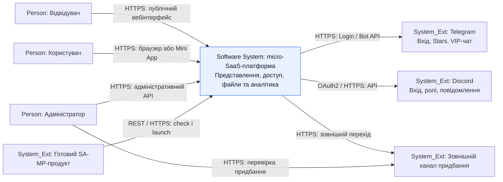
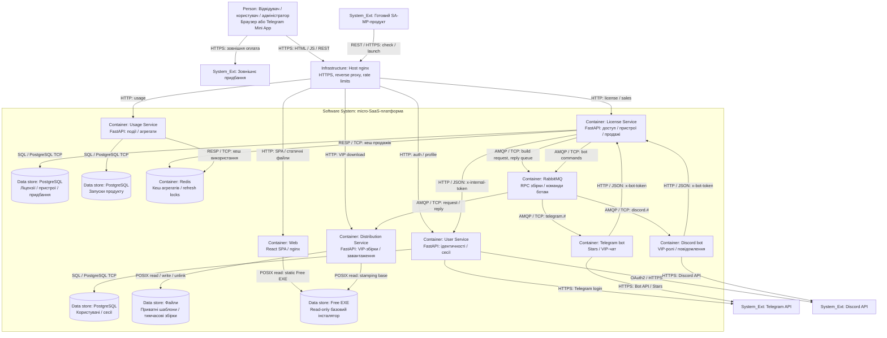
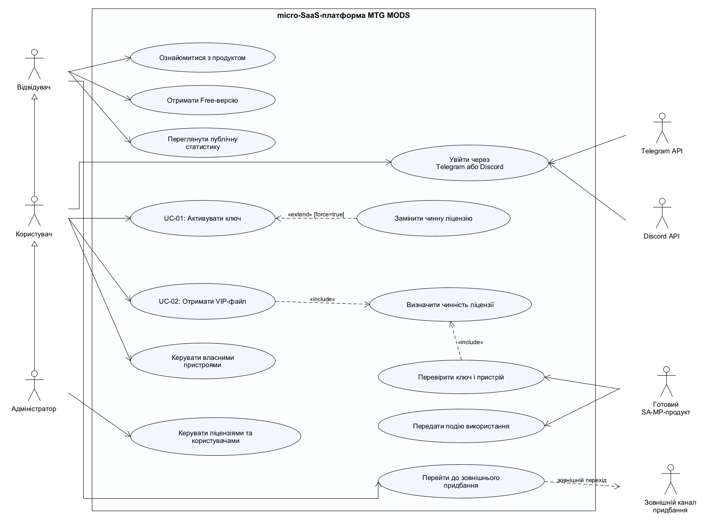
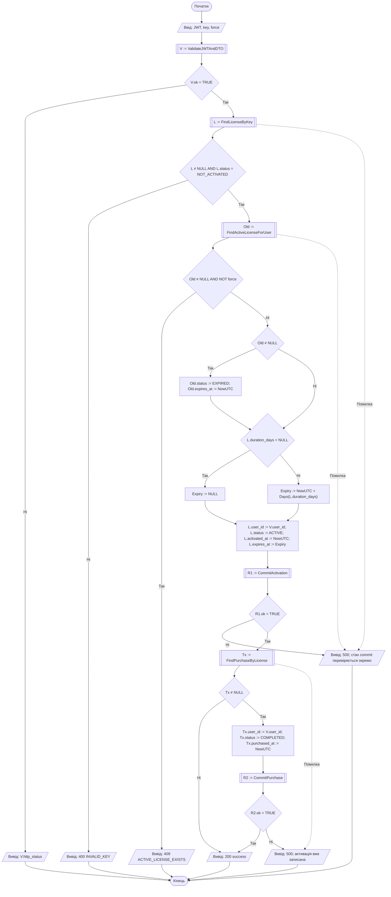
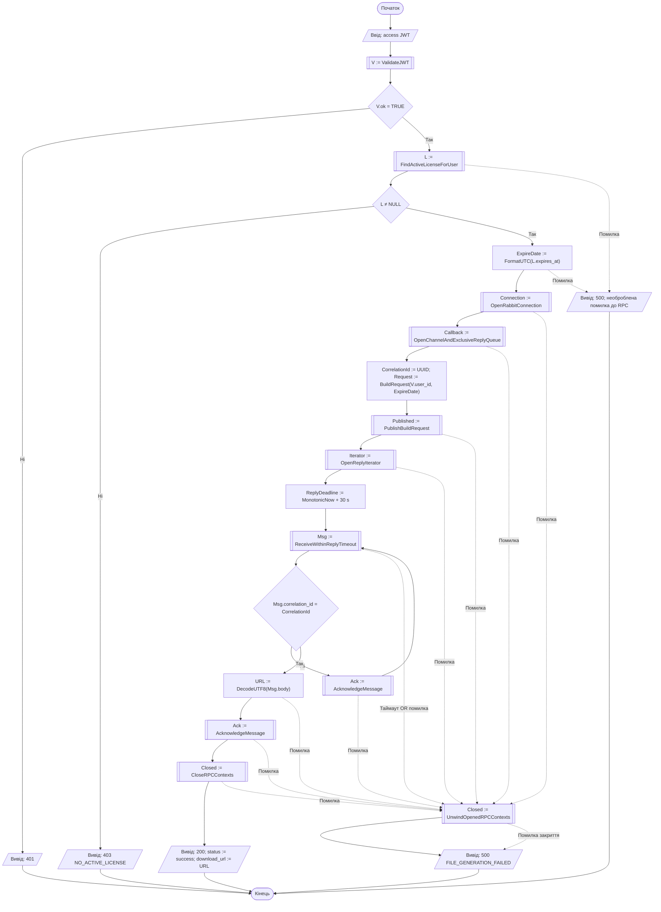
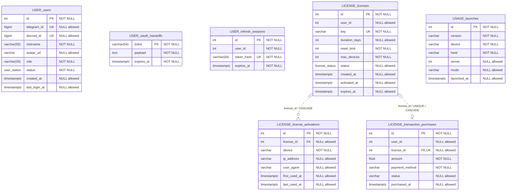
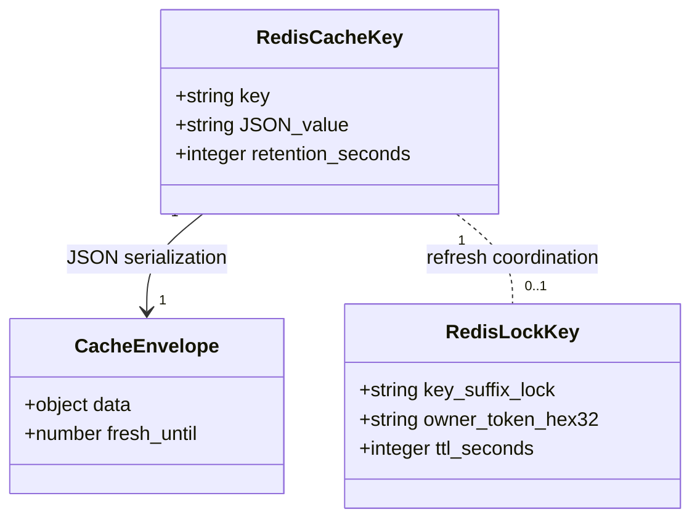

# РОЗДІЛ 2. ОБҐРУНТУВАННЯ АРХІТЕКТУРНИХ РІШЕНЬ ТА ПРОЄКТУВАННЯ СИСТЕМИ

Розділ консолідує архітектурні артефакти ЛР №5–7 для micro-SaaS-платформи готового зовнішнього freemium-продукту. Джерелами вимог є [SRS](srs.md) і [Розділ 1](1_analysis.md). Формулювання цільових метрик не є результатами тестування. [ADR-001](adr/0001-choice-of-technology.md) визначає рішення щодо RabbitMQ.

## 2.1. Обґрунтування архітектурного стилю та патернів проєктування

Платформа забезпечує представлення, розповсюдження, ліцензування й аналітику одного зовнішнього freemium-продукту. Ігрові функції помічника для SA-MP залишаються поза її межею. Попередня монолітна система замовника є джерелом правил сумісності: ключ із 16 символів A–Z/0–9 у форматі XXXX-XXXX-XXXX-XXXX та єдиний обліковий запис із Telegram, Discord або обома ідентичностями. Перенесення цих правил не означає перенесення прямого доступу ботів до спільної БД.

Обрано мікросервісну архітектуру з поєднанням синхронного HTTP та обміну повідомленнями AMQP. User Service відповідає за ідентичності й сесії, License Service — за ліцензії, пристрої та облік продажів, Usage Service — за події використання, Distribution Service — за персоналізовані файли. Перші три сервіси володіють окремими PostgreSQL-БД; Distribution використовує файловий каталог. React SPA, Telegram- і Discord-боти є адаптерами взаємодії. Це не повністю подієва система: кабінет очікує HTTP-відповідь, а перевірка ключа синхронно отримує профіль користувача.

Розмежування License і Usage ізолює моделі даних та профілі запитів. Запис телеметрії й агрегації не потребують спільних таблиць із транзакціями активації. Ця декомпозиція дає можливість незалежно виділяти ресурси процесам, але не доводить потрібної пропускної здатності. Приймання виконується за SRS: 50 RPS протягом 600 с, p95 ≤300 мс для прогрітого кешу публічної статистики та ≤500 мс для визначених внутрішніх API-операцій. Це цільові метрики, а не результати навантажувального тестування. Профіль генерації VIP-файлу перевіряється окремо.

Redis використовується як спільний кеш агрегатів із refresh-lock та політикою stale-while-revalidate. Кеш має fresh-період 300 с і граничне збереження 86400 с. Відокремлені ключі License і Usage не замінюють первинних PostgreSQL-даних. Кешування зменшує повторне виконання агрегацій; час відповіді за холодного кешу та відмови Redis потребує окремого вимірювання. Горизонтальне збільшення кількості процесів не усуває конкурентних змін ліцензій і не робить один Redis або один хост високодоступними.

Згідно з ADR-001, RabbitMQ обрано для адресних команд ботам і запиту на підготовку VIP-файлу. Черга file_generation_queue, callback-черга та correlation_id розмежовують виконавця збірки й HTTP-процес. HTTP-клієнт усе одно очікує результат; AMQP RPC не є фоновим job API з подальшим polling. Один asyncio.timeout(30) обмежує отримання й оброблення reply після publish та відкриття iterator. Підключення, створення черги й publish до цього інтервалу не входять. Загальний deadline REL-05 залишається окремим критерієм приймання. Correlation ID зіставляє відповіді, але не забезпечує дедуплікації, exactly-once чи скасування віддаленої збірки.

У License Service використано розподіл routers → application services → repositories/clients. Repository зосереджує SQLAlchemy-запити, а AsyncSession передається через FastAPI Depends. LicenseService сам створює конкретні LicenseRepository, TransactionRepository та UserServiceClient. Маршрут download після перевірки ліцензії безпосередньо викликає функцію AMQP. Тому поточну компонентну структуру не слід називати повною Clean Architecture, незалежним від SQLAlchemy доменом або завершеною інверсією залежностей. Цільова модель портів із ЛР №5 збережена як окремий варіант проєктного уточнення, а основна експлікація трасується на конкретні залежності.

DTO відокремлюють вхідні поля від ORM-моделей. Авторизаційні залежності розділяють access JWT, роль ADMIN та x-bot-token; відкритий check має власний контракт ключа й HWID. Створення session через Depends є локальною ін’єкцією ресурсу, а не доказом DI для всіх бізнес-залежностей. Окремого Unit of Work, CQRS, Saga, transactional outbox або Circuit Breaker у базовому складі не заявлено. Для цього масштабу їх додавання потребувало б окремих вимог і оцінки вартості; сам перелік патернів не усуває жодного збою.

Межа транзакцій визначається конкретним commit. Активація ключа фіксується раніше за завершення запису покупки. Після збою другого commit перший не відкочується: ліцензія може бути активною, а облік продажу — незавершеним. Перевірка пристрою також фіксує запис до HTTP-звернення за профілем. Отже, безпечний опис відмов передбачає повторне читання фактичного стану та звіряння, а не обіцянку автоматичного rollback у всіх сервісах. Відсутність унікальності пари license_id/device та блокувань активації є ризиком конкурентної коректності, який потрібно перевірити окремо.

Експлуатаційна топологія одного хоста з Docker Compose спрощує відтворення середовища, проте містить спільні точки відмови: gateway, хост, broker та сховища. Резервне копіювання трьох БД, відновлення з цільовими RPO ≤24 год і RTO ≤4 год, моніторинг помилок залежностей і перевірка NFR потрібні до приймання. Експлуатаційні витрати брокера й кешу охоплюють споживання оперативної пам’яті, використання дискового простору, оновлення та супровід; без вимірювань не наводяться вигадані оцінки економії. Архітектурне рішення приймається з цими обмеженнями й переглядається за критеріями ADR-001.

## 2.2. Контекстне та контейнерне моделювання системи (C4 Model)

### C4 Level 1 — System Context

[Інтерактивний Mermaid Live](https://mermaid.live/edit#pako:eJx1VF1r2zAU_StCfXUoydhWzChktGyFloU628syhmrLjaltFVmmK22hTTe6t40OMtjL_kJSFpaPJvkL0j_alaK0nZM-2ImVc84999zrnGCfBRS7OIzZkd8kXKDt3UaK0KucZuJ9A9coz1jqInmt2vKPvNF3dSlvZEddNfAHDX2bUf4Q-UtO1LnsqwvVKiCrQRKlD6HfQfIWJMeqbeDnAG5puiXUYiJCxhPgeCwUR4RT5B1ngiYuSiKfs5JHiFeSUznSTPXZlL6VnRd7fHVd_oaHHvgFadkBJyN4GkOxbw6CwhPrcOogIHbkAH7vIw1F8DSGawS2WrIvh7IzN8RZkPs6mJmNj5ufBPTxA8TAN5ToywHyqqWdGpiC6hOT1lC1LL9OY7rPSVIQmB_PbF-rLzpmB3mC8MxB77ZqJXWlG7QqG1HmMx4UROxpQcOYgEag5al2aMY4gYzuwrCiO4Qf0IXOfpqu9Hy-6jt0p9OYpYNMi33Q65qjey2zPahUWj9t4Nf1es1zNfYScDrSK8DqnEC4J7tm_C3ZU-cwhZ4cqIsGPr2b_HzBCmJdsyqX8q_m6XF15QTtRGmEqoeHRb5Zu4JAZ-nm9XWvxlu1tlWUsbO3QrubXh2tIqvnN6l_gFQbxSRP_eYC1X7_38Q22wdfq-glE_N680VYQnpTzUWzcl_SMuzUH68CGS2McKpjg8vsiFaZDf-xsCxcLw98DvULsmTyD1X8mGTZBg1RZpYJhVEcuyt0LSyHoZMJzg6ou1J5-uwJ3XN8FjPurpTL5bXK8zvyfTcziUaKHZxQnpAowO4JFk2a6D-ugIYkjwU-czDJBfOOUx-7gufUwflhQATdiIhOdHZ49g9jp0_K) · [Окремий код Mermaid](diagrams/c4-context.mmd) · [Окрема схема в GitHub](diagrams/c4-context.md).

- Відвідувач працює з публічними сторінками й Free-файлами; користувач — з кабінетом, адміністратор — з операціями керування. Канал доступу — HTTPS.
- Зовнішній клієнт продукту викликає check і launch через REST/HTTPS; розроблення його ігрової логіки не належить платформі.
- Telegram забезпечує відповідні механізми входу, Stars і VIP-чат; Discord — OAuth2 та API ролей/повідомлень. Платформа звертається до API через HTTPS.
- Зовнішній канал придбання не є платіжним сервісом усередині платформи. HTTPS-перехід і ручна перевірка адміністратором не означають автоматичний webhook або інтегрований еквайринг.

Контекст покриває [FUN-01/02](srs.md#srs-fun-01), [вхід та ідентичності](srs.md#srs-fun-03), [клієнтську перевірку](srs.md#srs-fun-09) і [придбання](srs.md#srs-fun-16).

### C4 Level 2 — Container

[Інтерактивний Mermaid Live](https://mermaid.live/edit#pako:eJyVV1tP40YY_Ssj96WVSJH6GFUrAQGWipQEp-1Km6qa2BNi4XjS8XgDWlbisuruG-pFILUPfekPAHYp7HL7C_Y_6vnGduLcFvUliiffOXPmuxxPXlqOdIVVttq-7DsdrjRrLDYDxhaV7IdCPW9aNaFCGZRZ_FtyEr-PL-gzOYov4rPkDZtn8cf4PtmPr5OD5LC4fIbYW8TeJSfmp338cEihX7fU_JP4V7NwFF_Fl8k-RZ_H96whfLGleJdVvcBjC71e0_qRxNSUdCNHQ4y9G2rR_Wl5R0PQ76ADJfa8jj8we6FUrZXiBxDfG4Ufk8MM31gdgw42WqitZTGVpbGYihc6UrmFkCpX22JCxalRQMd8i88_mFFwjdOf41R3WDrO4Ktciz7fBX4taCseaoUzRUqU2VMZahZsecGOSc7TRqNmzzElXiD1gvWU3NnFI-DM97qeDjPCMGrhEL0Oq_lct6XqkjTZ1n2uBEs1llnXc5Qs2ZzbyE18Q1VIXpuS3cZnGRFjP4gWwEsy0NwLhCrTgtGyKbijmV1bQE2NwgHkO7QHcjMKo0VmC_XCc4TBr-CciCoz0zyXSMcheuUNEnNv2uIEvMkBmuAACTwdkK8DH4RilDxbnM4P9vusBx-o_x4GTYl-SE7zJbQGyvJvclI4B98S46fA0oxtHkx3naSMZ_E7cF7G70xzXw840Tt6lJJWlNeKtCeD6czfr6F7r-JzcO9jqK6J_wo7XFAbgR2qKX-FhoL2yuLzz5tWhWvOQi2pl2ropS0l7Pp6Omh_To7nRNK_yLP-ON1fQPxidFzlSZiR6bERyPewH9_jFKiH5AgKKQ2jE50cDak2heuFRFbIs1nLT36ZvB2rEbrwAgKVaCsRdpgvne1wSFitjxZtk7danq7W00moLbHx-sD7aIxwxvek9NwY0ll8OyhQY1GONcLAelpSG15bcxWCjOqPwTgbuBbaaAKdm1IONiBKz40pqulO49BG2M1Ew6x4vgjH8x__A80fEH2dJu5vU70L09PwNQZjI3--AeedOTf1OsydxB6kG45kZpjQFSXE-G60xpafLef24pZk4O8y0ytXAzc3b44Dk82b5Dh9c-S8InALryhWKj3Za1rGNGGljeo6FH5j42Nz2W40rb3ceAtvkgxDAYjLoE5HONt49HkUOJ0xYPa1sFk5c8VUZW5rlK7XeTqJA0Y6C88j3QEB_L2NslBw5qmzAH5mgPMs5KgjITJPnIWIyMlSZvoyIwpdxFzZD3zJXQoms6LYTE4Wi_nEzsNhZY2lmqGumBtD7s6fDl5Pg1OH_XSoPY2XBJv6bnxbZjslL9BCBdwvabktgrEUjiJRbEKCvEyDa7xh5I0QXxDeGMi4xGlY6tPC3WfodAWOUQUL1fqApRV5vgsf-jkSoaZ3fQ8zgIfIVKtaN_eN-hRgBjEmBkyxXJ_YTWrmyG6XB274CL_O_OnLzyiQ_GtmqJuaURpZySIJMb1WEDEsU6FvK_8bMdqX2fgOjNWXuKcY8auTwRsLGLqv8qE3wpemyAYfLRBunhmHHhJWJkJHroo5IwY_i6pt2GvPUC7ulmGCXHvOwAQpnL4bXpRxOqLb84It1uKheDQecvvK0-QRUeB7wbZBkOvPtMzMdfMb7DHDY3ZTpBviXnbvbQbWnNUVqss91yq_tHRHdOmfgyvaPPK19WrOgqFJezdwrDLutmLOinou3KbicapLuvjqP4M4FnY) · [Окремий код Mermaid](diagrams/c4-container.mmd) · [Окрема схема в GitHub](diagrams/c4-container.md).

- **Gateway / host nginx** завершує TLS, маршрутизує HTTP у приватний контур і застосовує per-IP limits. Він є інфраструктурою доступу поза Docker Compose. [SEC-01](srs.md#srs-nfr-sec-01), [SEC-04](srs.md#srs-nfr-sec-04).
- **Web** — React SPA і nginx для статичного вмісту. Браузер виконує JavaScript та викликає API через gateway; стрілка gateway → Web означає доставку застосунку. Mini App відкриває той самий SPA. [FUN-01](srs.md#srs-fun-01), [FUN-02](srs.md#srs-fun-02).
- **User Service** зберігає користувачів, соціальні ідентичності й сесії у власній PostgreSQL; Telegram/Discord викликаються через HTTPS. [FUN-03](srs.md#srs-fun-03), [FUN-04](srs.md#srs-fun-04), [FUN-05](srs.md#srs-fun-05), [FUN-20](srs.md#srs-fun-20), [FUN-21](srs.md#srs-fun-21), [FUN-22](srs.md#srs-fun-22).
- **License Service** застосовує правила ключів, підписок, пристроїв і придбання; власна PostgreSQL містить відповідні записи. Профілі та social IDs отримуються від User Service через внутрішній HTTP з окремим токеном. [FUN-06](srs.md#srs-fun-06), [FUN-07](srs.md#srs-fun-07), [FUN-25](srs.md#srs-fun-25), [FUN-26](srs.md#srs-fun-26), [FUN-27](srs.md#srs-fun-27), [FUN-08](srs.md#srs-fun-08), [FUN-09](srs.md#srs-fun-09), [FUN-10](srs.md#srs-fun-10), [FUN-11](srs.md#srs-fun-11), [FUN-16](srs.md#srs-fun-16), [FUN-17](srs.md#srs-fun-17), [FUN-18](srs.md#srs-fun-18), [FUN-24](srs.md#srs-fun-24).
- **Usage Service** приймає події запуску й агрегує власну PostgreSQL. Публічні дані проходять через Redis-кеш; License Service використовує той самий Redis-контейнер з окремими ключами. RESP/TCP — протокол клієнта Redis. [FUN-14](srs.md#srs-fun-14), [FUN-15](srs.md#srs-fun-15), [CACHE-01](srs.md#srs-nfr-cache-01), [PRIV-01](srs.md#srs-nfr-priv-01).
- **Distribution Service** читає приватні шаблони й базовий EXE, записує тимчасові Lua/EXE та видає файл через HTTP API. Власна реляційна БД йому не потрібна. POSIX-позначення означає локальний файловий доступ, не мережевий протокол. [FUN-12](srs.md#srs-fun-12), [FUN-13](srs.md#srs-fun-13), [FUN-28](srs.md#srs-fun-28), [FUN-29](srs.md#srs-fun-29), [FILE-01](srs.md#srs-nfr-file-01).
- **RabbitMQ** переносить команди збірки та reply з URL, а також topic-команди ботам. HTTP-запит кабінету очікує RPC; брокер не робить його миттєвим. [REL-01](srs.md#srs-nfr-rel-01), [ADR-001](adr/0001-choice-of-technology.md).
- **Telegram/Discord-боти** споживають AMQP-команди й звертаються до License Service через HTTP з x-bot-token. Зовнішні API працюють через HTTPS; Stars належить Telegram-боту. [FUN-16](srs.md#srs-fun-16), [FUN-19](srs.md#srs-fun-19).

Три PostgreSQL не утворюють спільної ACID-транзакції; Redis не є первинним сховищем. Схема одного хоста не гарантує HA. Backup/restore й p95 перевіряються за [VC-08/11](srs.md#4-verification-criteria--критерії-верифікації), а не доводяться наявністю вузлів на рисунку.

## 2.3. Компонентне моделювання та опис серверного ядра

### C4 Level 3 — License Service

Основне подання відображає конкретні компоненти та залежності License Service: конструктори репозиторіїв, HTTP-клієнт, прямий виклик RPC із download route, cache та expiry task. Воно не приписує коду абстрактних портів або повної інверсії залежностей. [Цільовий варіант ЛР №5](diagrams/c4-component-target.mmd) збережено окремо для порівняння; його інтерфейси не оголошуються реалізованими.

```mermaid
%%{init: {"theme":"base","themeVariables":{"fontFamily":"Arial, sans-serif","fontSize":"16px","lineColor":"#64748b","clusterBkg":"#f8fafc","clusterBorder":"#cbd5e1","edgeLabelBackground":"#ffffff"},"flowchart":{"htmlLabels":true,"curve":"linear","nodeSpacing":35,"rankSpacing":65,"wrappingWidth":220}}}%%
flowchart TB
  %% C4 Level 3: actual concrete dependencies in services/license/app.
  Caller["Other containers: Host gateway / bots"]
  UserAPI["Other container: User Service"]
  PG[("Other container: License PostgreSQL")]
  Redis[("Other container: Redis")]
  MQ["Other container: RabbitMQ"]
  subgraph License["Container boundary: License Service / Python FastAPI"]
    Routes["Component: REST routers<br/>client / user / admin / bot / stats"]
    DTO["Component: Pydantic DTOs<br/>domain/schemas.py"]
    Guards["Component: Route-specific guards<br/>JWT access / ADMIN / x-bot-token"]
    Service["Component: LicenseService<br/>Activation / validity / devices / purchases"]
    Stats["Component: LicenseStatsService<br/>Public / legacy sales aggregates"]
    Worker["Component: Expiry task<br/>Status updates / social lookup / commands"]
    Repo["Component: LicenseRepository / TransactionRepository<br/>Concrete SQLAlchemy repositories and ORM models"]
    Client["Component: UserServiceClient<br/>Concrete HTTPX client"]
    Messaging["Component: Messaging functions<br/>aio-pika RPC / topic publisher"]
    Cache["Component: PublicStatsCache<br/>Redis / loader callback / refresh lock"]
    DB["Component: Database session factory<br/>get_db / AsyncSessionLocal"]
    Bootstrap["Component: FastAPI app / lifespan<br/>Router registration / caches / expiry task"]
    Errors["Cross-cutting: Error handlers<br/>DomainException / RequestValidationError"]
  end
  Caller -->|"HTTP / JSON"| Routes
  Routes -->|"FastAPI input validation"| DTO
  Routes -->|"Depends on protected routes"| Guards
  Routes -->|"Depends: get_db session"| DB
  Routes -->|"Python: LicenseService(db) / methods"| Service
  Routes -->|"Python: LicenseStatsService(app.state cache)"| Stats
  Routes -->|"Python await: download RPC after license check"| Messaging
  Service -->|"Constructs concrete repositories with session"| Repo
  Service -->|"Constructs / calls concrete client"| Client
  Service -->|"AsyncSession: flush / commit / refresh"| DB
  Stats -->|"cache.get(loader, background_tasks)"| Cache
  Stats -->|"Loader: own AsyncSessionLocal"| DB
  Stats -->|"Loader: LicenseRepository(db) aggregate query"| Repo
  Worker -->|"Own AsyncSessionLocal / commit"| DB
  Worker -->|"Constructs / calls LicenseRepository"| Repo
  Worker -->|"Resolves linked social IDs"| Client
  Worker -->|"Python await: VIP expiry commands"| Messaging
  Repo -->|"Injected AsyncSession: SQLAlchemy statements"| DB
  DB -->|"asyncpg / SQL / PostgreSQL TCP"| PG
  Client -->|"HTTP / JSON: x-internal-token"| UserAPI
  Messaging -->|"AMQP / TCP: build request/reply and bot commands"| MQ
  Cache -->|"RESP / TCP: cached aggregates / locks"| Redis
  Bootstrap -->|"include_router"| Routes
  Bootstrap -->|"Constructs two app.state caches / closes on shutdown"| Cache
  Bootstrap -->|"asyncio task: start / cancel"| Worker
  Bootstrap -->|"Registers exception handlers"| Errors
  Routes -.->|"DomainException / validation exception dispatch"| Errors
  Service -.->|"Raises DomainException on business errors"| Errors
  classDef external fill:#f3f4f6,stroke:#6b7280,color:#111827
  classDef component fill:#e8f1ff,stroke:#2563eb,color:#111827
  classDef storage fill:#ecfdf5,stroke:#059669,color:#111827
  class Caller,UserAPI,MQ external
  class PG,Redis storage
  class Routes,DTO,Guards,Service,Stats,Worker,Repo,Client,Messaging,Cache,DB,Bootstrap,Errors component
```

[Mermaid Live](https://mermaid.live/edit#pako:eJyFVw1v2zYQ_SuEgwApIMfNl5saQ4HYTrMUSePYXjugHgqKomzOMqmRVBKvyX_fHUlJluN2RdEmJO8d7-7dO-pHi6mEt3qt_f0fQgrbIz9mLbvgKz5r9WatmBr4IQpLX6gWNM64gT04lippP9KVyNbu7AVsZhExVJq24VqkzhAPTcS_Hu6omz-51UxIPlCZ0m55r3v67vQ8djssK4zlur-c-630PKUpa2wpnfBgyOLkjB-5XZ7M-Q2NedanbDnXqpBJQHB_Zq0XvE2mHtmCausjWNhV5mwwIqsLjl4K_eBvi5ek2oFLSNIkp0xIvNbJGSxpKpf1UheXHjXNc_j9q0jsAhaPj9--vLzs789k5ZdM-zNJyP4-GZySG_7AM3LSI5TZgmaEKck0t5wkPOcy4ZIJboiQBNL5IBg3nQz-lYZ3wM8h4gxolnH9bda6gwJpBLAUbq1Nj_yujCVzavkjXZMOiZWFIP9Coz8A7mJ0_dqq57bIxHsLp0dX3w52nLzxNyEjcDPXfHJ_M2u9cQZjngiz08btlMdu73ddYEzjWNjb--DcFPEckroo3YHJoDwMIUGNqV7Xlwk3h3BHa7tQknykxkKoAQ3upgrLjUNZ5UpyCYQfX06mROOGNr_FuvOBZQI2AKTAbHQITVZQA5dC-NdYWmWSkOH0rok2WidUWsFwx8MlagX37RgGLUTNYb6ujK8KqpPt2-BF2ibnTKSAMndHHM6nr1MgCrDAwC0uhrfXn-H_pzbcqm3VkssKNmShiRtSFPYc4AWz4oFaoTC4B5qJRFikSsId2eCnvNDAWsPreCcY_W5k3NmEHxUx0BVQMj6nbA3CAMpB6BzYgrSsMb8qvXQk3gC9fMqFXhNLzdKBIXphSJEnaIplUAzkhmRKLYscfmdqtaIyqVHHPFc7L4obRlilMdYptLGB9oMk1OvO46BsRqD2RYbFWxNdHsG-BG_kbnxLVqANWe134NjT9IxtFVLjt5sefp9OR38ST7sK5xYKTeegJk2oapmkhXT39uygQrVzsaRkPBpAXFblkPscS2AWqJbl7ShEssVYVydXPrfr4FyrYu0UTbBDQWdi0FVY0TzV3Cxghy3rNug3MYfUUpwdoFzGIMFSyHGZ2Tm335MYSWzWkk38iRsFPiq8vgK5stD5TdjQzgTkD-8mUm5yKv2FXQPD7eYCDQOrGQaEcfCaT5WTS62VdmTWypg2K6yFvPb8OllAfbNSEoauhy-fGM8D8pj_U3Bjv2DbOG_OKmCDeNfqTNrtD8-zFhYZ7D5N7j7PWs9BiZxeup_CqTJCIfPC-qZ06GgCivLq_NBNCkPgTrlWljPLEy9mBk28wvzMqkdCKUKVnJP-q9NeS7cl5CCJ30A8Kw6biXNWzo3_s98QigMcZKio3JfqjcNxCrsbhdBHiq-URD1K5KajO02x9GE2EoBBZj7XrYJY5WjwYNB6wJKCWVMP3UZzPwq72EwLisMvYTquRzbgynZ-Dorw2nqT_j2SwutmEYRM2LrR6qK4vARbl61DKN-B79CIxNWz5zuy3LhUuobetr1xFj0CKdzVgrvclSavJNSxoNJ0Aj2h15v58toeUO52OaxCrj03jHbk-NUtfupxzI3KHqCe8JZbQmeEqXE9NM3CNIyaTPtyPSrVo54xW-RC38H4Wv7tm7BZ3Y0h4ui-AsemjnjYD-YUrfI5hAoW-I6pnldkOhihwejKSYt_o7ySlh68CISEdpA0K58Fz-WLzz27qvkRSHh7j7YA3iNxITJQD69sHeiHbO2mHD58GrHfe3WDeMo8X04qFEfNZGPQuzHClsZXCZ-AckPhA4KQ8LxP-Hf_EGsq5PbZDUrYR0W2NMTxJFPQvKiKZlFYFItGN2wDuqwL5cZDDwukrSObZNw1hKfHLsuxmzcwJoAj5XAoJwda-hmzKWaHXoFfDZRa6zegIFk5tWzRhKpkxGONqcBgtyHhb1wYeCnDg5F72wYKy6gxQ56CO88Xkoos6-2lJ-lp2o0gSqBPb68bvzs-fxsx_Frr7R0dHZ0fv2uYs3I-B3t-nh6laWV_fNY94fEv7A10MJ3z0pqlSXpWWb89e9_tvv-JdRiwUaB3dHtfxVKfGV1F_jET_NQ7viIRjNXIz8koJDZy0hf5qkfY3JHvt6jqnshxKRr2o4oRkU9tnY-ZbEWtFddQlgQ-N_03NHxqJzylRWbhg7RFC6smwL3w9dny79uhoPDVs_KLL_8Bd0Jnlg) · [Код](diagrams/c4-component.mmd).

### Взаємодія внутрішніх компонентів License Service

Inbound layer утворюють п’ять REST routers: client, user, admin, bot і stats. Pydantic перевіряє оголошені DTO до виклику обробника; Depends на захищених маршрутах виконує JWT/ADMIN/bot-token guard і надає AsyncSession. Public check і статистика не отримують користувацький JWT автоматично. Помилки DTO повертаються через RequestValidationError handler, доменні винятки — через окремий DomainException handler.

Core layer містить LicenseService та LicenseStatsService. LicenseService координує пошук ключа, перевірку станів, зміну власника, облік пристроїв і покупки; він має залежність від FastAPI/SQLAlchemy та створює конкретні репозиторії. LicenseStatsService отримує cache з app.state і виконує агрегати через loader. Мікрорівень є шаровою організацією коду з частковим DI; абстрактні порти не видаються за наявні Python-інтерфейси.

Outbound layer охоплює LicenseRepository/TransactionRepository, UserServiceClient, функції aio-pika та PublicStatsCache. Репозиторії працюють з переданою AsyncSession, клієнт профілю виконує HTTP із x-internal-token, AMQP-адаптер обмінюється JSON request і UTF-8 reply, кеш працює через Redis. get_db закриває session у finally; зміни, не зафіксовані commit, не прирівнюються до успішних транзакцій. Уже завершений commit автоматично не компенсується.

Маршрут download виконує get_active_license, форматує expires_at та лише після цього входить у try для RPC. Тому збій БД або форматування до RPC — звичайний необроблений HTTP 500; збій усередині RPC перетворюється на FILE_GENERATION_FAILED. Worker завершення ліцензій використовує власну session, змінює статус і окремо публікує команди ботам. Спільної транзакції PostgreSQL/AMQP немає. Bootstrap реєструє routers, handlers, cache і worker; вимкнення сервісу закриває ресурси. Інваріанти та побічні ефекти деталізовано в Use Cases і схемах A1–A3.

## 2.4. Контур безпеки програмного рішення (Application Security)

### Ідентичності, токени та розмежування довіри

Власних паролів платформа не приймає: вхід делеговано Telegram/Discord. Тому Argon2id/Bcrypt не описуються як механізми хешування паролів, яких тут немає. Access JWT підписується HS256; guard перевіряє підпис, строк дії, type=access і sub, який перетворюється на внутрішній INT. Типове налаштування — 15 хв для access і 30 днів для refresh; конфігурація середовища може їх змінити. Refresh зберігається у БД як SHA-256 digest високоентропійного токена та відкликається під час ротації/виходу. Це не алгоритм для людського пароля.

ADMIN guard додатково перевіряє role=ADMIN у JWT; це RBAC за роллю, без окремого ABAC engine. Контроль власника для пристрою перевіряє його належність активній ліцензії користувача з sub. Користувач не задає власника активації в body. x-internal-token для User S2S і x-bot-token для ботів є окремими контурами; вони не передаються клієнтському SPA. Закритість мережі не підміняє перевірки цих заголовків. Зміна статусу користувача на DELETED не є миттєвим відкликанням уже виданого access JWT у License Service; це явне обмеження політики відновлення доступу.

### OAuth, браузер і передавання секретів

OAuth state зберігається у cookie з HttpOnly, SameSite=Lax, max_age=300 та Secure поза DEBUG_MODE; callback звіряє state. Telegram OIDC перевіряє RS256 за JWKS, audience, issuer і строк дії з leeway=60 с. Mini App перевіряє HMAC-SHA256 init_data через compare_digest, максимальний вік 3600 с та майбутнє зміщення до 60 с. Handoff-квиток одноразовий, з типовим TTL 30 с; фонове очищення прострочених записів відбувається на старті й кожні 15 хвилин.

Access і refresh токени SPA зберігаються в localStorage; отже, XSS може їх прочитати. HttpOnly session-cookie для токенів, автоматичний token denylist та повний CSP-контур не заявляються. CORS допускає <https://mtgmods.com>, <http://localhost> і <http://127.0.0.1>, allow_credentials=true, methods/headers=*. Це браузерне обмеження джерела, а не автентифікація API чи захист від небраузерних клієнтів. У production слід окремо переглянути потребу локальних origins та оцінити CSP/зберігання сесій; ці заходи не позначено виконаними.

Ліцензійний ключ у check/activate передається в JSON body через TLS 1.2/1.3, не в query. Водночас адміністративний GET /license/find приймає key у query, OAuth callback — code/state, link flow — ticket, а Distribution — токен у шляху. Стандартний access_log може містити URI, тому вимога не журналювати секрети потребує окремого налаштування редагування логів. Перенесення параметрів у body не вигадується заднім числом. Тимчасовий download URL є bearer-capability: будь-хто, хто його отримав, може використати посилання до видалення файлу.

### DTO, SQL, файли та контроль доступу до об’єктів

CheckRequestDTO допускає key за regex ^[A-Z0-9]{4}(-[A-Z0-9]{4}){3}$ і HWID 2–100 символів; ActivateKeyDTO перевіряє довжину key=19 та force bool. Ці два набори правил не ототожнюються. Додаткові поля DTO ігноруються за типовою політикою Pydantic; заблоковане mass assignment до ORM не означає заборону кожного невідомого поля. Адміністративні DTO з role/status/user_id дозволені лише за ADMIN guard. Пряма передача всього request body у довільний ORM update не є контрактом користувацької активації.

SQLAlchemy формує запити через вирази та bound parameters. Це знижує ризик SQL injection для відповідних repository-методів; повна відсутність SQLi не сертифікується без аудиту всіх raw SQL і негативних тестів. BOLA/IDOR перевіряється на межі owner/resource, а не самим фактом наявності JWT: для reset_device сервер звіряє device_id з пристроями поточної активної ліцензії. INT у URL не є контролем доступу.

Для VIP-файлу token має regex ^[a-f0-9]{10}$; шлях resolve перевіряється через is_relative_to каталогу збірок. Файл віддається з Cache-Control: no-store і видаляється фоновим завданням після відповіді. Lua-видача не має атомарного claim перед читанням: одночасні запити можуть побачити файл до очищення. Для EXE є окремий файловий marker claim; його не слід приписувати Lua-маршруту. Така видача не є абсолютним DRM або гарантією точно одного читача.

Окремий ризик має прямий POST /users/me/link: DTO приймає соціальний ID, а бізнес-метод перевіряє стан і конфлікт прив’язки, проте сам ID не доводить володіння зовнішнім обліковим записом. OAuth-прив’язування з підписаним ticket і callback та прямий маршрут не можна вважати рівнозначними доказами ідентичності. Потрібні негативний тест підстановки чужого ID та рішення щодо обмеження прямого маршруту; усунення цього ризику кодом не заявлено.

### Мережеві обмеження та невиконані перевірки

Host nginx обмежує body до 2 MiB, застосовує 30 запитів/хв/IP із burst=5 до точних check/launch і 60 запитів/хв/IP із burst=20 до auth prefix. Окремий ліміт activate/download у цих правилах відсутній. connect/send/read proxy timeouts становлять 5/30/60 с і не є єдиним загальним deadline. Обмеження gateway не захищають прямий доступ до портів сервісів: доступність портів, firewall, секрети середовища й AMQP/Redis перевіряються під час розгортання.

У базовому коді є handlers, повідомлення worker та стандартні журнали, проте повноцінне незмінюване Audit Logging з окремою схемою подій і redaction не підтверджено. Приклади та репозиторій документації не містять значень JWT_SECRET, bot/internal tokens чи реальних HWID. Dependency scanning, перевірка контейнерів, CSP, owner-negative tests, replay/concurrency tests та усунення витоків через exception.message є окремими критеріями приймання. Docs Quality Gate перевіряє Markdown; він не є доказом відсутності OWASP-вразливостей у застосунку.

## 2.5. Специфікація міжсервісних контрактів та топологія API-маршрутів

### Карта інтерфейсних маршрутів системи

Публічна база — <https://api.mtgmods.com>. Gateway переписує /v1/ на /api/v1/ відповідного сервісу: User — users, License — license, Usage — usage, Distribution — files. Внутрішні S2S/ботові маршрути перелічені разом із guard: наявність маршруту під загальним proxy-prefix не означає анонімного доступу чи фізичної ізоляції. У клієнтських налаштуваннях внутрішні токени відсутні.

У [OpenAPI ЛР №6](api/openapi.yaml) повністю специфіковано три критичні POST — activate, check, download. Їхні сигнатури та статуси збережено. Наведена матриця додатково охоплює всі явно оголошені бізнес-маршрути чотирьох сервісів; ці додаткові рядки не видаються за вже включені до трьохопераційного OpenAPI. Позначення ?/Optional у параметрах означає необов’язкове поле відповідного DTO; точні допустимі значення наведено нижче.

| ID маршруту | HTTP-метод | Топологічний шлях (URI) | Вхідні параметри / Payload | Призначення та контейнер-обробник |
| --- | --- | --- | --- | --- |
| API-REQ-01 | GET | /v1/users/search | query nickname:Optional[str]=None; query telegram_id:Optional[str]=None; query discord_id:Optional[str]=None | User Service; Знайти користувачів за фільтрами; ADMIN JWT |
| API-REQ-02 | GET | /v1/users/{user_id} | path user_id:int | User Service; Прочитати користувача для адміністратора; ADMIN JWT |
| API-REQ-03 | PATCH | /v1/users/{user_id} | path user_id:int; body status:UserStatus?, role:UserRole?, telegram_id:string?, discord_id:string? | User Service; Змінити стан/роль/соціальні ідентичності; ADMIN JWT |
| API-REQ-04 | GET | /v1/users/auth/telegram/login | query ticket:str \| None=None | User Service; Розпочати Telegram OAuth; без Bearer JWT |
| API-REQ-05 | GET | /v1/users/auth/telegram/callback | query code:str; query state:str=None | User Service; Завершити Telegram OAuth; OAuth state/code |
| API-REQ-06 | POST | /v1/users/auth/telegram/webapp | body init_data:string\|null | User Service; Увійти через Telegram Mini App; без Bearer JWT |
| API-REQ-07 | GET | /v1/users/auth/discord/login | query ticket:str \| None=None | User Service; Розпочати Discord OAuth; без Bearer JWT |
| API-REQ-08 | GET | /v1/users/auth/discord/callback | query code:str; query state:str=None | User Service; Завершити Discord OAuth; OAuth state/code |
| API-REQ-09 | GET | /v1/users/auth/handoff/{ticket} | path ticket:str | User Service; Спожити одноразовий OAuth handoff; без Bearer JWT |
| API-REQ-10 | POST | /v1/users/auth/refresh | body refresh_token:string | User Service; Оновити access JWT і ротувати refresh; refresh token body |
| API-REQ-11 | POST | /v1/users/auth/logout | body refresh_token:string | User Service; Відкликати refresh-сесію; refresh token body |
| API-REQ-12 | GET | /v1/users/resolve | query telegram_id:Optional[int]=None; query discord_id:Optional[int]=None | User Service; Розв’язати соціальний ID у внутрішній user_id; x-internal-token |
| API-REQ-13 | GET | /v1/users/{user_id}/socials | path user_id:int | User Service; Отримати соціальні ідентичності для сервісу; x-internal-token |
| API-REQ-14 | GET | /v1/users/{user_id}/profile | path user_id:int | User Service; Отримати профіль для сервісу; x-internal-token |
| API-REQ-15 | GET | /v1/users/me | відсутні | User Service; Прочитати власний профіль; access JWT |
| API-REQ-16 | POST | /v1/users/me/link-ticket | body provider:'telegram'\|'discord' | User Service; Створити підписаний квиток прив’язування; access JWT |
| API-REQ-17 | POST | /v1/users/me/link | body telegram_id:string\|null або discord_id:string\|null; рівно один | User Service; Прив’язати соціальний ID до профілю; access JWT |
| API-REQ-18 | POST | /v1/users/me/unlink | body provider:'telegram'\|'discord' | User Service; Відв’язати одну соціальну ідентичність; access JWT |
| API-REQ-19 | POST | /v1/license/generate | body count:int 1–1000; duration_days:int>0\|null; amount:float≥0; method:PaymentMethod; status:PENDING\|COMPLETED; max_devices:int≥1; reset_limit:int≥0 | License Service; Створити один ключ і запис покупки; ADMIN JWT |
| API-REQ-20 | POST | /v1/license/generate/bulk | body count:int 1–1000; duration_days:int>0\|null; amount:float≥0; method:PaymentMethod; status:PENDING\|COMPLETED; max_devices:int≥1; reset_limit:int≥0 | License Service; Створити пакет ключів і покупок; ADMIN JWT |
| API-REQ-21 | GET | /v1/license/find | query user_id:Optional[int]=Query(None, description='Search by owner User ID'); query key:Optional[str]=Query(None, description='Search by exact License Key') | License Service; Знайти ліцензії за власником/ключем; ADMIN JWT |
| API-REQ-22 | GET | /v1/license/{license_id} | path license_id:int | License Service; Прочитати ліцензію для адміністратора; ADMIN JWT |
| API-REQ-23 | PATCH | /v1/license/{license_id} | path license_id:int; body status:LicenseStatus?, reset_limit:int≥0?, max_devices:int≥1?, user_id:int≥1?, duration_days:int>0?, amount:float≥0? | License Service; Змінити ліцензію й параметри покупки; ADMIN JWT |
| API-REQ-24 | DELETE | /v1/license/{license_id} | path license_id:int | License Service; Видалити ліцензію з каскадами; ADMIN JWT |
| API-REQ-25 | DELETE | /v1/license/devices/{device_id} | path device_id:int | License Service; Видалити прив’язку пристрою адміністратором; ADMIN JWT |
| API-REQ-26 | POST | /v1/license/generate/telegram_bot | body duration_days:int>0\|null; amount:float≥0; max_devices:int≥1; reset_limit:int≥0 | License Service; Створити ключ після платежу Telegram Stars; x-bot-token |
| API-REQ-27 | GET | /v1/license/check/info | query telegram_id:int=None; query discord_id:int=None | License Service; Перевірити VIP-стан за соціальним ID; x-bot-token |
| API-REQ-28 | POST | /v1/license/check | body key:string(19, regex 4×4 A–Z/0–9), device:string(2–100) | License Service; Перевірити ключ і зареєструвати HWID продукту; без Bearer JWT |
| API-REQ-29 | GET | /v1/license/stats/public | відсутні | License Service; Публічні агрегати продажів; без Bearer JWT |
| API-REQ-30 | GET | /v1/license/stats/old | відсутні | License Service; Отримати агрегати старих lifetime-продажів; без Bearer JWT |
| API-REQ-31 | GET | /v1/license/tariffs | відсутні | License Service; Отримати тарифи й квоти пристроїв; без Bearer JWT |
| API-REQ-32 | POST | /v1/license/activate | body key:string(19), force:boolean=false | License Service; Активувати ключ і завершити облік покупки; access JWT |
| API-REQ-33 | POST | /v1/license/download | відсутні | License Service; Запросити персоналізовану VIP-збірку; access JWT |
| API-REQ-34 | GET | /v1/license/info | відсутні | License Service; Прочитати ліцензію, покупку й масковані пристрої; access JWT |
| API-REQ-35 | GET | /v1/license/history | відсутні | License Service; Прочитати власну історію ліцензій; access JWT |
| API-REQ-36 | DELETE | /v1/license/device/{device_id} | path device_id:int | License Service; Скинути прив’язку пристрою в межах квоти; access JWT |
| API-REQ-37 | POST | /v1/usage/launch | body version:string≤25 (формат версії); mode:enum; server:int (alias server_id); device:PC\|MOBILE; hwid:string(5–255) | Usage Service; Зареєструвати подію запуску продукту; без Bearer JWT |
| API-REQ-38 | GET | /v1/usage/stats/public | відсутні | Usage Service; Публічні агрегати використання; без Bearer JWT |
| API-REQ-39 | GET | /v1/files/downloads/installer | відсутні | Distribution Service; Перенаправити до статичного Free-інсталятора; без Bearer JWT |
| API-REQ-40 | GET | /v1/files/downloads/vip/{token}.exe | path token:str=Path(..., pattern='^[a-f0-9]{10}$') | Distribution Service; Видати персональний Windows-інсталятор; без Bearer JWT |
| API-REQ-41 | GET | /v1/files/downloads/vip/{token} | path token:str=Path(..., pattern='^[a-f0-9]{10}$', description='10-character hex token') | Distribution Service; Видати персональний Lua-файл; без Bearer JWT |

GET /health існує окремо в кожному сервісі як технічний маршрут без бізнес-параметрів. Публічний GET / на API-host повертає перевірочний JSON gateway. Вбудовані /docs, /redoc та /openapi.json FastAPI є службовими інтерфейсами, а не додатковими користувацькими операціями. Статичні маршрути SPA й Free-файл обслуговує Web/nginx; їх не слід плутати з REST API чотирьох сервісів.

### Типи, контракти та мережеві інваріанти

- activate: body key має рівно 19 символів, force типово false; JWT визначає власника; 200, 400 INVALID_KEY, 409 ACTIVE_LICENSE_EXISTS, 401, 422 та необроблений 500. Regex 4×4 застосований у check DTO, не в activate DTO.
- check: key має regex ^[A-Z0-9]{4}(-[A-Z0-9]{4}){3}$, device — HWID 2–100. Bearer JWT не потрібний. 200 valid=true містить id ліцензії, не користувача; 404 — відсутній ключ, 403 — стан/квота, 400 — сумісна помилка залежності, 422 — DTO, 429 — gateway.
- download: POST без body/path/query DTO; JWT; 200 URL, 403 NO_ACTIVE_LICENSE, 401, RPC 500 FILE_GENERATION_FAILED або звичайний 500 до RPC. Статус 422 для цього POST не додається. Наступний файловий GET має власну валідацію параметра шляху і може повертати 422.
- GeneratePurchaseDTO: count 1–1000; одиничний generate примусово встановлює count=1. PaymentMethod: допустимі значення визначає enum контракту; status покупки — PENDING/COMPLETED. UpdateUser використовує UserStatus ACTIVE/BANNED/DELETED і UserRole; ADMIN-доступ перевіряється окремо.
- LaunchPayload: версія має формат числової версії з Free/VIP/Launcher Edition і довжину ≤25; mode — none, police, fbi, prison, army, smi, hospital, gov, judge, lc, fd, ins, mafia, ghetto; server — 0, 1–33, 101–103, 200, 301–307, 401–403; device — PC/MOBILE; hwid — 5–255. API server_id є alias server, не новою колонкою БД.
- Pagination: history, user search та license find не мають page/limit/cursor. Вигадані query-параметри не додаються. Результати можуть бути необмеженими; це ризик обсягу відповіді й предмет окремого контрактного вдосконалення. Агрегована статистика не є paginated списком сирих подій.
- Max Body Size: 2 MiB на host nginx; для великого body можлива 413 до DTO. Це ліміт вхідного HTTP body, не максимальний розмір вихідного EXE/Lua. Публічного multipart upload у цій карті немає.
- CORS у чотирьох FastAPI допускає <https://mtgmods.com>, <http://localhost>, <http://127.0.0.1>, credentials=true, methods/headers=*. Довільний origin не допускається; CORS не захищає API від CLI-клієнта й не заміняє JWT/owner-check.
- Gateway: точні check/launch мають 30 r/m/IP, burst=5; auth prefix — 60 r/m/IP, burst=20. 429 повертає valid=false, error_code=RATE_LIMIT, retry=60; заголовок Retry-After не гарантується. Загального аналогічного limit для activate/download не заявлено.
- TLS: 1.2/1.3 на зовнішній межі. Внутрішні HTTP/AMQP і Redis потребують закритого мережевого контуру. Proxy connect/send/read — 5/30/60 с, це не end-to-end deadline.
- Секретні query/path: admin find приймає key, OAuth — code/state/link ticket, file GET — capability token. Вони можуть потрапити в URI журналів. Redaction, строки збереження логів і обмеження поширення URL потребують окремої політики; поточний контракт не переписується без версіонування.

### Data Flow DF-01 — активація та облік покупки

1. React SPA надсилає HTTPS POST /v1/license/activate із Bearer access JWT та JSON key/force. Gateway обмежує body й переписує prefix; він не декодує JWT замість FastAPI.
2. License router виконує DTO та JWT guard; sub задає user_id. Repository читає ключ і ACTIVE-ліцензію власника з License PostgreSQL. За конфлікту force=false повертається 409 без зміни стану.
3. LicenseService змінює власника/стан/дату нової ліцензії та за force стару ліцензію; commit №1 фіксує ці зміни. Інші сервісні БД не беруть участі в цій транзакції.
4. complete_purchase окремо читає purchase за license_id та виконує commit №2, якщо рядок існує. Збій тут не відкочує commit №1; відповідь може бути 500 попри ACTIVE-ліцензію.
5. HTTP 200 містить status/message; кабінет окремо перечитує info. Сліпий retry після мережевої помилки не є ідемпотентним відновленням. Межі відмов визначено у UC-01.

### Data Flow DF-02 — перевірка готовим продуктом

1. Зовнішній продукт виконує HTTPS POST /v1/license/check із JSON key/device. Gateway застосовує 30 r/m/IP і body limit; користувацький JWT не потрібний за чинним контрактом.
2. DTO перевіряє regex/довжини; LicenseRepository читає licenses разом із devices, перевіряються BANNED/EXPIRED/NOT_ACTIVATED та квота нового HWID.
3. Repository створює або оновлює запис у license_activations і виконує commit. Потім UserServiceClient виконує внутрішній GET /api/v1/users/{user_id}/profile із x-internal-token.
4. Наявний nickname або MTGVIP стає полем user; id відповіді є license.id. Помилка профілю/мережі перетворюється client route на 400 valid=false/error; пристрій міг уже залишитися в БД. Порівняння expires_at із Now не підміняє фоновий статусний процес.

### Data Flow DF-03 — персоналізована збірка й файл

1. SPA надсилає POST /v1/license/download з JWT без body. License читає ACTIVE-ліцензію й готує user_id/expire_date; для lifetime expire_date=null.
2. License відкриває AMQP channel та exclusive callback-чергу, надсилає FileGenerationRequested у file_generation_queue. correlation_id і reply_to — AMQP properties, не JSON-поля чи колонки jobs.
3. Після publish та відкриття iterator один asyncio.timeout(30) обмежує reply-контекст. Нецільовий correlation_id ігнорується після ack без скидання таймера. Distribution записує файл і надсилає UTF-8 URL, не JSON-об’єкт.
4. License повертає 200 download_url. UI має власний timeout 30 с; broker, browser і proxy не утворюють єдиної гарантії 30 с, а timeout браузера не скасовує збірку.
5. Окремий GET /v1/files/downloads/vip/{token} проходить path regex і boundary check та повертає байти з no-store; BackgroundTasks очищає тимчасові файли. Невикористані артефакти прибирає sweep кожні 3600 с, якщо їхній вік >3600 с. Додатковий EXE GET використовує власний marker claim і не змінює контракт Lua.

Трасування до критичних OpenAPI operationId: activateLicense, checkLicenseDevice, requestVipDownload. JSON-схеми, різні envelope помилок, приклади й AMQP payload зберігаються у YAML; матриця не уніфікує їх у вигаданий один формат. Мережевий аудит не є penetration test працюючого сервера.

## 2.6. Моделювання користувацького досвіду та транзакційних сценаріїв

### Межі та актори UML-моделі

Subject — micro-SaaS-платформа MTG MODS. Усередині межі розташовано вебзастосунок, власні сервіси й ботові адаптери. Ігровий SA-MP-продукт, Telegram, Discord і зовнішній канал придбання перебувають за межею. Придбання на маркетплейсі не моделюється як транзакція карткового еквайрингу платформи. Наявність Telegram Stars у боті не означає платіжного шлюзу на сайті.

Первинні людські актори — відвідувач, користувач і адміністратор. Адміністратор успадковує можливості користувача, користувач — публічні можливості відвідувача. Зовнішній продукт ініціює check і launch; Telegram/Discord надають засоби входу та зовнішні API. Для include стрілка йде від базового прецеденту до обов’язкової включеної поведінки; для extend — від опціонального сценарію до базового. Вхід до кабінету є передумовою активації/запиту файлу, а не безумовним повторним OAuth у кожній операції. Внутрішні компоненти й таблиці не є користувацькими акторами.

Редагована CASE-модель і PNG наведені у [каталозі UML](uml/README.md). Діаграма описує цілі акторів; алгоритмічні блок-схеми A1–A3 деталізують серверну реалізацію й не підміняють UML Use Case Diagram.

### UC-01. Активувати придбаний ліцензійний ключ

| Поле | Специфікація |
| --- | --- |
| ID та назва | UC-01 — Активувати придбаний ліцензійний ключ |
| Primary Actor | Автентифікований користувач |
| Secondary Actors | Відсутні під час HTTP-активації; зовнішній продавець передає ключ до початку сценарію |
| Бізнес-ціль | Прив’язати право платного доступу до облікового запису без повторного придбання |
| Контракт і трасування | POST /v1/license/activate; OpenAPI activateLicense; SRS-FUN-06/07/25/26; алгоритм A1 |
| Продуктові передумови | Відкритий кабінет; наявний access JWT; користувач отримав ключ. Для Happy Path ключ існує в NOT_ACTIVATED, іншої ACTIVE-ліцензії немає. Ключ нового продукту не створюється цим запитом |
| Інфраструктурні передумови | Gateway і License Service доступні; License PostgreSQL приймає запити; секрет перевірки JWT налаштовано; session може виконати читання, UPDATE і commit. У базовій моделі немає спільної транзакції двох application-методів |
| Вхід | JSON key: string довжини 19; force: bool, типово false. Власник визначається з JWT sub |
| Постумови успіху | licenses.user_id дорівнює sub; status=ACTIVE; activated_at встановлено; expires_at = NULL для lifetime або час активації + duration_days. Якщо purchase існує, він має user_id, COMPLETED і purchased_at; якщо ні — нова покупка автоматично не створюється |

#### Main Success Scenario — UC-01

| Крок | Дія Актора | Реакція та відповідь системи |
| --- | --- | --- |
| 1 | Вводить отриманий ключ і надсилає запит активації | SPA надсилає HTTPS POST /v1/license/activate, Authorization: Bearer access JWT, JSON key/force=false; gateway переписує prefix на /api/v1/license |
| 2 | Очікує перевірки запиту | FastAPI перевіряє DTO; guard декодує HS256, exp, type=access, sub. AsyncSession отримується через get_db; user_id не береться з body |
| 3 | Очікує рішення щодо доступу | LicenseRepository виконує SELECT ключа та поточної ACTIVE-ліцензії власника. Для еталону ключ NOT_ACTIVATED, чинної іншої ліцензії немає |
| 4 | Очікує активації | LicenseService встановлює власника, ACTIVE, activated_at та expires_at і виконує перший commit. Це незворотна межа для наступного методу, а не підготовка distributed transaction |
| 5 | Очікує завершення обліку | TransactionRepository виконує SELECT покупки за license_id; за наявності рядка complete_purchase змінює user_id/status/purchased_at та виконує другий commit |
| 6 | Отримує підтвердження й переглядає стан | API повертає 200 status=success, message=License activated successfully. Кабінет окремо перечитує особисті дані через GET /license/info; ID активації у відповіді POST відсутній |

#### Alternative Flow Specification — UC-01

| ID потоку | Старт Happy Path | Умова-тригер | Повернення / завершення |
| --- | --- | --- | --- |
| AF-01A | Крок 3 | Уже існує ACTIVE-ліцензія і force=false | 409 ACTIVE_LICENSE_EXISTS без зміни ліцензій; після явного підтвердження — новий запит із кроку 1, force=true, далі крок 4 |
| AF-01B | Крок 3 | Ключ не існує або вже не NOT_ACTIVATED | 400 INVALID_KEY без активації; користувач отримує придатний ключ і повертається до кроку 1 |
| AF-01C | Крок 4 | duration_days = NULL | expires_at лишається NULL; повернення до кроку 5 |
| AF-01D | Крок 5 | Запис purchase за license_id відсутній | Додатковий commit покупки не виконується; повернення до кроку 6 без вигаданого INSERT продажу |

| Потік / крок | Дія Актора | Реакція та відповідь системи |
| --- | --- | --- |
| AF-01A.1 | Читає повідомлення про чинну підписку | Сервер зберігає 409 і не змінює стару чи нову ліцензію |
| AF-01A.2 | Підтверджує заміну або відмовляється | За підтвердження SPA надсилає новий POST із force=true; за відмови сценарій завершується без активації |
| AF-01A.3 | Очікує результату нового запиту | Сервер повторно читає стан; стара ACTIVE переходить у EXPIRED із expires_at=NowUTC, нова активується в тому самому першому commit; продовження Happy Path 5 |
| AF-01B.1 | Виправляє бізнес-вибір ключа | Непридатний ключ не перевипускається автоматично; новий запит повторює перевірки з кроку 2 |
| AF-01C.1 | Продовжує активацію безстрокового доступу | Сервер не додає тривалість до дати; expires_at=NULL, продовження 5 |
| AF-01D.1 | Очікує підтвердження | Сервер не створює фіктивну покупку, продовження 6 |

Порожнє поле або неприпустима довжина спричиняють помилку DTO-валідації з HTTP-статусом 422; це не окремий доменний альтернативний сценарій. Успіх альтернативи можливий лише після коректного нового запиту; початковий відхилений HTTP-запит сам не відновлюється.

#### Exception Flow Specification — UC-01

| Exception ID / назва | Умова-тригер та старт | Результат і стан даних |
| --- | --- | --- |
| EF-01A — відмова БД до підтвердженого commit | Кроки 3–4: помилка SELECT/UPDATE або невдале завершення першої транзакції | HTTP 500; незакомічена session закривається, незавершені зміни не приймаються як успішні. Втрата зв’язку під час commit залишає результат невідомим до повторного читання |
| EF-01B — розрив обліку після активації | Крок 5: збій читання або другого commit | HTTP 500; перший commit з ACTIVE уже збережений. Загальний rollback і автоматична компенсація старої ліцензії відсутні |
| EF-01C — клієнт не отримав відповідь | Кроки 4–6: timeout/розрив HTTP після можливого commit | Клієнт не вважає ключ неактивованим лише через мережеву помилку; результат уточнюється читанням кабінету |

| Потік / крок | Дії для UI / Користувача | Технічні дії сервера та БД |
| --- | --- | --- |
| EF-01A.1 | Отримує помилку або невідомий результат | Виняток перериває обробник; get_db закриває session. Незакомічена транзакція не фіксується; уже прийнятий БД commit не скасовується закриттям session |
| EF-01A.2 | Перечитує стан перед повторенням | Окремий GET /license/info встановлює спостережуваний стан. Діагностика невизначеного commit не підміняється сліпим автоматичним повтором POST |
| EF-01B.1 | Може побачити помилку попри активний доступ | API завершується з 500; автоматичної транзакції ліцензія+покупка, retry чи outbox немає |
| EF-01B.2 | Перевіряє кабінет; за розбіжності звертається до адміністратора | Звіряння ліцензії й purchase є процедурою відновлення/критерієм приймання; повторна активація вже ACTIVE-ключа відхиляється INVALID_KEY. Фоновий автоматичний reconciliation не заявлено |
| EF-01C.1 | Оновлює стан кабінету після відновлення мережі | Серверний commit міг завершитися незалежно від доставки відповіді; ідемпотентного ключа HTTP-запиту немає |

**Межа гарантій.** Послідовна специфікація не усуває гонку двох одночасних активацій. Вимога нульової подвійної активації перевіряється конкурентним тестом; наявність блокування рядка або умовного атомарного UPDATE у базовому алгоритмі не заявлено.

### UC-02. Отримати персоналізований VIP-файл

| Поле | Специфікація |
| --- | --- |
| ID та назва | UC-02 — Отримати персоналізований VIP-файл |
| Primary Actor | Автентифікований користувач |
| Secondary Actors | Зовнішніх API у критичному Happy Path немає. RabbitMQ і Distribution — внутрішні учасники платформи, не зовнішні актори |
| Бізнес-ціль | Отримати файл готового продукту з умовами власної платної ліцензії |
| Контракт і трасування | POST /v1/license/download: requestVipDownload у OpenAPI; GET /v1/files/downloads/vip/{token} — наступний файловий маршрут; SRS-FUN-12/13, REL-01/05, FILE-01; A3 |
| Продуктові передумови | Відкритий кабінет, access JWT; існує ACTIVE-ліцензія поточного користувача. Для Happy Path доступний файл-шаблон відповідного продукту |
| Інфраструктурні передумови | Gateway, License PostgreSQL, RabbitMQ та consumer Distribution доступні; file_generation_queue оголошена; callback-чергу можна створити; каталог збірок доступний для запису; приватні шаблони налаштовано |
| Вхід | POST не має body/path/query DTO; user_id береться з JWT sub. File GET приймає лише token за regex ^[a-f0-9]{10}$ |
| Постумови успіху | POST повертає URL підготовленого файлу; GET починає файлову відповідь, після якої BackgroundTasks прибирають тимчасові артефакти. Ліцензія та purchase не списуються і не подовжуються; постійного рядка jobs у БД немає |

#### Main Success Scenario — UC-02

| Крок | Дія Актора | Реакція та відповідь системи |
| --- | --- | --- |
| 1 | Запитує персоналізоване завантаження | SPA виконує HTTPS POST /v1/license/download із Bearer JWT без body; gateway передає /api/v1/license/download |
| 2 | Очікує перевірки права доступу | JWT guard визначає sub; get_active_license виконує SELECT ACTIVE-ліцензії цього user_id, format_utc перетворює expires_at, зберігаючи NULL для lifetime |
| 3 | Очікує підготовки | License відкриває AMQP connection/channel та exclusive callback-чергу, формує UUID correlation_id і JSON FileGenerationRequested з payload user_id/expire_date, публікує в file_generation_queue |
| 4 | Очікує результату збірки | Після відкриття callback iterator починається один asyncio.timeout(30). Distribution обробляє запит, читає шаблон, створює тимчасовий файл та надсилає UTF-8 URL із тим самим correlation_id |
| 5 | Отримує посилання | License зіставляє correlation_id, декодує reply, підтверджує повідомлення, закриває RPC-контексти та повертає HTTP 200 з download_url. Окремої IsURL-перевірки reply немає |
| 6 | Переходить за отриманим URL | GET /v1/files/downloads/vip/{token} перевіряє regex і межу каталогу, наявність файлу; Distribution повертає FileResponse application/octet-stream з Cache-Control: no-store |
| 7 | Отримує байти файлу | BackgroundTasks видаляє Lua/пов’язані тимчасові EXE/marker. Завершення відповіді сервера не підтверджує встановлення файлу на пристрої користувача |

#### Alternative Flow Specification — UC-02

| ID потоку | Старт Happy Path | Умова-тригер | Повернення / завершення |
| --- | --- | --- | --- |
| AF-02A | Крок 2 | ACTIVE-ліцензія відсутня | 403 NO_ACTIVE_LICENSE, RPC не запускається; після придбання/активації — новий запит UC-02 із кроку 1 |
| AF-02B | Крок 2 | expires_at=NULL у lifetime | У payload передається null; продовження кроку 3 |
| AF-02C | Крок 6 | Файл уже видалений або посилання прострочене | 404 FILE_NOT_FOUND; користувач повторно ініціює UC-02 з кроку 1, а не використовує те саме спожите посилання |

| Потік / крок | Дія Актора | Реакція та відповідь системи |
| --- | --- | --- |
| AF-02A.1 | Переглядає стан підписки | Жоден файл не генерується; сервер повертає доменну 403 |
| AF-02A.2 | Активує придатний ключ через UC-01 | Після успіху ініціює новий POST download; усі серверні перевірки виконуються повторно |
| AF-02B.1 | Очікує збірки безстрокового файлу | Сервер зберігає null, не генерує вигаданої дати завершення, повернення 3 |
| AF-02C.1 | Запитує нову збірку | Створюється новий correlation_id і новий файл; старий URL не поновлюється |

#### Exception Flow Specification — UC-02

| Exception ID / назва | Умова-тригер та старт | Результат і стан даних |
| --- | --- | --- |
| EF-02A — відмова до RPC | Крок 2: збій читання БД або форматування expires_at | Звичайний HTTP 500, без FILE_GENERATION_FAILED; AMQP-запит не надіслано |
| EF-02B — збій RPC або reply timeout | Кроки 3–5: connection/publish/read/decode/close error або 30 с усередині reply-контексту | 500 FILE_GENERATION_FAILED. Ліцензія не змінюється; віддалена збірка могла продовжитися |
| EF-02C — втрата мережі чи клієнтський timeout | Кроки 3–7: браузер перервав очікування або не отримав файлову відповідь | Результат збірки/передавання невідомий клієнту. Переривання fetch не доводить скасування consumer чи rollback файлового каталогу |

| Потік / крок | Дії для UI / Користувача | Технічні дії сервера та БД |
| --- | --- | --- |
| EF-02A.1 | Отримує помилку, не отримує download_url | Обробник завершується; session закривається. До RPC немає запису ліцензії або jobs, який потрібно компенсувати |
| EF-02B.1 | Отримує помилку підготовки або timeout клієнта | RPC-контексти закриваються; маршрут перетворює виняток на FILE_GENERATION_FAILED. Немає автоматичного refund, retry чи зміни ACTIVE на EXPIRED |
| EF-02B.2 | Повторює дію явно після перевірки доступності | Новий HTTP-запит знову перевіряє ліцензію. Consumer міг залишити покинутий файл: фонове очищення перевіряє файли кожні 3600 с і прибирає артефакти старші за 3600 с |
| EF-02C.1 | Перевіряє завантаження та за потреби починає новий запит | Уже виданий або видалений файл не відновлюється автоматично; Lua GET не має атомарного claim і не гарантує відсутності паралельного другого читача |

**Межа гарантій.** Reply timeout не обмежує connect/publish і не гарантує end-to-end 30 с. Загальний REL-05, квоти одночасних збірок, атомарність одноразової Lua-видачі та очищення при аварійному завершенні потребують окремого приймання. Специфікація описує ці ризики, не додаючи до базового складу Saga, job table чи новий механізм платежів.

### Математичні описи критичних алгоритмів A1–A3

Оператор присвоювання — `:=`, рівність в умовах — `=`, логічні зв’язки — `AND`, `OR`, `NOT`. Термінатори позначають початок/кінець, паралелограми — ввід/вивід, прямокутники — процеси, ромби — рішення, подвійні прямокутники — підпрограми вводу/виводу. Пунктирні переходи показують винятки. HTTP-відповіді визначає [OpenAPI](api/openapi.yaml).

#### A1. Активація ключа і завершення обліку покупки

Трасування: [FUN-07](srs.md#srs-fun-07), [FUN-25](srs.md#srs-fun-25), [FUN-26](srs.md#srs-fun-26), [FUN-27](srs.md#srs-fun-27). Сутності: licenses, transaction_purchases. Це послідовний сценарій; він не доводить захист від конкурентного запису.

1. [Термінатор → Дані → Підпрограма] Прийняти JWT, key, force; `V := ValidateJWTAndDTO`. Неприпустимі облікові дані завершують сценарій із 401, некоректний DTO — із 422.
2. [Підпрограма → Рішення] `L := FindLicenseByKey`. Умова продовження: `L ≠ NULL AND L.status = NOT_ACTIVATED`; інакше 400 INVALID_KEY.
3. [Підпрограма → Рішення] `Old := FindActiveLicenseForUser`. За `Old ≠ NULL AND NOT force` повернути 409 ACTIVE_LICENSE_EXISTS. За підтвердженого force виконати `Old.status := EXPIRED`, `Old.expires_at := NowUTC`.
4. [Рішення → Процес] За `L.duration_days = NULL` виконати `Expiry := NULL`, інакше `Expiry := NowUTC + Days(L.duration_days)`. Встановити власника з JWT, ACTIVE, час активації й Expiry.
5. [Підпрограма] `R1 := CommitActivation`. Зміни старої та нової ліцензії входять до цього commit. Помилка завершує HTTP з 500; у разі втрати з’єднання після commit результат перевіряється окремим читанням, без сліпого повтору.
6. [Підпрограма → Рішення] `Tx := FindPurchaseByLicense`. Якщо покупки немає, відразу повернути 200. Інакше виконати `Tx.user_id := V.user_id`, `Tx.status := COMPLETED`, `Tx.purchased_at := NowUTC` та `R2 := CommitPurchase`.
7. [Дані → Термінатор] Успіх — 200. Збій читання/завершення покупки після першого commit — 500; ліцензія вже може бути активною. Розподіленої транзакції й автоматичної компенсації тут немає.

Порожній ключ і null відхиляє DTO. Циклів немає. Помилки БД обробляються на межі HTTP; не приписується уніфікований JSON для необробленого 500. Конкурентне блокування/повторне узгодження покупки — критерії подальшої реалізації та тестування, а не можливості блок-схеми.

[Інтерактивна схема](https://mermaid.live/view#pako:eJx9VW1L21AU_iuXfFJWa1u2D6s4iEmKWbO0NmnmSEsISVyD9oU02SxRUD84BoIwhh8GY2O_oMjcxE39Czd_Yb9k594kbeJ0-XbveXKe55zn3HtDxhraDlNlXnvmqIdUvjNA8CkLOv6Cb6J3eBod4Rt81V1ES0vPkKgv4w_4PDrD36vo-Uu1gLadSQFtDT3LWe7G_4oUqem6hqqrSDN3XNv0HQCzA5tXG90EplHYRqgVh9toFamttrAfRzZIZA9_js72kCZQxsuUUyv2fH9kjH3TD8YpoybQXAKI_gSwa3wRHUcn3cVcum94iq_2kKTrEtFVcwe25FrOYOysTerOJJUl0VT1UEJ_3n9FcluSECvzSCrGlKBUbqgGy6mixqoCn0iuZySvsXxe8-NSCYmyxkoib9SFV6lqwMWycykSmayuN3bsVChr-e4bJ5FbG3rtseOlglmahAsJPCcZdMbGJBq5HAHXkO-qfIpoWYIhiZwgK4IhbIqKqqR64Y-sXi5T8nqOPeFbz_E1SD1pE6EsYbMptgR-BZFtZ3fkes7YMH0Skodv2yrXzWWhNMlwNqgMPpSKduCZvjscGLY5odbM2fkcu6wLhGJC0wOomwPR5KreYTIgqgE9QjxkXrjDtNhhkgRxRxRBjZdqutSlYgAeGS61UEsXK_M5gu2422TPJP7CIbFzHSCRfGdifQk30MTWl3W9VSZhbtjvuz4bJwOx6YhwZQps1Mthq_zPcYPtTBtq-al4UiqtoOgQLoEpvkYWJUD4Fk7YAb4goOggOo0-RkfRCaBOEbkraOg3vkkHp5Ydmxlb4kxT19XddM6bgWf1THIik1lPK2jSFOusEgL47pyxSkZ_S1DyFVTg9I0Dy3LGs_ti9keiod0EDQ8YBoG5Y1zjRVMSVDK2sD9K1Nr3zW07lsxVwJzK3Jy0wpk1lcSaStiq3GNNJScUirsToDU32ZZ6j23kHzAONuEWPwarwJ5z_ANfIPwTYrf4MjoktuJp2hiSKGsW8GWXcDcWEXkXwN1L_Atf4SkqQrg2u4n-F24-ECaknQFTYPqO1zddm6mGjN9z-uRVsp0tM9jxmf0CYwb-UJkMLKbqe4FTYIIReVZ414SXqx9v7v8F8V980Q). [Код](diagrams/algorithm-activation.mmd).

#### A2. Перевірка ліцензії та квоти пристроїв

Трасування: [FUN-09](srs.md#srs-fun-09), [FUN-10](srs.md#srs-fun-10), [SEC-03](srs.md#srs-nfr-sec-03). Сутності: licenses, license_activations; HTTP-профіль User Service. JWT для цього клієнтського інтерфейсу не додається.

1. [Дані → Підпрограма] Прийняти key, device/HWID та транспортні IP/User-Agent. `V := ValidateCheckDTO`; некоректна довжина/формат або порожні дані завершують операцію з 422. Gateway може завершити її раніше з 429.
2. [Підпрограма → Рішення] `L := FindLicenseWithDevices`. Відсутня ліцензія — 404 LICENSE_NOT_FOUND. Умова `L.status = BANNED OR L.status = EXPIRED OR L.status = NOT_ACTIVATED` — 403 з відповідним кодом.
3. [Процес → Рішення] `Devices := L.devices`, `n := Length(Devices)`, `i := 0`, `found := FALSE`. Поки `i < n AND NOT found`, порівнювати `Devices[i].device = device`: збіг встановлює `found := TRUE`, незбіг — `i := i + 1`. Не більше n порівнянь; порожня колекція коректна.
4. [Рішення] За `NOT found AND n ≥ L.max_devices` повернути 403 HWID_LIMIT_REACHED. Відомий HWID не витрачає нову квоту.
5. [Підпрограма] `R := UpsertDeviceAndCommit`: для нового HWID створити запис, для відомого оновити IP, User-Agent і last_used_at. `first_used_at` зберігається. Після commit отримати профіль через User Service.
6. [Рішення → Процес] `Profile = NULL` або помилка мережі/профілю завершують операцію сумісною відповіддю 400 `{valid:false,error:...}`. Для існуючого профілю з порожнім nickname виконати `Name := MTGVIP`; інакше `Name := Profile.nickname`.
7. [Дані → Термінатор] Повернути 200 з valid true, user Name, id L.id. ID належить ліцензії. Запис пристрою може зберегтися навіть за наступної помилки HTTP-профілю.

Безпосереднє порівняння expires_at з поточним часом не додається: стан змінює фоновий процес завершення ліцензій. Nullable status вихідної схеми та одночасні перевірки квоти є явними ризиками для тестування. Цей послідовний алгоритм не заявляє атомарність конкурентного upsert.

[Інтерактивна схема](https://mermaid.live/view#pako:eJx9VV9r01AU_yqHPIjDrur0qWVC1ty5YJZkaZo5slJCc7eGtelI0-HI9qCCIvjkwwRBFMH3IYoy_3yGm6_gJ_Hcm9zYVDBPybm_8zu_8-8mU4bTkCot5TAJjkfgavsx4NO97rN37Ff-nF3mT9gvdtVfgdXVe6D7N9kr9im_YJ9bcERPGxDSk2hIG6DbDejNaKIe0ji92S9odOHk-b4HrXXwgnEUBintjOjwSHOtfonyBGon85rTI1gH1-mR8-Jkh5-csbf5xRl4RMT-JqPfXVsDTzV0TXV1yxwQx7EcGdcjgpJgFm8Q_ZN9yZ_lL_srNdYP7JJdnYHh-wZXtxnFoYGpxDO6G6UjTeQ1kxoNQbhp9UwtM-D3i_dg9gyjlCnMC1LNzSWpt-6CoXeI2SUD03IHAi-1mpuF1n-oSn1dNzOaszRI5zMszoZqmkQDy4EFI3lo684_Vh5J7bi6p7pEK5V23Rq3Rsy9Zal32sCusOWfIX-Mvb9kP_OnwL7nF_kz9gVL-RXfXkvxnGBRvuQXZdBN3fX3lbKSvMZGsxiXWRti8U3jw3R0vUSstCHi1lttOJjO41B0RTW6ZF-R84SMIpxhWXYWwbVxyplULBlmW3iVmXJELVeyk1Va_KhfKsE6FS_7SulI6uOxR7p-pYaPZr8OKzPt-EJ6BDfgdolAz0qrlN9ZsvxVKXh2eparZlUqIrEYp-0jVm4SPBqU1ZPbwdH1Wda3seTLDYWtXV0biLOBQ9TOFqmGTxgXG7jAKRR1Vdw73-G59Y5xvdOigmocdqaTSZTK_eA4wWP7vp1MD6Ix5T73acovhdKycbrlurZ0EYmLNcqkx_riVvHXegcdZzk3HJUTfqtUo9IGmiTThH_rcUqTOBgDCjihSXFQbV1FXmys3nkgVTTjaHgUBxMq1pxs2-6eVISomiJT3Sa-yaEYb9m9v-wkIqFKo3LZdu97ui2BSCZK4uDI1fJcq-XJh7ANc8yKf3Eq3JuwWK8olAnyOJKtsDjlPJadxmoufiK4CfzOZz8w8He8Ai6hyY8dZ7HD_8fY_wMoDWVCk0kQhUorU9IRnfD_TkgPgvk4Vc4bSjBPp93TeKi00mROG8r8mP8ttCjAf9OkMJ7_AT_gWaU). [Код](diagrams/algorithm-device-check.mmd).

#### A3. Координація VIP-завантаження через RabbitMQ

Трасування: [FUN-12](srs.md#srs-fun-12), [REL-01](srs.md#srs-nfr-rel-01), [ADR-001](adr/0001-choice-of-technology.md). Сутності: активна licenses; повідомлення FileGenerationRequested; ексклюзивна callback-черга. Постійної таблиці генерацій немає. Схема відтворює послідовність маршруту download та RabbitMQ-адаптера.

1. [Термінатор → Дані → Підпрограма] Прийняти access JWT. `V := ValidateJWT`; помилка автентифікації — 401. `L := FindActiveLicenseForUser(V.user_id)`; відсутність активної ліцензії — 403 NO_ACTIVE_LICENSE. Тіло запиту та user_id від клієнта не приймаються.
2. [Процес] `ExpireDate := FormatUTC(L.expires_at)`; NULL для lifetime зберігається. Читання ліцензії та форматування часу виконуються перед блоком try маршруту, який охоплює RPC. Їхній необроблений збій дає звичайний 500; код FILE_GENERATION_FAILED до нього не приписується.
3. [Підпрограми → Процес] Відкрити RabbitMQ connection/channel та ексклюзивну callback-чергу. `CorrelationId := UUID`; `Request := BuildRequest(V.user_id, ExpireDate)`. Надіслати JSON з event_type FileGenerationRequested і payload user_id/expire_date у file_generation_queue. correlation_id та reply_to — властивості AMQP, не колонки БД.
4. [Підпрограма → Процес] Після publish відкрити iterator callback-черги. `ReplyDeadline := MonotonicNow + 30 s` — математичний запис одного спільного asyncio.timeout(30) лише для очікування reply та оброблення повідомлень усередині цього контексту. Connect, створення черги, publish і відкриття iterator відбуваються раніше та цим таймером не обмежуються.
5. [Підпрограма → Рішення] `Msg := ReceiveWithinReplyTimeout`. Якщо `Msg.correlation_id ≠ CorrelationId`, підтвердити повідомлення та перейти до наступного отримання без перезапуску таймера. За збігу виконати `URL := DecodeUTF8(Msg.body)` і підтвердити повідомлення. Спільний ReplyDeadline обмежує цикл; помилка декодування або таймаут переходять до RPC-помилки.
6. [Підпрограма → Дані → Термінатор] Вийти з відкритих контекстів RPC. Успіх — 200 з download_url. Вміст reply передається після UTF-8 декодування без окремої IsURL-перевірки або перевірки порожнього рядка. Помилка з’єднання, publish, очікування, декодування чи завершення RPC передається маршруту та перетворюється на 500 FILE_GENERATION_FAILED.

**Межа таймера:** 30 с тут не є загальним deadline HTTP-запиту. [REL-05](srs.md#srs-nfr-rel-05) залишається окремим цільовим критерієм приймання з ЛР №5 і не зображається як уже наявний алгоритм. Таймаут не скасовує віддалену збірку; автоматичний повтор, outbox та exactly-once не передбачені. Помилка збірки без reply призводить до завершення очікування за таймаутом. Закриття контекстів не містить доданого циклу повторних спроб.

[Інтерактивна схема](https://mermaid.live/view#pako:eJyNVe1u40QUfZWRf7WimxYWJJRqkVx7Qg2O03XsFORW0cQeGmsdT7DHtFVaCRUJhISExI_9gYRAPEFAu2IpUF5h_Ao8CXfGdj5KVyGREnvmnHPv3Dl3ZqaFLKJaWzvLyHSMPPMkRfDpbwXiR3FXfiXm5Y24E7en2-jRo_eQFeyK78Sv5XPxoo1IGNI8Rx8ce7unFc1SoEEQDFD7CRqQJI4IpwA4rQEDBdB973A2aLFn6AnyXB9fV5NyWM5fiR_K51fId1SwV024t_febOL4jtLBkOX3MPmXeFl-WX5zun1f52cxF7dXyA4CWybUidNID3n8GbXjkKY57bDMz2nWZGcr1UO9P7PRP1__hBzftuvcYHAlNRM7H99P7jFyekPd8KwBHtqWgZ0-btKV8Crhe2J1fvijo-BEwxfTOKMmFEzlyrIJ4b5nbNktqmbyIeHbJ1qtCRwlafQcBxteEBgsTSksjqWS3pvS1CWjUcyX480ya4qiP_Wxj4FMkmREwmcN1RgTYCV6GuGLMClyKJlLp8nl04IWtNFR3MoWjuXBCgyWZTQhMpYVSSnft8x95NJPC5pzOXBQxElUv28NWgUUfxhHO2i59uUKpahSP_IPguCoGCVxPqZKt35ZVWuSAnCVkofdILA4zQhn2aIkchHNYEORUMXxrC6QFMakJEriVG1Fl6WMszQOHXaO3kCP91BeMxVBUY91qEDQzc8kwaUhhYodx3wcVyG9eEJZsUhSoqsszRlwWuGycFAO6Iq1StYWtMwVB-rGh0GgVxsGfyk7T2h0RrvQkORssUOAWmS3LlI7z8RGz8Swdb6rOsSk8jjwvc67WzKvEYsulxtSgZVgV_eMw_-RgMJVPrV7fWm0hOXVHqon98gAf3J6wfOFOyVQUXq-t95kb-3t7aOcE17kUiEv1AG0jyJ2niaMRMMiS5TtXLtpPdBY7Tzo8BaSJ5v4E2T_ELdijlowbR5g110P9o4MJo8WAP9Sfi5_gfASRuZI_L2mIF6IOwRL2V3tzdfHqaspH1dzW7Tlg8yObtmr5fPTczjNpKdp9EAV6958rdRKs2zAVN2xAVQZGkDSV78DbF5-Ud6gnnu_VOs05c8N0o3rNsBqp21A1ebagJJPamegsA_5AnUsGw_fxw52dc_qOUNJwGaz_RX9PzHEb7LnwEmvyhv4fquCVhEqXvXcWELb0SYU7oA40tozjY_pRF7TEf2EFAnXrnc0UnDWv0xDrc2zgu5oxVRetmZM4CqfVIPX_wLA5-fv). [Код](diagrams/algorithm-vip-download.mmd).

## 2.7. Проєктування та документування моделей даних

### Межі володіння та специфікація

Реляційна модель містить 7 таблиць і 47 полів. User Service володіє users, oauth_handoffs і refresh_sessions; License Service — licenses, license_activations і transaction_purchases; Usage Service — launches. У Distribution Service власної БД немає. Префікси USER/ LICENSE/ USAGE нижче означають окремі БД, не PostgreSQL-схеми одного сервера.

Фізичні FK у ERD відокремлено від логічних посилань; user_id в інших таблицях є логічним посиланням, а не вигаданим міжбазовим обмеженням. `device` таблиці license_activations — HWID; `device` таблиці launches — PC/MOBILE. Кратності враховують nullable FK. `..` позначає неідентифікувальний зв’язок, не «віртуальний FK». Статус DELETED зберігає рядок користувача; це не SQL DELETE. Очищення сесій виконується за expires_at, а фізичні каскади стосуються видалення ліцензії. Повний опис наведено у [життєвому циклі даних](data/schema.md#життєвий-цикл-користувача-сесій-та-каскади).

[Інтерактивний ERD](https://mermaid.live/view#pako:eJy1VtuO2jAQ_RXLT10Jbauq7QNviKXVqoheKG9I1jSeEIvYjmyHhbL8eyeQtNxyoZe8REqOj2fOnBl7yyMrkfc5ugcFCwd6bhg9s-noq8g9Os-2hy_Fo0xgSrLPH9mcTz59Y5PZeDznv_9_V4sCEjDFgkoQdrbHEo5BmtonlFfwUvnIOtkKX4GLEnAv3r66Y0ZFSwMaayIpoQxWEMCJ3KUdeF8Tr7NpHWchh_ABQu5Z-boODEojAXQWfrDIIQSUAkJDAMcLUvBBpJaEqV-zOyqShTwkIgEjbRyfVKtK692bO9ohWmKor1zAdWAZbFILskNWuM6UQ19GeAY-js5hTLhEePReWXOTm4r_e81VXUgnGdolGtLBJ6WJ_kEK48fhaDIdiVRFaCiFv4i-2XpsiZv6sPc9kjsIpKCQsPENhAWW0kLykNLqWm4VSsNaSFxRanU-LtO-9HwHG9_se4iCWt225LSE9X1yVkZRbvUnfqwoCPe-w6hiB4FbhpTKBEhJmTSJW4H3noIFmq4qxcrRRKFltw6h5iVn2gYHxhfCkkWzvAj1v_TLRQ16jSdGTPMsMNA2N3WtUOlKw0-TqEJjSGzLwLmtFSo52sWcTQcfyKaQmyi5Tb0qsBWd2FSCFlQnVyZPtXO3iIZKRZt1MKymC0Zn2-0z7-66X4P52d7f221jp_eJ8sg6L9lwMB0OHkYV9XXO5xaHX7DOJo9fZqNjet7jGp0GJXl_y0OCurhwSYwhTwPf9Tid4Ha6MRHvB5djj-eZpEFY3scOH3c_Ad25-_E). [Код ERD](diagrams/erd.mmd).

Повний [словник усіх полів, обмежень та індексів](data/schema.md) містить нормалізацію, каскади, типи та план оптимізації. [DBML-копія](data/er-model.dbml) відображає ту саму SQL-модель. [SRS](srs.md) задає бізнес-обмеження, які не слід плутати з фізичними CHECK/FK.

### Допоміжна Key-Value модель Redis

Redis не зберігає облікові записи чи ліцензії як основне джерело даних. Це кеш агрегатів і короткочасне блокування перерахунку. JSON envelope містить `data` та числовий `fresh_until` (Unix seconds). Значення lock — випадковий hex-токен власника; звільнення перевіряє токен через Lua.

Ключі наборів: `mtgmods:license:public_stats:v2`, `mtgmods:license:old_stats:v3`, `mtgmods:usage:public_stats:v2`; lock має суфікс `:lock`. Fresh — 300 с, граничне збереження — 86400 с. Для License lock TTL 120 с / generation timeout 90 с; для Usage 330 с / 300 с. Cold wait 4 с, poll 0.1 с; Redis connect/socket timeout 0.5 с. Окремих вторинних індексів у Key-Value моделі немає: доступ за точним ключем. Це допоміжна схема, а не додаткові постійні таблиці.

[Інтерактивна Redis-модель](https://mermaid.live/view#pako:eJx1UrtuwzAM_BWBaxOjj81Dl7ZLWrRAsxoQFIm21chSIFFpUiP_Xvkx2EjMiTgSdzySLUinEHKQRoTwqkXlRVNYlqJH2IuQNb7ZIxp3QNYOpS7u3O4HJTElSExQG5sdelZ6DDWPlrQZipcp6TcqHXrmdzzPSAN5bSu2x_M1uNl-ffKjMBEnNW0JqyTokTCpOcsDSmdVWJL9cHK_rMpDLEt94iZ1XTe4X4uek9uj5TWenh5vDEJkbo4w91zAQwFsvX4es_ma894rC-i1MPpPdL6WWbIsJfdZ1uUzi3naSn8IJp3zStuRCFbQoG-EVpC3QDU23QcoLEU0BJcViEhue7YScvIRVxAP6co4fscAXv4BGJa4CQ).

## 2.8. Інтеграційний аудит та висновок про готовність архітектури до реалізації

### Production Readiness Report — узгодженість специфікацій

**Обсяг:** ERD/словник 7 таблиць, Redis-модель, три HTTP-операції, AMQP RPC і алгоритми A1–A3. **Висновок:** пакет узгоджений на рівні архітектурних специфікацій та придатний для передавання до Розділу 3. Нерозв’язаних суперечностей назв, типів чи призначення полів у цьому обсязі не виявлено. Це не висновок про завершене приймання програмної реалізації або виконання NFR.

#### API ↔ Data ↔ Logic

| Елемент | API / транспорт | Збереження / джерело | Алгоритм та перевірка |
| --- | --- | --- | --- |
| Власник | JWT sub → integer | users.id; licenses.user_id INT | A1/A3; клієнт не задає власника |
| key | string, 19 символів; regex у check | licenses.key VARCHAR UNIQUE | A1 точний пошук / A2 формат; DB CHECK не вигадано |
| force | boolean default false | Команда, не колонка | A1: 409 або завершення Old |
| Стани | HTTP success/valid; коди помилок | LicenseStatus та окремий purchase.status VARCHAR | ACTIVE ≠ COMPLETED; не змішано з HTTP status |
| Пристрої | check.device string 2–100 | license_activations.device VARCHAR | A2: Devices[i] — завантажена колекція рядків, не масив-колонка |
| Квота | 403 HWID_LIMIT_REACHED | licenses.max_devices INT | A2 відомий HWID / новий; конкурентний тест окремо |
| id у check | integer/int32 | licenses.id INT | A2 повертає L.id; не user_id |
| user у check | nickname string | users.nickname VARCHAR(50) через HTTP | A2: MTGVIP лише для порожнього nickname, не для відсутнього профілю |
| expire_date | AMQP string date-time або null | licenses.expires_at TIMESTAMPTZ nullable | A3 UTC serialization; lifetime зберігає null |
| correlation_id/reply_to | Властивості AMQP | Тимчасова координація, не таблиці | A3 зіставлення reply та спільний reply-timeout |
| download_url | HTTP string/uri; AMQP UTF-8 string | Файл Distribution; не колонка License DB | A3 результат генерації, не сутність OAuth |
| Агрегати Usage | Поза трьома вибраними HTTP-операціями | launches.device PC/MOBILE; hwid 5–255 | Не ототожнюються з A2.device HWID 2–100 |

#### Виявлені й усунені розбіжності документації

1. У початковому ескізі ERD не були розрізнені DB-власники та nullable FK. Додано всі 47 полів, 0..1 кардинальності та два фізичні FK; user_id залишено логічним посиланням.
2. Первинний API-каркас описував лише 200. Додано JWT, валідацію, 400/401/403/404/409/422/429/500/502/504 за конкретними операціями та різні envelope помилок.
3. Уточнено id ліцензії, HWID vs PC/MOBILE, Activate length vs Check regex. Жодного UUID замість INT або required-колонки для force/valid не додано.
4. Початковий алгоритм приховував два commit. A1 тепер показує часткове завершення; A2 — commit пристрою до HTTP-профілю. Опис не гарантує відкат уже записаних змін.
5. Відокремлено AMQP metadata від JSON payload, а reply URL — від HTTP JSON. Для nullable expiry збережено передачу null без штучного рядка "None".
6. A3 приведено до вихідної послідовності: 30 с лише на reply після publish, без доданої URL-валідації. Звичайний 500 до RPC відокремлено від FILE_GENERATION_FAILED. Загальний deadline REL-05 залишено окремим цільовим критерієм.
7. Для download прибрано непідтверджений 422; для activate/check його збережено. Описано DELETED, очищення auth-артефактів і два наявні CASCADE без додавання FK.

#### Інструментальна перевірка та межі приймання

- DBML розібрано штатним парсером; склад і обмеження звірено з ORM без підключення до робочих БД.
- Mermaid ERD, Redis і три алгоритми перевірено рендерером; текстові блоки відповідають .mmd-копіям.
- OpenAPI 3.0.3 перевірено валідатором; локальні $ref та приклади запитів/відповідей перевірено за схемами. Runtime-секрети і дані користувачів не використовувалися.
- Перевірено відносні посилання на [SRS](srs.md), [ADR](adr/0001-choice-of-technology.md), схеми та контракт; дані й алгоритми трасовано до функціональних вимог.

**Умови приймання реалізації:** конкурентна активація одного ключа й квоти, відновлення покупки після часткового commit, захист nullable/неприпустимих станів, точність фінансових сум, загальний deadline connect/publish/reply/cleanup за окремим цільовим REL-05. Наявний алгоритм A3 обмежує лише reply; додаткова IsURL-перевірка до нього не приписується. Це відкриті критерії верифікації реалізації; вони не приховуються під статусом Done для документації. Відсутність outbox/дедуплікації збережено як компроміс ADR-001. Додавання Kafka, CQRS або нових сервісів для виконання ЛР не потрібне.

### Нормативні технічні джерела

- [Mermaid ERD](https://mermaid.js.org/syntax/entityRelationshipDiagram.html).
- [OpenAPI 3.0.3](https://spec.openapis.org/oas/v3.0.3.html).
- [DBML syntax](https://dbml.dbdiagram.io/docs/).

### Додаткова верифікація ЛР №7

Консолідація зіставляє карту маршрутів із трьома критичними OpenAPI-операціями, два Use Cases із commit-межами A1/A3, опис AppSec із конкретними guards/DTO та C4 із фактичними компонентами. Цільовий ports/DI-варіант відокремлено від основного подання. Остаточна структура 2.1–2.8 відповідає завданню 5 ЛР №7; робочі номери з окремих попередніх завдань зіставляються за назвами підрозділів.

Статус пакета — готовий до викладацького й peer review на рівні документації. Конкурентна активація, розрив activation/purchase commits, зв’язність refresh_sessions, необмежені списки, localStorage/XSS, URI-секрети, одноразовість Lua-видачі та end-to-end deadline залишаються явними ризиками приймання. Їх опис не є заявою про виправлення коду. Автоматичний Docs Quality Gate перевіряє форматування /docs; він не підтверджує функціональну, безпекову чи навантажувальну готовність системи.

### Висновки до розділу 2

Обґрунтовано розподіл платформи на сервіси ідентичностей, ліцензування, телеметрії та персоналізованої видачі файлів. C4-подання визначають зовнішню межу готового продукту, контейнери та конкретну структуру критичного License Service. ADR-001 фіксує вибір RabbitMQ, альтернативи й експлуатаційні компроміси без приписування системі High Availability або exactly-once.

Контракти API, топологічна матриця, UML-прецеденти, математичні алгоритми й модель семи таблиць узгоджують параметри, власників даних та точки незворотного commit. Для активації й видачі файлу описано бізнес-відгалуження, технічні відмови та межі відновлення. AppSec-контур розмежовує механізми, підтверджені структурою, і перевірки, які необхідно виконати перед прийманням.

Консолідований пакет є основою реалізації та її перевірки за SRS. Git-версіювання, відкритий Pull Request і лінтер документації забезпечують контроль зміни текстів; відповідність метрик p95, конкурентних інваріантів, відновлення БД та захисту доступу повинна підтверджуватися окремими тестовими результатами. Остаточне peer review виконується під час захисту й не підміняється самоперевіркою.
