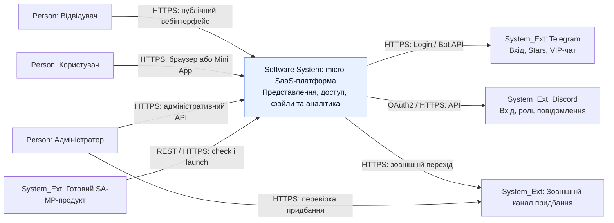
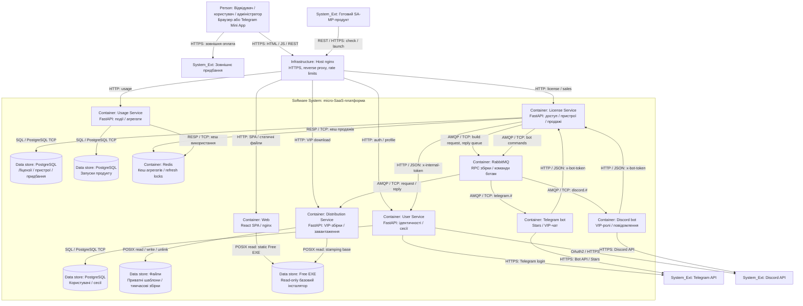

# РОЗДІЛ 2. ПРОЄКТУВАННЯ АРХІТЕКТУРИ СИСТЕМИ

Архітектура деталізує [SRS](srs.md) і зберігає межу між готовим цифровим продуктом та платформою його супроводу. У ЛР №5 побудовано три рівні C4 і зафіксовано [ADR-001](adr/0001-choice-of-technology.md). Схеми описують структурні рішення; вони не є доказом виконання цільових метрик або всіх принципів Clean Architecture.

Використано C4-семантику в Mermaid flowchart: Person — людина, System_Ext — зовнішня система, Software System — межа платформи, Container — застосунок/сховище, Component — внутрішня одиниця сервісу. Така нотація зберігає три рівні C4 і підтримує Mermaid Preview. Стрілки означають ініціатора виклику або залежність, а не повний порядок виконання; зворотні відповіді HTTP не дублюються. C4-контейнер не обов’язково дорівнює Docker-контейнеру: SPA та файловий каталог також можуть бути структурними елементами.

## 2.1. Контекстне та контейнерне моделювання системи (C4 Model)

### C4 Level 1 — System Context

[Окремий код Mermaid](diagrams/c4-context.mmd).

- Відвідувач працює з публічними сторінками й Free-файлами; користувач — з кабінетом, адміністратор — з операціями керування. Канал доступу — HTTPS.
- Зовнішній клієнт продукту викликає check і launch через REST/HTTPS; розроблення його ігрової логіки не належить платформі.
- Telegram забезпечує відповідні механізми входу, Stars і VIP-чат; Discord — OAuth2 та API ролей/повідомлень. Платформа звертається до API через HTTPS.
- Зовнішній канал придбання не є платіжним сервісом усередині платформи. HTTPS-перехід і ручна перевірка адміністратором не означають автоматичний webhook або інтегрований еквайринг.

Контекст покриває [FUN-01/02](srs.md#srs-fun-01), [вхід та ідентичності](srs.md#srs-fun-03), [клієнтську перевірку](srs.md#srs-fun-09) і [придбання](srs.md#srs-fun-16).

### C4 Level 2 — Container

[Окремий код Mermaid](diagrams/c4-container.mmd).

- **Gateway / host nginx** завершує TLS, маршрутизує HTTP у приватний контур і застосовує per-IP limits. Він є інфраструктурою доступу поза Docker Compose. [SEC-01](srs.md#srs-nfr-sec-01), [SEC-04](srs.md#srs-nfr-sec-04).
- **Web** — React SPA і nginx для статичного вмісту. Браузер виконує JavaScript та викликає API через gateway; стрілка gateway → Web означає доставку застосунку. Mini App відкриває той самий SPA. [FUN-01](srs.md#srs-fun-01), [FUN-02](srs.md#srs-fun-02).
- **User Service** зберігає користувачів, соціальні ідентичності й сесії у власній PostgreSQL; Telegram/Discord викликаються через HTTPS. [FUN-03](srs.md#srs-fun-03), [FUN-04](srs.md#srs-fun-04), [FUN-05](srs.md#srs-fun-05).
- **License Service** застосовує правила ключів, підписок, пристроїв і придбання; власна PostgreSQL містить відповідні записи. Профілі та social IDs отримуються від User Service через внутрішній HTTP з окремим токеном. [FUN-06–09](srs.md#srs-fun-06), [FUN-10](srs.md#srs-fun-10), [FUN-11](srs.md#srs-fun-11), [FUN-16](srs.md#srs-fun-16), [FUN-17](srs.md#srs-fun-17), [FUN-18](srs.md#srs-fun-18).
- **Usage Service** приймає події запуску й агрегує власну PostgreSQL. Публічні дані проходять через Redis-кеш; License Service використовує той самий Redis-контейнер з окремими ключами. RESP/TCP — протокол клієнта Redis. [FUN-14](srs.md#srs-fun-14), [FUN-15](srs.md#srs-fun-15), [CACHE-01](srs.md#srs-nfr-cache-01), [PRIV-01](srs.md#srs-nfr-priv-01).
- **Distribution Service** читає приватні шаблони й базовий EXE, записує тимчасові Lua/EXE та видає файл через HTTP API. Власна реляційна БД йому не потрібна. POSIX-позначення означає локальний файловий доступ, не мережевий протокол. [FUN-12](srs.md#srs-fun-12), [FUN-13](srs.md#srs-fun-13), [FILE-01](srs.md#srs-nfr-file-01).
- **RabbitMQ** переносить команди збірки та reply з URL, а також topic-команди ботам. HTTP-запит кабінету очікує RPC; брокер не робить його миттєвим. [REL-01](srs.md#srs-nfr-rel-01), [ADR-001](adr/0001-choice-of-technology.md).
- **Telegram/Discord-боти** споживають AMQP-команди й звертаються до License Service через HTTP з x-bot-token. Зовнішні API працюють через HTTPS; Stars належить Telegram-боту. [FUN-16](srs.md#srs-fun-16), [FUN-19](srs.md#srs-fun-19).

Три PostgreSQL не утворюють спільної ACID-транзакції; Redis не є первинним сховищем. Схема одного хоста не гарантує HA. Backup/restore й p95 перевіряються за [VC-08/11](srs.md#4-verification-criteria--критерії-верифікації), а не доводяться наявністю вузлів на рисунку.

## 2.2. Компонентне моделювання критичного сервісу системи

### C4 Level 3 — License Service

Обрано License Service: він поєднує рішення про доступ, транзакційні записи, правила пристроїв, облік продажів та інтеграцію з підготовкою файлів і ботами. Показано фактичні залежності компонентів; повна інверсія залежностей або перебудова коду не заявляється.

```mermaid
flowchart TB
  Caller["Other containers: Gateway / боти"]
  UserAPI["Other container: User Service"]
  PG[("Other container: License PostgreSQL")]
  Redis[("Other container: Redis")]
  MQ["Other container: RabbitMQ"]
  subgraph License["Container boundary: License Service / Python FastAPI"]
    subgraph Inbound["Inbound / API"]
      Routes["Component: REST routers<br/>client / user / admin / bot / stats"]
      DTO["Component: Pydantic DTO<br/>domain.schemas"]
      Guards["Component: JWT / ADMIN / bot-token guards<br/>Depends за маршрутом"]
    end
    subgraph Application["Application / бізнес-логіка"]
      Service["Component: LicenseService<br/>Активація / чинність / пристрої"]
      Stats["Component: LicenseStatsService<br/>Публічні агрегати"]
      Worker["Component: Expiry worker<br/>Завершення підписок / команди"]
    end
    subgraph Infra["Infrastructure / Outbound"]
      Repo["Component: LicenseRepository / TransactionRepository<br/>SQLAlchemy ORM"]
      Client["Component: UserServiceClient<br/>HTTP adapter"]
      Messaging["Component: messaging functions<br/>aio-pika RPC / topic publish"]
      Cache["Component: PublicStatsCache<br/>Redis loader / refresh lock"]
      DB["Component: AsyncSession factory<br/>get_db / AsyncSessionLocal"]
    end
    Errors["Cross-cutting: DomainException / Validation handlers<br/>HTTPException: стандартний FastAPI handler"]
    Log["Cross-cutting: logging / stdout<br/>Розподілений tracing не заявлено"]
  end
  Caller -->|"HTTP / JSON"| Routes
  Routes -->|"FastAPI: валідація параметрів"| DTO
  Routes -->|"Depends: JWT або ADMIN або bot-token"| Guards
  Routes -->|"Depends: AsyncSession"| DB
  Routes -->|"Python: LicenseService(db), method call"| Service
  Routes -->|"Python: LicenseStatsService(cache)"| Stats
  Routes -->|"Python await: download RPC після перевірки"| Messaging
  Service -->|"Python: створення concrete repositories"| Repo
  Service -->|"Python: concrete client call"| Client
  Stats -->|"Python: cache.get(loader)"| Cache
  Stats -->|"Python: loader / repository call"| Repo
  Worker -->|"Python: create / await / commit"| Repo
  Worker -->|"Python: AsyncSessionLocal"| DB
  Worker -->|"Python: social IDs lookup"| Client
  Worker -->|"Python await: publish commands"| Messaging
  Cache -->|"RESP / TCP"| Redis
  Repo -->|"SQLAlchemy / SQL / TCP"| PG
  Client -->|"HTTP / JSON: x-internal-token"| UserAPI
  Messaging -->|"AMQP / TCP: correlation ID / reply_to"| MQ
  Routes -.->|"Exception dispatch"| Errors
  Service -.->|"DomainException"| Errors
  DTO -.->|"RequestValidationError"| Errors
  Service -.->|"Python logging"| Log
  Messaging -.->|"stdout: технічні події"| Log
```

[Окремий код Mermaid](diagrams/c4-component.mmd).

- **REST routers** розділяють client/user/admin/bot/stats API. FastAPI перевіряє DTO до виклику endpoint. Depends надає JWT/ADMIN/bot-token guards відповідно до маршруту; публічні check і статистика не потребують користувацького JWT.
- **Pydantic DTO** визначають структуру запитів. **Guards** перевіряють підпис, строк, тип токена або відповідний внутрішній секрет; авторизація власника додатково виконується бізнес-логікою. [SEC-02/03](srs.md#srs-nfr-sec-02).
- **LicenseService** застосовує правила активації, чинності та пристроїв; **LicenseStatsService** організовує отримання агрегатів. Це компоненти одного процесу, а не окремі мікросервіси.
- **LicenseRepository / TransactionRepository** виконують SQLAlchemy-запити до PostgreSQL; **AsyncSession factory** надає сесію через get_db або AsyncSessionLocal. Наявність сесії в endpoint не означає, що endpoint напряму виконує SQL.
- **UserServiceClient** є HTTP-адаптером пошуку профілів/social IDs. **Messaging functions** інкапсулюють aio-pika publish/RPC; download-маршрут викликає їх після перевірки активної ліцензії.
- **PublicStatsCache** отримує loader і керує Redis fresh/stale та refresh lock. **Expiry worker** окремо відкриває сесію, змінює прострочені ліцензії й публікує бот-команди.
- **Обробники помилок** перетворюють DomainException і RequestValidationError у JSON; HTTPException обробляється стандартними механізмами FastAPI. Власний глобальний handler усіх невідомих Exception не заявлено.
- **Logging/stdout** показано як наявний технічний канал; повноцінні distributed tracing, Prometheus або уніфіковані структуровані журнали тут не приписуються.

### Межі відповідності Clean Architecture та SOLID

Залежність routes → application → repository присутня для основних сценаріїв. Однак LicenseService сам створює concrete repositories і UserServiceClient; business layer також залежить від AsyncSession та ORM-моделей. Тому Depends на вході не доводить повної Dependency Inversion. Download-маршрут напряму викликає messaging, а expiry worker координує repository, client і publisher. Це зафіксовані компроміси, які збільшують зв’язність і потребу в інтеграційних тестах.

Схема не додає відсутніх інтерфейсів, Unit of Work чи transactional outbox. Можливе подальше винесення контрактів та orchestration є рекомендацією аудиту, а не виконаною зміною коду. Для перевірки ізоляції й негативних сценаріїв застосовуються [VC-03–07](srs.md#4-verification-criteria--критерії-верифікації). Залежність від RabbitMQ обґрунтовано в [ADR-001](adr/0001-choice-of-technology.md).

## 2.3. Журнал архітектурних рішень (Architecture Decision Records)

[ADR-001: RabbitMQ для команд ботам і RPC підготовки VIP-файлів](adr/0001-choice-of-technology.md) містить Context, Alternatives, Decision, Consequences і статус Approved у межах навчального проєктування. Розглянуто також прямий REST і Apache Kafka; наведено ризики таймаутів, повторів, неатомарності БД/брокера й експлуатаційних витрат.

## Трасування та перевірка

- Вісім груп FR ЛР №4 деталізовано в [19 вимог SRS-FUN](srs.md#2-functional-requirements--функціональні-вимоги); кожна група віднесена до вузла Level 2, а критичні сценарії License — до Level 3.
- Чисельні обмеження збережено в [SRS-NFR](srs.md#3-non-functional-requirements--нефункціональні-вимоги); окремі [Verification Criteria](srs.md#4-verification-criteria--критерії-верифікації) називають інструменти й негативні сценарії.
- Mermaid-код є первинним артефактом. SVG-прев’ю генеруються з нього; при зміні коду вони мають оновлюватися разом.
- Якщо вбудований GitHub Mermaid-renderer не завантажується, SVG вище забезпечують перегляд схем; той самий Mermaid-код можна відкрити в Mermaid Live. Статичне прев’ю не є доказом роботи інтерактивного renderer.
- Статус архітектурного етапу — In Progress: виконано документування, очікується рев’ю. Вимірювання NFR і виправлення обмежень коду не позначено завершеними.

## Джерела

- [C4 Model: рівні моделювання](https://c4model.com/diagrams).
- [C4 Container: застосунки та сховища](https://c4model.com/diagrams/container).
- [Mermaid: синтаксис](https://mermaid.js.org/intro/syntax-reference.html).
