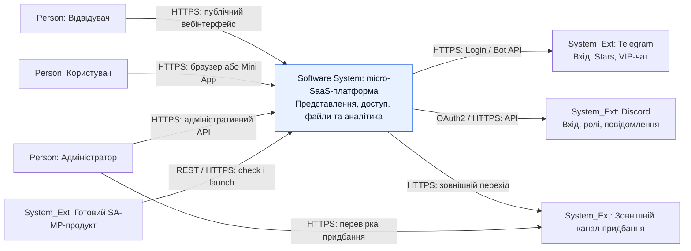
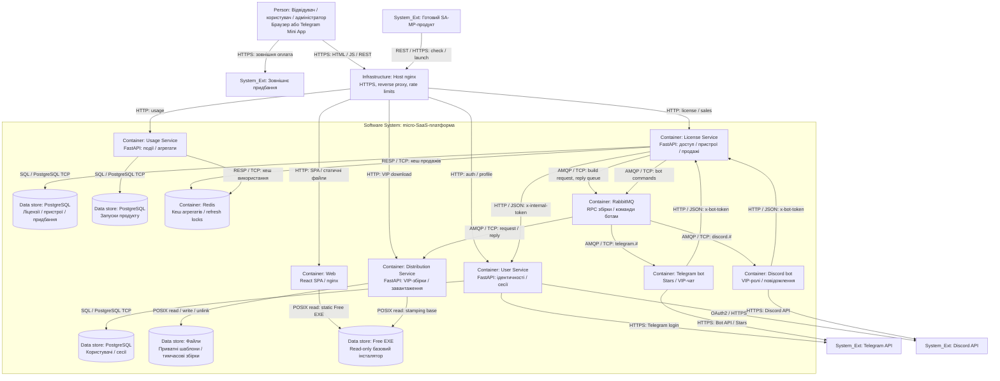

# РОЗДІЛ 2. ПРОЄКТУВАННЯ АРХІТЕКТУРИ СИСТЕМИ

Архітектура деталізує [SRS](srs.md) і зберігає межу між готовим цифровим продуктом та платформою його супроводу. У ЛР №5 побудовано три рівні C4 і зафіксовано [ADR-001](adr/0001-choice-of-technology.md). Схеми описують структурні рішення; вони не є доказом виконання цільових метрик або всіх принципів Clean Architecture.

Використано C4-семантику в Mermaid flowchart: Person — людина, System_Ext — зовнішня система, Software System — межа платформи, Container — застосунок/сховище, Component — внутрішня одиниця сервісу. Така нотація зберігає три рівні C4 і підтримує Mermaid Preview. Стрілки означають ініціатора виклику або залежність, а не повний порядок виконання; зворотні відповіді HTTP не дублюються. C4-контейнер не обов’язково дорівнює Docker-контейнеру: SPA та файловий каталог також можуть бути структурними елементами.

## 2.1. Контекстне та контейнерне моделювання системи (C4 Model)

### C4 Level 1 — System Context

[Інтерактивний Mermaid Live](https://mermaid.live/edit#pako:eJx1VF1r2zAU_StCfXUoydhWzChktGyFloU628syhmrLjaltFVmmK22hTTe6t40OMtjL_kJSFpaPJvkL0j_alaK0nZM-2ImVc84999zrnGCfBRS7OIzZkd8kXKDt3UaK0KucZuJ9A9coz1jqInmt2vKPvNF3dSlvZEddNfAHDX2bUf4Q-UtO1LnsqwvVKiCrQRKlD6HfQfIWJMeqbeDnAG5puiXUYiJCxhPgeCwUR4RT5B1ngiYuSiKfs5JHiFeSUznSTPXZlL6VnRd7fHVd_oaHHvgFadkBJyN4GkOxbw6CwhPrcOogIHbkAH7vIw1F8DSGawS2WrIvh7IzN8RZkPs6mJmNj5ufBPTxA8TAN5ToywHyqqWdGpiC6hOT1lC1LL9OY7rPSVIQmB_PbF-rLzpmB3mC8MxB77ZqJXWlG7QqG1HmMx4UROxpQcOYgEag5al2aMY4gYzuwrCiO4Qf0IXOfpqu9Hy-6jt0p9OYpYNMi33Q65qjey2zPahUWj9t4Nf1es1zNfYScDrSK8DqnEC4J7tm_C3ZU-cwhZ4cqIsGPr2b_HzBCmJdsyqX8q_m6XF15QTtRGmEqoeHRb5Zu4JAZ-nm9XWvxlu1tlWUsbO3QrubXh2tIqvnN6l_gFQbxSRP_eYC1X7_38Q22wdfq-glE_N680VYQnpTzUWzcl_SMuzUH68CGS2McKpjg8vsiFaZDf-xsCxcLw98DvULsmTyD1X8mGTZBg1RZpYJhVEcuyt0LSyHoZMJzg6ou1J5-uwJ3XN8FjPurpTL5bXK8zvyfTcziUaKHZxQnpAowO4JFk2a6D-ugIYkjwU-czDJBfOOUx-7gufUwflhQATdiIhOdHZ49g9jp0_K) · [Окремий код Mermaid](diagrams/c4-context.mmd) · [Окрема схема в GitHub](diagrams/c4-context.md).

- Відвідувач працює з публічними сторінками й Free-файлами; користувач — з кабінетом, адміністратор — з операціями керування. Канал доступу — HTTPS.
- Зовнішній клієнт продукту викликає check і launch через REST/HTTPS; розроблення його ігрової логіки не належить платформі.
- Telegram забезпечує відповідні механізми входу, Stars і VIP-чат; Discord — OAuth2 та API ролей/повідомлень. Платформа звертається до API через HTTPS.
- Зовнішній канал придбання не є платіжним сервісом усередині платформи. HTTPS-перехід і ручна перевірка адміністратором не означають автоматичний webhook або інтегрований еквайринг.

Контекст покриває [FUN-01/02](srs.md#srs-fun-01), [вхід та ідентичності](srs.md#srs-fun-03), [клієнтську перевірку](srs.md#srs-fun-09) і [придбання](srs.md#srs-fun-16).

### C4 Level 2 — Container

[Інтерактивний Mermaid Live](https://mermaid.live/edit#pako:eJyVV1tP40YY_Ssj96WVSJH6GFUrAQGWipQEp-1Km6qa2BNi4XjS8XgDWlbisuruG-pFILUPfekPAHYp7HL7C_Y_6vnGduLcFvUliiffOXPmuxxPXlqOdIVVttq-7DsdrjRrLDYDxhaV7IdCPW9aNaFCGZRZ_FtyEr-PL-gzOYov4rPkDZtn8cf4PtmPr5OD5LC4fIbYW8TeJSfmp338cEihX7fU_JP4V7NwFF_Fl8k-RZ_H96whfLGleJdVvcBjC71e0_qRxNSUdCNHQ4y9G2rR_Wl5R0PQ76ADJfa8jj8we6FUrZXiBxDfG4Ufk8MM31gdgw42WqitZTGVpbGYihc6UrmFkCpX22JCxalRQMd8i88_mFFwjdOf41R3WDrO4Ktciz7fBX4taCseaoUzRUqU2VMZahZsecGOSc7TRqNmzzElXiD1gvWU3NnFI-DM97qeDjPCMGrhEL0Oq_lct6XqkjTZ1n2uBEs1llnXc5Qs2ZzbyE18Q1VIXpuS3cZnGRFjP4gWwEsy0NwLhCrTgtGyKbijmV1bQE2NwgHkO7QHcjMKo0VmC_XCc4TBr-CciCoz0zyXSMcheuUNEnNv2uIEvMkBmuAACTwdkK8DH4RilDxbnM4P9vusBx-o_x4GTYl-SE7zJbQGyvJvclI4B98S46fA0oxtHkx3naSMZ_E7cF7G70xzXw840Tt6lJJWlNeKtCeD6czfr6F7r-JzcO9jqK6J_wo7XFAbgR2qKX-FhoL2yuLzz5tWhWvOQi2pl2ropS0l7Pp6Omh_To7nRNK_yLP-ON1fQPxidFzlSZiR6bERyPewH9_jFKiH5AgKKQ2jE50cDak2heuFRFbIs1nLT36ZvB2rEbrwAgKVaCsRdpgvne1wSFitjxZtk7danq7W00moLbHx-sD7aIxwxvek9NwY0ll8OyhQY1GONcLAelpSG15bcxWCjOqPwTgbuBbaaAKdm1IONiBKz40pqulO49BG2M1Ew6x4vgjH8x__A80fEH2dJu5vU70L09PwNQZjI3--AeedOTf1OsydxB6kG45kZpjQFSXE-G60xpafLef24pZk4O8y0ytXAzc3b44Dk82b5Dh9c-S8InALryhWKj3Za1rGNGGljeo6FH5j42Nz2W40rb3ceAtvkgxDAYjLoE5HONt49HkUOJ0xYPa1sFk5c8VUZW5rlK7XeTqJA0Y6C88j3QEB_L2NslBw5qmzAH5mgPMs5KgjITJPnIWIyMlSZvoyIwpdxFzZD3zJXQoms6LYTE4Wi_nEzsNhZY2lmqGumBtD7s6fDl5Pg1OH_XSoPY2XBJv6bnxbZjslL9BCBdwvabktgrEUjiJRbEKCvEyDa7xh5I0QXxDeGMi4xGlY6tPC3WfodAWOUQUL1fqApRV5vgsf-jkSoaZ3fQ8zgIfIVKtaN_eN-hRgBjEmBkyxXJ_YTWrmyG6XB274CL_O_OnLzyiQ_GtmqJuaURpZySIJMb1WEDEsU6FvK_8bMdqX2fgOjNWXuKcY8auTwRsLGLqv8qE3wpemyAYfLRBunhmHHhJWJkJHroo5IwY_i6pt2GvPUC7ulmGCXHvOwAQpnL4bXpRxOqLb84It1uKheDQecvvK0-QRUeB7wbZBkOvPtMzMdfMb7DHDY3ZTpBviXnbvbQbWnNUVqss91yq_tHRHdOmfgyvaPPK19WrOgqFJezdwrDLutmLOinou3KbicapLuvjqP4M4FnY) · [Окремий код Mermaid](diagrams/c4-container.mmd) · [Окрема схема в GitHub](diagrams/c4-container.md).

- **Gateway / host nginx** завершує TLS, маршрутизує HTTP у приватний контур і застосовує per-IP limits. Він є інфраструктурою доступу поза Docker Compose. [SEC-01](srs.md#srs-nfr-sec-01), [SEC-04](srs.md#srs-nfr-sec-04).
- **Web** — React SPA і nginx для статичного вмісту. Браузер виконує JavaScript та викликає API через gateway; стрілка gateway → Web означає доставку застосунку. Mini App відкриває той самий SPA. [FUN-01](srs.md#srs-fun-01), [FUN-02](srs.md#srs-fun-02).
- **User Service** зберігає користувачів, соціальні ідентичності й сесії у власній PostgreSQL; Telegram/Discord викликаються через HTTPS. [FUN-03](srs.md#srs-fun-03), [FUN-04](srs.md#srs-fun-04), [FUN-05](srs.md#srs-fun-05), [FUN-20](srs.md#srs-fun-20), [FUN-21](srs.md#srs-fun-21), [FUN-22](srs.md#srs-fun-22).
- **License Service** застосовує правила ключів, підписок, пристроїв і придбання; власна PostgreSQL містить відповідні записи. Профілі та social IDs отримуються від User Service через внутрішній HTTP з окремим токеном. [FUN-06](srs.md#srs-fun-06), [FUN-07](srs.md#srs-fun-07), [FUN-08](srs.md#srs-fun-08), [FUN-09](srs.md#srs-fun-09), [FUN-10](srs.md#srs-fun-10), [FUN-11](srs.md#srs-fun-11), [FUN-16](srs.md#srs-fun-16), [FUN-17](srs.md#srs-fun-17), [FUN-18](srs.md#srs-fun-18), [FUN-24](srs.md#srs-fun-24).
- **Usage Service** приймає події запуску й агрегує власну PostgreSQL. Публічні дані проходять через Redis-кеш; License Service використовує той самий Redis-контейнер з окремими ключами. RESP/TCP — протокол клієнта Redis. [FUN-14](srs.md#srs-fun-14), [FUN-15](srs.md#srs-fun-15), [CACHE-01](srs.md#srs-nfr-cache-01), [PRIV-01](srs.md#srs-nfr-priv-01).
- **Distribution Service** читає приватні шаблони й базовий EXE, записує тимчасові Lua/EXE та видає файл через HTTP API. Власна реляційна БД йому не потрібна. POSIX-позначення означає локальний файловий доступ, не мережевий протокол. [FUN-12](srs.md#srs-fun-12), [FUN-13](srs.md#srs-fun-13), [FILE-01](srs.md#srs-nfr-file-01).
- **RabbitMQ** переносить команди збірки та reply з URL, а також topic-команди ботам. HTTP-запит кабінету очікує RPC; брокер не робить його миттєвим. [REL-01](srs.md#srs-nfr-rel-01), [ADR-001](adr/0001-choice-of-technology.md).
- **Telegram/Discord-боти** споживають AMQP-команди й звертаються до License Service через HTTP з x-bot-token. Зовнішні API працюють через HTTPS; Stars належить Telegram-боту. [FUN-16](srs.md#srs-fun-16), [FUN-19](srs.md#srs-fun-19).

Три PostgreSQL не утворюють спільної ACID-транзакції; Redis не є первинним сховищем. Схема одного хоста не гарантує HA. Backup/restore й p95 перевіряються за [VC-08/11](srs.md#4-verification-criteria--критерії-верифікації), а не доводяться наявністю вузлів на рисунку.

## 2.2. Компонентне моделювання критичного сервісу системи

### C4 Level 3 — License Service

Обрано License Service: у ньому зосереджено рішення про доступ, активацію, пристрої, придбання та видачу файлів. Нижче наведено **цільову проєктну модель**, уточнену за результатами аудиту ЛР №5. Вона визначає контракти для подальшої реалізації; наявність усіх портів і DI-provider у програмному коді не заявляється.

[Вихідний ескіз наявних залежностей](diagrams/c4-component-reference.mmd) зберігає concrete constructors, прямий download → messaging і worker orchestration для порівняння з результатом аудиту.

```mermaid
flowchart TB
  Caller["External containers: Gateway / bots"]
  PG[("License PostgreSQL")]
  UserAPI["User Service"]
  MQ["RabbitMQ"]
  Redis[("Redis")]
  subgraph License["License Service — цільова компонентна модель"]
    subgraph Inbound["Inbound adapters"]
      API["REST controllers"]
      DTO["Pydantic DTO validation"]
      Guard["JWT / ADMIN / bot-token guards"]
      Worker["Expiry scheduler adapter"]
    end
    subgraph Core["Application / domain — без FastAPI та SQLAlchemy"]
      UseCases["License use cases<br/>activate / check / reset / expire"]
      Download["Download use case<br/>authorize + request build"]
      Stats["Sales statistics use case"]
      RP["Port: LicenseStore / PurchaseStore"]
      UP["Port: UserDirectory"]
      MP["Port: BuildGateway / BotPublisher"]
      CP["Port: StatsCache"]
    end
    subgraph Outbound["Outbound adapters"]
      Repo["SQLAlchemy repositories / transaction scope"]
      HTTP["httpx UserServiceClient"]
      AMQP["aio-pika RPC / publisher"]
      Cache["Redis cache adapter"]
    end
    Wiring["Composition root<br/>Depends providers / constructor injection"]
    Errors["Error boundary / sanitized logging"]
  end
  Caller -->|"HTTP / JSON"| API
  API -->|"FastAPI validation"| DTO
  API -->|"Depends: route-specific policy"| Guard
  API -->|"injected interface call"| UseCases
  API -->|"injected interface call"| Download
  API -->|"injected interface call"| Stats
  Worker -->|"injected expire use case"| UseCases
  UseCases -->|"interface call"| RP
  UseCases -->|"interface call"| UP
  UseCases -->|"interface call: expiry commands"| MP
  Download -->|"interface call: authorize"| RP
  Download -->|"interface call: build / deadline"| MP
  Stats -->|"interface call: aggregates loader"| RP
  Stats -->|"interface call: cache policy"| CP
  Repo -.->|"implements interface"| RP
  HTTP -.->|"implements interface"| UP
  AMQP -.->|"implements interface"| MP
  Cache -.->|"implements interface"| CP
  Wiring -.->|"binds ports to adapters"| Repo
  Wiring -.->|"binds ports to adapters"| HTTP
  Wiring -.->|"binds ports to adapters"| AMQP
  Wiring -.->|"binds ports to adapters"| Cache
  Wiring -.->|"constructs use cases"| UseCases
  Wiring -.->|"constructs use cases"| Download
  Wiring -.->|"constructs use cases"| Stats
  API -.->|"exception mapping / log event"| Errors
  Worker -.->|"exception mapping / log event"| Errors
  DTO -.->|"422 validation error"| Errors
  Repo -->|"SQL / PostgreSQL TCP"| PG
  HTTP -->|"HTTP / JSON: internal token"| UserAPI
  AMQP -->|"AMQP / TCP"| MQ
  Cache -->|"RESP / TCP"| Redis
```

[Інтерактивний Mermaid Live](https://mermaid.live/edit#pako:eJyVVstuGzcU_RViVi1qVUDQlVAEsCXXdRDFY0mBF1YXnBlaYj1DsiRHthIFCLroqssg35EWLQq0SfsL8i_0S3ovOQ9KdSJ5YYszc87lfZ1LvoxSmbGoF13l8iadU23J5GgqCOnTPGf6chod31qmBc1JKoWlXDBteuSEWnZDl6RLEmnNNPoOKfHJ5WfT6ClPmTCMxNLYmWbj86fT6HP3_blh-jA-BZu4ImOmF4CtyMNzeD-iScLt8Lx6N2IZN2jTLWozpkxmmqo5qXa6bPesTJJ_X78hdz_dvV3_dffz-u_1r-t3ZP0nLN6v_4H_H9a_rz_c_Qi_8Po9vPgNXgCy2jXY4VQkshQZ7FCtCM2ognyYBkuID2l0PJ64FGmJiQsBg8kZAOJlRoXlKT6SBc15Ri2XIsCdlFTjXk8uJpDYw8Hw9JlPcMfKaybIDL-Hhi-kvq5qpLheEpPOWVbC7rWbDZaJbCu0vtSYuUOlcp46T2CvTBZQYZe-9S-QlD_IN9RYCJBAut4RqOVhDnsUy8AJqGWfGmaCMpTwl-K7rxPdfUxTyxfQL2AfuOk1_GpmmIVfhn6zMFXyRuSSYhbqZWPNGyvtXGr-gpEvwMoPJTOWJCXPs8DI2FKL7oxpzgwx8MQNJN40lgLsKMbSSG17dTuNLWQGfItLDXqonsN4Wwa28QACSAESpmTYQo7Qt1YtR9LGZZJzMw-KA2JrCc75PoVMfaJ4Z6WtG7Ne3teZI6Yk5qEpG6RMScPBXQ6Z6RKrqTBYH6i-SaUK4_x2MkGv5taqWxdpJa5-zpmwYf8PzxFIuewofk0hpX0wre4LE8O6rOQMlYCnj3fqBddczADdl4VzGp3UUlrXBwOmAGmI0nLBMwgbu0sKY3WJ1SBcfM_SDX0day01toVbEJc0qrEohgqw_oJlJJezGWxacSpX_CQknc7j1TTCrADlyfjs2TRaofYRggrx32u9hAJfoeQ3YZX7PQiotKxjFEv5FcwGJUGNS6S4YbBJ8jGBm1xAxq5oit2c54iuRbg3oVbX3gTXl4j2Q2eb4JUcKGzTp3rd0LbNj-K9YM93w3relyW0Q1FQgQNzBYpEXjNS7uc1s6V1aAfDTR6cm4xmORyN7VYuXR_bZwbn4gxmgiFoG5u_3u9TNK-XtkP6sT8jlSSdLz2jUDkrQJ2mLWBr27XuDqTPLyp6F9KH6RS9C-od9XqusQl36oWRZ4iVwfBauYgeRMDAHkTA-B5E8PP4f4xm4LRHi9nu_P0YoRz3YzR6dOr1WHabMuXmZEGVQiNdHGmELdzEXlUzMFTxg4l4e6lYXz16FMw5whCzCfbN6cBwCOGh2lwKyQTaAsDxSdub2xO25_sIL5_uBlTlVtdT17WpI7llt7YJF8i2N913uJ0F3_11UkQHUcE03HiyqPcysnBA4kU4Y1e0zG306iCCgSDHS5FGPagAO4hKBaGyAadwChf-5av_ALL129Q) · [Окремий код Mermaid](diagrams/c4-component.mmd) · [Перегляд окремої схеми в GitHub](diagrams/c4-component.md).

### Компоненти, контракти та напрями залежностей

- **REST controllers** приймають HTTP і викликають application use cases через ін’єктовані залежності. Вони не виконують SQL і не звертаються до aio-pika напряму. Валідація **Pydantic DTO** та **JWT/ADMIN/bot-token guards** залишається на вході; публічні маршрути не отримують зайвого JWT-обмеження. [SEC-02](srs.md#srs-nfr-sec-02), [SEC-03](srs.md#srs-nfr-sec-03).
- **License use cases** визначають активацію, чинність, квоти, скидання й завершення ліцензії. Власник ресурсу перевіряється в use case; підпис JWT не підміняє ownership. [FUN-07](srs.md#srs-fun-07), [FUN-09](srs.md#srs-fun-09), [FUN-10](srs.md#srs-fun-10), [FUN-11](srs.md#srs-fun-11).
- **Download use case** об’єднує перевірку активного доступу та запит збірки через BuildGateway; загальний deadline керується в цьому application-сценарії. [FUN-12](srs.md#srs-fun-12), [REL-05](srs.md#srs-nfr-rel-05).
- **Sales statistics use case** звертається до портів сховища й кешу; loader-логіка не отримує мережевих деталей Redis. [FUN-17](srs.md#srs-fun-17), [CACHE-02](srs.md#srs-nfr-cache-02).
- **Expiry scheduler adapter** лише запускає відповідний use case. Зміна стану, отримання social IDs і публікація бот-команди координуються application layer через порти. [FUN-19](srs.md#srs-fun-19), [FUN-23](srs.md#srs-fun-23).
- **LicenseStore/PurchaseStore, UserDirectory, BuildGateway/BotPublisher, StatsCache** є внутрішніми контрактами. Use cases залежать від цих контрактів; адаптери реалізують їх. Пунктир implements означає залежність типів/реалізації, а не доставку повідомлення.
- **SQLAlchemy repositories / transaction scope** реалізують доступ до PostgreSQL; **httpx client** — HTTP до User Service; **aio-pika adapter** — AMQP RPC/publish; **Redis adapter** — RESP і cache locks. Контракти повинні повертати application DTO/значення й доменні помилки, не ORM-моделі або FastAPI Response.
- **Composition root** зв’язує порти з concrete adapters і створює use cases через constructor injection. FastAPI Depends використовується на межі застосунку; core не залежить від FastAPI, AsyncSession чи aio-pika. Різні порти для build і bot commands не вимагають спільного широкого інтерфейсу.
- **Error boundary / sanitized logging** перетворює помилки у визначений HTTP-контракт і записує технічну подію без секретів. Guards, валідація й error mapping є cross-cutting механізмами, а не бізнес-правилами. [OBS-01](srs.md#srs-nfr-obs-01), [PRIV-02](srs.md#srs-nfr-priv-02).

### Усунені недоліки на рівні проєктування

Після аудиту concrete construction перенесено в composition root, download orchestration — до use case, а ORM/HTTP/AMQP/Redis — за outbound ports. Це виправлення Mermaid-моделі та контрактів, не звіт про рефакторинг реалізації. Перевірка майбутньої реалізації має включати unit tests з підміною портів, перевірку імпортів core без framework dependencies та інтеграційні сценарії [VC-03–07](srs.md#4-verification-criteria--критерії-верифікації).

Transactional outbox, кластерний broker і distributed tracing не додаються до складу системи. Ризик неатомарності БД/publish залишається явним компромісом [ADR-001](adr/0001-choice-of-technology.md); DI не усуває цей ризик автоматично.

## 2.3. Журнал архітектурних рішень (Architecture Decision Records)

[ADR-001: RabbitMQ для команд ботам і RPC підготовки VIP-файлів](adr/0001-choice-of-technology.md) містить Context, Alternatives, Decision, Consequences і статус Approved у межах навчального проєктування. Розглянуто також прямий REST і Apache Kafka; наведено ризики таймаутів, повторів, неатомарності БД/брокера й експлуатаційних витрат.

## Трасування та перевірка

- Вісім груп FR ЛР №4 деталізовано в [24 вимоги SRS-FUN](srs.md#2-functional-requirements--функціональні-вимоги); кожна група віднесена до вузла Level 2, а критичні сценарії License — до Level 3.
- Чисельні обмеження збережено в [SRS-NFR](srs.md#3-non-functional-requirements--нефункціональні-вимоги); окремі [Verification Criteria](srs.md#4-verification-criteria--критерії-верифікації) називають інструменти й негативні сценарії.
- Mermaid-код є первинним артефактом. SVG-прев’ю генеруються з нього; при зміні коду вони мають оновлюватися разом.
- Для незалежного інтерактивного перегляду наведено Mermaid Live; той самий код зберігається в Git. SVG мають явні розміри й забезпечують читабельний резервний перегляд при недоступності вбудованого GitHub renderer. Статичне прев’ю не підміняє перевірку інтерактивного перегляду.
- Статус архітектурного етапу — In Progress: виконано документування, очікується рев’ю. Вимірювання NFR і виправлення обмежень коду не позначено завершеними.

## Джерела

- [C4 Model: рівні моделювання](https://c4model.com/diagrams).
- [C4 Container: застосунки та сховища](https://c4model.com/diagrams/container).
- [Mermaid: синтаксис](https://mermaid.js.org/intro/syntax-reference.html).
