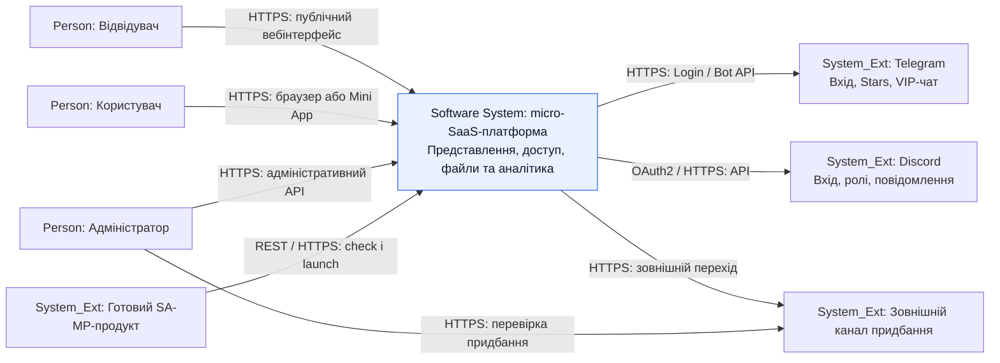
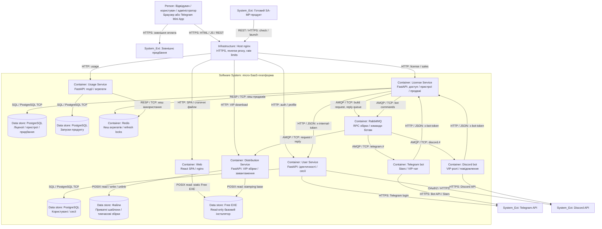
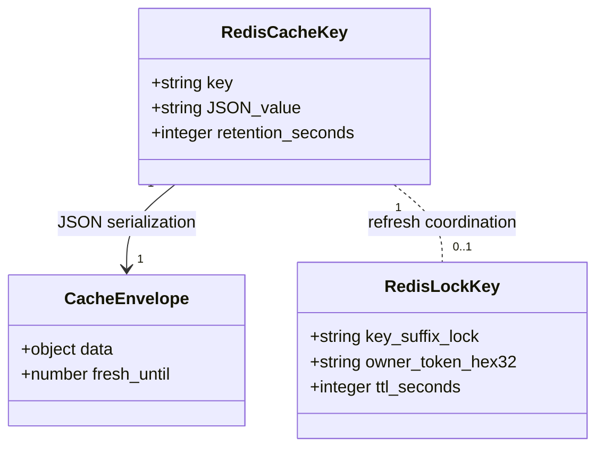
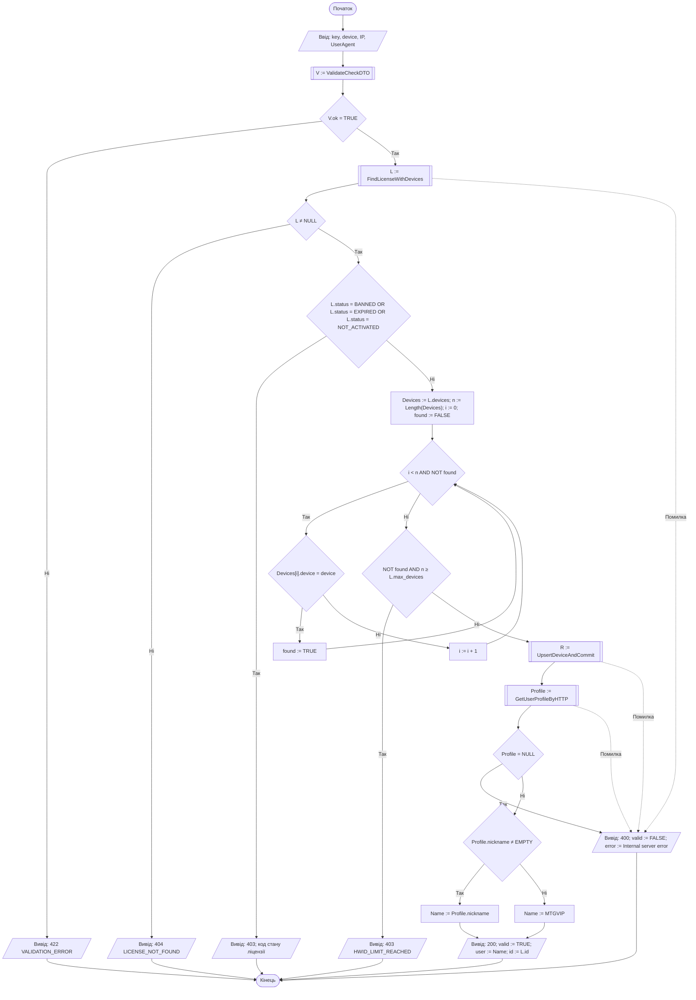
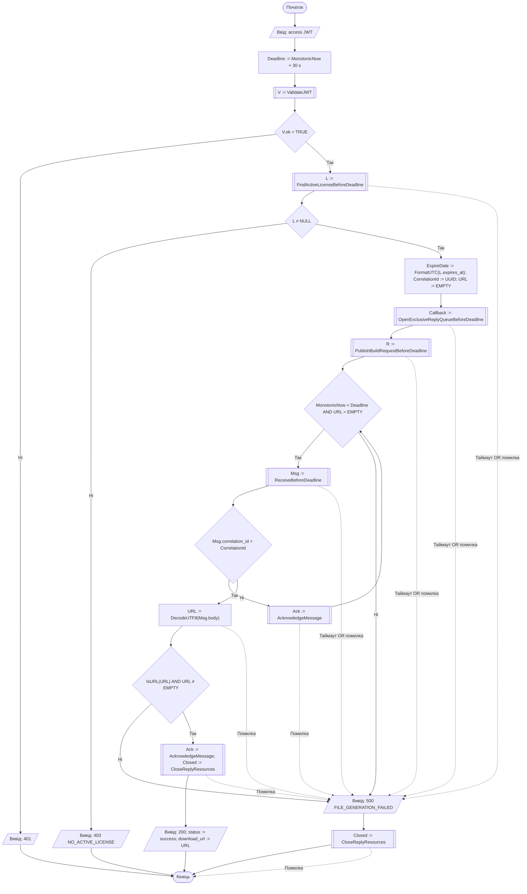

# РОЗДІЛ 2. ПРОЄКТУВАННЯ АРХІТЕКТУРИ СИСТЕМИ

Архітектура деталізує [SRS](srs.md) і зберігає межу між готовим цифровим продуктом та платформою його супроводу. У ЛР №5 побудовано три рівні C4 і зафіксовано [ADR-001](adr/0001-choice-of-technology.md). Схеми описують структурні рішення; вони не є доказом виконання цільових метрик або всіх принципів Clean Architecture.

Використано C4-семантику в Mermaid flowchart: Person — людина, System_Ext — зовнішня система, Software System — межа платформи, Container — застосунок/сховище, Component — внутрішня одиниця сервісу. Така нотація зберігає три рівні C4 і підтримує Mermaid Preview. Стрілки означають ініціатора виклику або залежність, а не повний порядок виконання; зворотні відповіді HTTP не дублюються. C4-контейнер не обов’язково дорівнює Docker-контейнеру: SPA та файловий каталог також можуть бути структурними елементами.

## 2.1. Контекстне та контейнерне моделювання системи (C4 Model)

### C4 Level 1 — System Context

[Інтерактивний Mermaid Live](https://mermaid.live/edit#pako:eJx1VF1r2zAU_StCfXUoydhWzChktGyFloU628syhmrLjaltFVmmK22hTTe6t40OMtjL_kJSFpaPJvkL0j_alaK0nZM-2ImVc84999zrnGCfBRS7OIzZkd8kXKDt3UaK0KucZuJ9A9coz1jqInmt2vKPvNF3dSlvZEddNfAHDX2bUf4Q-UtO1LnsqwvVKiCrQRKlD6HfQfIWJMeqbeDnAG5puiXUYiJCxhPgeCwUR4RT5B1ngiYuSiKfs5JHiFeSUznSTPXZlL6VnRd7fHVd_oaHHvgFadkBJyN4GkOxbw6CwhPrcOogIHbkAH7vIw1F8DSGawS2WrIvh7IzN8RZkPs6mJmNj5ufBPTxA8TAN5ToywHyqqWdGpiC6hOT1lC1LL9OY7rPSVIQmB_PbF-rLzpmB3mC8MxB77ZqJXWlG7QqG1HmMx4UROxpQcOYgEag5al2aMY4gYzuwrCiO4Qf0IXOfpqu9Hy-6jt0p9OYpYNMi33Q65qjey2zPahUWj9t4Nf1es1zNfYScDrSK8DqnEC4J7tm_C3ZU-cwhZ4cqIsGPr2b_HzBCmJdsyqX8q_m6XF15QTtRGmEqoeHRb5Zu4JAZ-nm9XWvxlu1tlWUsbO3QrubXh2tIqvnN6l_gFQbxSRP_eYC1X7_38Q22wdfq-glE_N680VYQnpTzUWzcl_SMuzUH68CGS2McKpjg8vsiFaZDf-xsCxcLw98DvULsmTyD1X8mGTZBg1RZpYJhVEcuyt0LSyHoZMJzg6ou1J5-uwJ3XN8FjPurpTL5bXK8zvyfTcziUaKHZxQnpAowO4JFk2a6D-ugIYkjwU-czDJBfOOUx-7gufUwflhQATdiIhOdHZ49g9jp0_K) · [Окремий код Mermaid](diagrams/c4-context.mmd) · [Окрема схема в GitHub](diagrams/c4-context.md).

- Відвідувач працює з публічними сторінками й Free-файлами; користувач — з кабінетом, адміністратор — з операціями керування. Канал доступу — HTTPS.
- Зовнішній клієнт продукту викликає check і launch через REST/HTTPS; розроблення його ігрової логіки не належить платформі.
- Telegram забезпечує відповідні механізми входу, Stars і VIP-чат; Discord — OAuth2 та API ролей/повідомлень. Платформа звертається до API через HTTPS.
- Зовнішній канал придбання не є платіжним сервісом усередині платформи. HTTPS-перехід і ручна перевірка адміністратором не означають автоматичний webhook або інтегрований еквайринг.

Контекст покриває [FUN-01/02](srs.md#srs-fun-01), [вхід та ідентичності](srs.md#srs-fun-03), [клієнтську перевірку](srs.md#srs-fun-09) і [придбання](srs.md#srs-fun-16).

### C4 Level 2 — Container

[Інтерактивний Mermaid Live](https://mermaid.live/edit#pako:eJyVV1tP40YY_Ssj96WVSJH6GFUrAQGWipQEp-1Km6qa2BNi4XjS8XgDWlbisuruG-pFILUPfekPAHYp7HL7C_Y_6vnGduLcFvUliiffOXPmuxxPXlqOdIVVttq-7DsdrjRrLDYDxhaV7IdCPW9aNaFCGZRZ_FtyEr-PL-gzOYov4rPkDZtn8cf4PtmPr5OD5LC4fIbYW8TeJSfmp338cEihX7fU_JP4V7NwFF_Fl8k-RZ_H96whfLGleJdVvcBjC71e0_qRxNSUdCNHQ4y9G2rR_Wl5R0PQ76ADJfa8jj8we6FUrZXiBxDfG4Ufk8MM31gdgw42WqitZTGVpbGYihc6UrmFkCpX22JCxalRQMd8i88_mFFwjdOf41R3WDrO4Ktciz7fBX4taCseaoUzRUqU2VMZahZsecGOSc7TRqNmzzElXiD1gvWU3NnFI-DM97qeDjPCMGrhEL0Oq_lct6XqkjTZ1n2uBEs1llnXc5Qs2ZzbyE18Q1VIXpuS3cZnGRFjP4gWwEsy0NwLhCrTgtGyKbijmV1bQE2NwgHkO7QHcjMKo0VmC_XCc4TBr-CciCoz0zyXSMcheuUNEnNv2uIEvMkBmuAACTwdkK8DH4RilDxbnM4P9vusBx-o_x4GTYl-SE7zJbQGyvJvclI4B98S46fA0oxtHkx3naSMZ_E7cF7G70xzXw840Tt6lJJWlNeKtCeD6czfr6F7r-JzcO9jqK6J_wo7XFAbgR2qKX-FhoL2yuLzz5tWhWvOQi2pl2ropS0l7Pp6Omh_To7nRNK_yLP-ON1fQPxidFzlSZiR6bERyPewH9_jFKiH5AgKKQ2jE50cDak2heuFRFbIs1nLT36ZvB2rEbrwAgKVaCsRdpgvne1wSFitjxZtk7danq7W00moLbHx-sD7aIxwxvek9NwY0ll8OyhQY1GONcLAelpSG15bcxWCjOqPwTgbuBbaaAKdm1IONiBKz40pqulO49BG2M1Ew6x4vgjH8x__A80fEH2dJu5vU70L09PwNQZjI3--AeedOTf1OsydxB6kG45kZpjQFSXE-G60xpafLef24pZk4O8y0ytXAzc3b44Dk82b5Dh9c-S8InALryhWKj3Za1rGNGGljeo6FH5j42Nz2W40rb3ceAtvkgxDAYjLoE5HONt49HkUOJ0xYPa1sFk5c8VUZW5rlK7XeTqJA0Y6C88j3QEB_L2NslBw5qmzAH5mgPMs5KgjITJPnIWIyMlSZvoyIwpdxFzZD3zJXQoms6LYTE4Wi_nEzsNhZY2lmqGumBtD7s6fDl5Pg1OH_XSoPY2XBJv6bnxbZjslL9BCBdwvabktgrEUjiJRbEKCvEyDa7xh5I0QXxDeGMi4xGlY6tPC3WfodAWOUQUL1fqApRV5vgsf-jkSoaZ3fQ8zgIfIVKtaN_eN-hRgBjEmBkyxXJ_YTWrmyG6XB274CL_O_OnLzyiQ_GtmqJuaURpZySIJMb1WEDEsU6FvK_8bMdqX2fgOjNWXuKcY8auTwRsLGLqv8qE3wpemyAYfLRBunhmHHhJWJkJHroo5IwY_i6pt2GvPUC7ulmGCXHvOwAQpnL4bXpRxOqLb84It1uKheDQecvvK0-QRUeB7wbZBkOvPtMzMdfMb7DHDY3ZTpBviXnbvbQbWnNUVqss91yq_tHRHdOmfgyvaPPK19WrOgqFJezdwrDLutmLOinou3KbicapLuvjqP4M4FnY) · [Окремий код Mermaid](diagrams/c4-container.mmd) · [Окрема схема в GitHub](diagrams/c4-container.md).

- **Gateway / host nginx** завершує TLS, маршрутизує HTTP у приватний контур і застосовує per-IP limits. Він є інфраструктурою доступу поза Docker Compose. [SEC-01](srs.md#srs-nfr-sec-01), [SEC-04](srs.md#srs-nfr-sec-04).
- **Web** — React SPA і nginx для статичного вмісту. Браузер виконує JavaScript та викликає API через gateway; стрілка gateway → Web означає доставку застосунку. Mini App відкриває той самий SPA. [FUN-01](srs.md#srs-fun-01), [FUN-02](srs.md#srs-fun-02).
- **User Service** зберігає користувачів, соціальні ідентичності й сесії у власній PostgreSQL; Telegram/Discord викликаються через HTTPS. [FUN-03](srs.md#srs-fun-03), [FUN-04](srs.md#srs-fun-04), [FUN-05](srs.md#srs-fun-05), [FUN-20](srs.md#srs-fun-20), [FUN-21](srs.md#srs-fun-21), [FUN-22](srs.md#srs-fun-22).
- **License Service** застосовує правила ключів, підписок, пристроїв і придбання; власна PostgreSQL містить відповідні записи. Профілі та social IDs отримуються від User Service через внутрішній HTTP з окремим токеном. [FUN-06](srs.md#srs-fun-06), [FUN-07](srs.md#srs-fun-07), [FUN-25](srs.md#srs-fun-25), [FUN-26](srs.md#srs-fun-26), [FUN-27](srs.md#srs-fun-27), [FUN-08](srs.md#srs-fun-08), [FUN-09](srs.md#srs-fun-09), [FUN-10](srs.md#srs-fun-10), [FUN-11](srs.md#srs-fun-11), [FUN-16](srs.md#srs-fun-16), [FUN-17](srs.md#srs-fun-17), [FUN-18](srs.md#srs-fun-18), [FUN-24](srs.md#srs-fun-24).
- **Usage Service** приймає події запуску й агрегує власну PostgreSQL. Публічні дані проходять через Redis-кеш; License Service використовує той самий Redis-контейнер з окремими ключами. RESP/TCP — протокол клієнта Redis. [FUN-14](srs.md#srs-fun-14), [FUN-15](srs.md#srs-fun-15), [CACHE-01](srs.md#srs-nfr-cache-01), [PRIV-01](srs.md#srs-nfr-priv-01).
- **Distribution Service** читає приватні шаблони й базовий EXE, записує тимчасові Lua/EXE та видає файл через HTTP API. Власна реляційна БД йому не потрібна. POSIX-позначення означає локальний файловий доступ, не мережевий протокол. [FUN-12](srs.md#srs-fun-12), [FUN-13](srs.md#srs-fun-13), [FUN-28](srs.md#srs-fun-28), [FUN-29](srs.md#srs-fun-29), [FILE-01](srs.md#srs-nfr-file-01).
- **RabbitMQ** переносить команди збірки та reply з URL, а також topic-команди ботам. HTTP-запит кабінету очікує RPC; брокер не робить його миттєвим. [REL-01](srs.md#srs-nfr-rel-01), [ADR-001](adr/0001-choice-of-technology.md).
- **Telegram/Discord-боти** споживають AMQP-команди й звертаються до License Service через HTTP з x-bot-token. Зовнішні API працюють через HTTPS; Stars належить Telegram-боту. [FUN-16](srs.md#srs-fun-16), [FUN-19](srs.md#srs-fun-19).

Три PostgreSQL не утворюють спільної ACID-транзакції; Redis не є первинним сховищем. Схема одного хоста не гарантує HA. Backup/restore й p95 перевіряються за [VC-08/11](srs.md#4-verification-criteria--критерії-верифікації), а не доводяться наявністю вузлів на рисунку.

## 2.2. Компонентне моделювання критичного сервісу системи

### C4 Level 3 — License Service

Обрано License Service: у ньому зосереджено рішення про доступ, активацію, пристрої, придбання та видачу файлів. Нижче наведено **цільову проєктну модель**, уточнену за результатами аудиту ЛР №5. Вона визначає контракти для подальшої реалізації; наявність усіх портів і DI-provider у програмному коді не заявляється.

[Вихідний ескіз наявних залежностей](diagrams/c4-component-reference.mmd) зберігає concrete constructors, прямий download → messaging і worker orchestration для порівняння з результатом аудиту.

```mermaid
flowchart TB
  Caller["External containers: Gateway / bots"]
  PG[("License PostgreSQL")]
  UserAPI["User Service"]
  MQ["RabbitMQ"]
  Redis[("Redis")]
  subgraph License["License Service — цільова компонентна модель"]
    subgraph Inbound["Inbound adapters"]
      API["REST controllers"]
      DTO["Pydantic DTO validation"]
      Guard["JWT / ADMIN / bot-token guards"]
      Worker["Expiry scheduler adapter"]
    end
    subgraph Core["Application / domain — без FastAPI та SQLAlchemy"]
      UseCases["License use cases<br/>activate / check / reset / expire"]
      Download["Download use case<br/>authorize + request build"]
      Stats["Sales statistics use case"]
      RP["Port: LicenseStore / PurchaseStore"]
      UP["Port: UserDirectory"]
      MP["Port: BuildGateway / BotPublisher"]
      CP["Port: StatsCache"]
    end
    subgraph Outbound["Outbound adapters"]
      Repo["SQLAlchemy repositories / transaction scope"]
      HTTP["httpx UserServiceClient"]
      AMQP["aio-pika RPC / publisher"]
      Cache["Redis cache adapter"]
    end
    Wiring["Composition root<br/>Depends providers / constructor injection"]
    Errors["Error boundary / sanitized logging"]
  end
  Caller -->|"HTTP / JSON"| API
  API -->|"FastAPI validation"| DTO
  API -->|"Depends: route-specific policy"| Guard
  API -->|"injected interface call"| UseCases
  API -->|"injected interface call"| Download
  API -->|"injected interface call"| Stats
  Worker -->|"injected expire use case"| UseCases
  UseCases -->|"interface call"| RP
  UseCases -->|"interface call"| UP
  UseCases -->|"interface call: expiry commands"| MP
  Download -->|"interface call: authorize"| RP
  Download -->|"interface call: build / deadline"| MP
  Stats -->|"interface call: aggregates loader"| RP
  Stats -->|"interface call: cache policy"| CP
  Repo -.->|"implements interface"| RP
  HTTP -.->|"implements interface"| UP
  AMQP -.->|"implements interface"| MP
  Cache -.->|"implements interface"| CP
  Wiring -.->|"binds ports to adapters"| Repo
  Wiring -.->|"binds ports to adapters"| HTTP
  Wiring -.->|"binds ports to adapters"| AMQP
  Wiring -.->|"binds ports to adapters"| Cache
  Wiring -.->|"constructs use cases"| UseCases
  Wiring -.->|"constructs use cases"| Download
  Wiring -.->|"constructs use cases"| Stats
  API -.->|"exception mapping / log event"| Errors
  Worker -.->|"exception mapping / log event"| Errors
  DTO -.->|"422 validation error"| Errors
  Repo -->|"SQL / PostgreSQL TCP"| PG
  HTTP -->|"HTTP / JSON: internal token"| UserAPI
  AMQP -->|"AMQP / TCP"| MQ
  Cache -->|"RESP / TCP"| Redis
```

[Інтерактивний Mermaid Live](https://mermaid.live/edit#pako:eJyVVstuGzcU_RViVi1qVUDQlVAEsCXXdRDFY0mBF1YXnBlaYj1DsiRHthIFCLroqssg35EWLQq0SfsL8i_0S3ovOQ9KdSJ5YYszc87lfZ1LvoxSmbGoF13l8iadU23J5GgqCOnTPGf6chod31qmBc1JKoWlXDBteuSEWnZDl6RLEmnNNPoOKfHJ5WfT6ClPmTCMxNLYmWbj86fT6HP3_blh-jA-BZu4ImOmF4CtyMNzeD-iScLt8Lx6N2IZN2jTLWozpkxmmqo5qXa6bPesTJJ_X78hdz_dvV3_dffz-u_1r-t3ZP0nLN6v_4H_H9a_rz_c_Qi_8Po9vPgNXgCy2jXY4VQkshQZ7FCtCM2ognyYBkuID2l0PJ64FGmJiQsBg8kZAOJlRoXlKT6SBc15Ri2XIsCdlFTjXk8uJpDYw8Hw9JlPcMfKaybIDL-Hhi-kvq5qpLheEpPOWVbC7rWbDZaJbCu0vtSYuUOlcp46T2CvTBZQYZe-9S-QlD_IN9RYCJBAut4RqOVhDnsUy8AJqGWfGmaCMpTwl-K7rxPdfUxTyxfQL2AfuOk1_GpmmIVfhn6zMFXyRuSSYhbqZWPNGyvtXGr-gpEvwMoPJTOWJCXPs8DI2FKL7oxpzgwx8MQNJN40lgLsKMbSSG17dTuNLWQGfItLDXqonsN4Wwa28QACSAESpmTYQo7Qt1YtR9LGZZJzMw-KA2JrCc75PoVMfaJ4Z6WtG7Ne3teZI6Yk5qEpG6RMScPBXQ6Z6RKrqTBYH6i-SaUK4_x2MkGv5taqWxdpJa5-zpmwYf8PzxFIuewofk0hpX0wre4LE8O6rOQMlYCnj3fqBddczADdl4VzGp3UUlrXBwOmAGmI0nLBMwgbu0sKY3WJ1SBcfM_SDX0day01toVbEJc0qrEohgqw_oJlJJezGWxacSpX_CQknc7j1TTCrADlyfjs2TRaofYRggrx32u9hAJfoeQ3YZX7PQiotKxjFEv5FcwGJUGNS6S4YbBJ8jGBm1xAxq5oit2c54iuRbg3oVbX3gTXl4j2Q2eb4JUcKGzTp3rd0LbNj-K9YM93w3relyW0Q1FQgQNzBYpEXjNS7uc1s6V1aAfDTR6cm4xmORyN7VYuXR_bZwbn4gxmgiFoG5u_3u9TNK-XtkP6sT8jlSSdLz2jUDkrQJ2mLWBr27XuDqTPLyp6F9KH6RS9C-od9XqusQl36oWRZ4iVwfBauYgeRMDAHkTA-B5E8PP4f4xm4LRHi9nu_P0YoRz3YzR6dOr1WHabMuXmZEGVQiNdHGmELdzEXlUzMFTxg4l4e6lYXz16FMw5whCzCfbN6cBwCOGh2lwKyQTaAsDxSdub2xO25_sIL5_uBlTlVtdT17WpI7llt7YJF8i2N913uJ0F3_11UkQHUcE03HiyqPcysnBA4kU4Y1e0zG306iCCgSDHS5FGPagAO4hKBaGyAadwChf-5av_ALL129Q) · [Окремий код Mermaid](diagrams/c4-component.mmd) · [Перегляд окремої схеми в GitHub](diagrams/c4-component.md).

### Вихідна структура та межа проєктного уточнення

Вихідна компонентна структура визначає функції сервісу й інтеграційні контракти:

- Маршрути створюють `LicenseService(db)`; сервіс сам створює `LicenseRepository`, `TransactionRepository` і `UserServiceClient` та використовує SQLAlchemy-моделі й `AsyncSession`.
- Маршрут завантаження після перевірки активної ліцензії напряму викликає функцію RabbitMQ RPC.
- Expiry task сам відкриває сесію, оновлює ліцензії, отримує соціальні ID та публікує команди ботам.
- `LicenseStatsService` отримує кеш і передає loader; loader відкриває власну сесію для агрегатів. FastAPI lifespan створює два кеші та запускає expiry task.

Цільова схема вище змінює напрям залежностей через порти й DI, зберігаючи ці функції та зовнішні контракти. Це проєктне уточнення за результатами Завдання 3, а не твердження про наявність відповідних класів у вихідній реалізації. Вихідний RPC має таймер очікування reply 30 с; загальний deadline [REL-05](srs.md#srs-nfr-rel-05) є окремим цільовим критерієм приймання.

### Компоненти, контракти та напрями залежностей

- **REST controllers** приймають HTTP і викликають application use cases через ін’єктовані залежності. Вони не виконують SQL і не звертаються до aio-pika напряму. Валідація **Pydantic DTO** та **JWT/ADMIN/bot-token guards** залишається на вході; публічні маршрути не отримують зайвого JWT-обмеження. [SEC-02](srs.md#srs-nfr-sec-02), [SEC-03](srs.md#srs-nfr-sec-03).
- **License use cases** визначають активацію, чинність, квоти, скидання й завершення ліцензії. Власник ресурсу перевіряється в use case; підпис JWT не підміняє ownership. [FUN-07](srs.md#srs-fun-07), [FUN-25](srs.md#srs-fun-25), [FUN-26](srs.md#srs-fun-26), [FUN-27](srs.md#srs-fun-27), [FUN-09](srs.md#srs-fun-09), [FUN-10](srs.md#srs-fun-10), [FUN-11](srs.md#srs-fun-11).
- **Download use case** об’єднує перевірку активного доступу та запит збірки через BuildGateway; загальний deadline керується в цьому application-сценарії. [FUN-12](srs.md#srs-fun-12), [REL-05](srs.md#srs-nfr-rel-05).
- **Sales statistics use case** звертається до портів сховища й кешу; loader-логіка не отримує мережевих деталей Redis. [FUN-17](srs.md#srs-fun-17), [CACHE-02](srs.md#srs-nfr-cache-02).
- **Expiry scheduler adapter** лише запускає відповідний use case. Зміна стану, отримання social IDs і публікація бот-команди координуються application layer через порти. [FUN-19](srs.md#srs-fun-19), [FUN-23](srs.md#srs-fun-23).
- **LicenseStore/PurchaseStore, UserDirectory, BuildGateway/BotPublisher, StatsCache** є внутрішніми контрактами. Use cases залежать від цих контрактів; адаптери реалізують їх. Пунктир implements означає залежність типів/реалізації, а не доставку повідомлення.
- **SQLAlchemy repositories / transaction scope** реалізують доступ до PostgreSQL; **httpx client** — HTTP до User Service; **aio-pika adapter** — AMQP RPC/publish; **Redis adapter** — RESP і cache locks. Контракти повинні повертати application DTO/значення й доменні помилки, не ORM-моделі або FastAPI Response.
- **Composition root** зв’язує порти з concrete adapters і створює use cases через constructor injection. FastAPI Depends використовується на межі застосунку; core не залежить від FastAPI, AsyncSession чи aio-pika. Різні порти для build і bot commands не вимагають спільного широкого інтерфейсу.
- **Error boundary / sanitized logging** перетворює помилки у визначений HTTP-контракт і записує технічну подію без секретів. Guards, валідація й error mapping є cross-cutting механізмами, а не бізнес-правилами. [OBS-01](srs.md#srs-nfr-obs-01), [PRIV-02](srs.md#srs-nfr-priv-02).

### Усунені недоліки на рівні проєктування

Після аудиту concrete construction перенесено в composition root, download orchestration — до use case, а ORM/HTTP/AMQP/Redis — за outbound ports. Це виправлення Mermaid-моделі та контрактів, не звіт про рефакторинг реалізації. Перевірка майбутньої реалізації має включати unit tests з підміною портів, перевірку імпортів core без framework dependencies та інтеграційні сценарії [VC-03–07](srs.md#4-verification-criteria--критерії-верифікації).

Transactional outbox, кластерний broker і distributed tracing не додаються до складу системи. Ризик неатомарності БД/publish залишається явним компромісом [ADR-001](adr/0001-choice-of-technology.md); DI не усуває цей ризик автоматично.

## 2.3. Журнал архітектурних рішень (Architecture Decision Records)

[ADR-001: RabbitMQ для команд ботам і RPC підготовки VIP-файлів](adr/0001-choice-of-technology.md) містить Context, Alternatives, Decision, Consequences і статус Approved у межах навчального проєктування. Розглянуто також прямий REST і Apache Kafka; наведено ризики таймаутів, повторів, неатомарності БД/брокера й експлуатаційних витрат.

## Трасування та перевірка

- Вісім груп FR ЛР №4 деталізовано в [29 вимог SRS-FUN](srs.md#2-functional-requirements--функціональні-вимоги); кожна група віднесена до вузла Level 2, а критичні сценарії License — до Level 3.
- Чисельні обмеження збережено в [SRS-NFR](srs.md#3-non-functional-requirements--нефункціональні-вимоги); окремі [Verification Criteria](srs.md#4-verification-criteria--критерії-верифікації) називають інструменти й негативні сценарії.
- Mermaid-код є первинним артефактом; відповідні `.mmd`-файли та блоки Розділу 2 повинні залишатися синхронізованими.
- Для незалежного інтерактивного перегляду наведено Mermaid Live; той самий код зберігається в Git. Перегляд у Mermaid Live не підміняє перевірку Mermaid Preview безпосередньо в GitHub, передбачену Завданням 5.
- Статус документування архітектури, даних та алгоритмів — Done у ЛР №6; викладацьке рев’ю виконується під час захисту. Вимірювання NFR і виправлення обмежень коду не позначено завершеними.

## Джерела

- [C4 Model: рівні моделювання](https://c4model.com/diagrams).
- [C4 Container: застосунки та сховища](https://c4model.com/diagrams/container).
- [Mermaid: синтаксис](https://mermaid.js.org/intro/syntax-reference.html).

## 2.4. Проєктування та моделювання баз даних

### Межі володіння та специфікація

Реляційна модель містить 7 таблиць і 47 полів. User Service володіє users, oauth_handoffs і refresh_sessions; License Service — licenses, license_activations і transaction_purchases; Usage Service — launches. У Distribution Service власної БД немає. Префікси USER/ LICENSE/ USAGE нижче означають окремі БД, не PostgreSQL-схеми одного сервера.

У ERD показано лише фізичні FK; user_id в інших таблицях є логічним посиланням, а не вигаданим міжбазовим обмеженням. `device` таблиці license_activations — HWID; `device` таблиці launches — PC/MOBILE. Кратності враховують nullable FK. `..` позначає неідентифікувальний зв’язок, не «віртуальний FK».

[Інтерактивний ERD](https://mermaid.live/view#pako:eJy1VtuO2jAQ_RXLT10Jbauq7QNviKXVqoheKG9I1jSeEIvYjmyHhbL8eyeQtNxyoZe8REqOj2fOnBl7yyMrkfc5ugcFCwd6bhg9s-noq8g9Os-2hy_Fo0xgSrLPH9mcTz59Y5PZeDznv_9_V4sCEjDFgkoQdrbHEo5BmtonlFfwUvnIOtkKX4GLEnAv3r66Y0ZFSwMaayIpoQxWEMCJ3KUdeF8Tr7NpHWchh_ABQu5Z-boODEojAXQWfrDIIQSUAkJDAMcLUvBBpJaEqV-zOyqShTwkIgEjbRyfVKtK692bO9ohWmKor1zAdWAZbFILskNWuM6UQ19GeAY-js5hTLhEePReWXOTm4r_e81VXUgnGdolGtLBJ6WJ_kEK48fhaDIdiVRFaCiFv4i-2XpsiZv6sPc9kjsIpKCQsPENhAWW0kLykNLqWm4VSsNaSFxRanU-LtO-9HwHG9_se4iCWt225LSE9X1yVkZRbvUnfqwoCPe-w6hiB4FbhpTKBEhJmTSJW4H3noIFmq4qxcrRRKFltw6h5iVn2gYHxhfCkkWzvAj1v_TLRQ16jSdGTPMsMNA2N3WtUOlKw0-TqEJjSGzLwLmtFSo52sWcTQcfyKaQmyi5Tb0qsBWd2FSCFlQnVyZPtXO3iIZKRZt1MKymC0Zn2-0z7-66X4P52d7f221jp_eJ8sg6L9lwMB0OHkYV9XXO5xaHX7DOJo9fZqNjet7jGp0GJXl_y0OCurhwSYwhTwPf9Tid4Ha6MRHvB5djj-eZpEFY3scOH3c_Ad25-_E). [Код ERD](diagrams/erd.mmd).

Повний [словник усіх полів, обмежень та індексів](data/schema.md) містить нормалізацію, каскади, типи та план оптимізації. [DBML-копія](data/er-model.dbml) відображає ту саму SQL-модель. [SRS](srs.md) задає бізнес-обмеження, які не слід плутати з фізичними CHECK/FK.

### Допоміжна Key-Value модель Redis

Redis не зберігає облікові записи чи ліцензії як основне джерело даних. Це кеш агрегатів і короткочасне блокування перерахунку. JSON envelope містить `data` та числовий `fresh_until` (Unix seconds). Значення lock — випадковий hex-токен власника; звільнення перевіряє токен через Lua.

Ключі наборів: `mtgmods:license:public_stats:v2`, `mtgmods:license:old_stats:v3`, `mtgmods:usage:public_stats:v2`; lock має суфікс `:lock`. Fresh — 300 с, граничне збереження — 86400 с. Для License lock TTL 120 с / generation timeout 90 с; для Usage 330 с / 300 с. Cold wait 4 с, poll 0.1 с; Redis connect/socket timeout 0.5 с. Окремих вторинних індексів у Key-Value моделі немає: доступ за точним ключем. Це допоміжна схема, а не додаткові постійні таблиці.

[Інтерактивна Redis-модель](https://mermaid.live/view#pako:eJx1UrtuwzAM_BWBaxOjj81Dl7ZLWrRAsxoQFIm21chSIFFpUiP_Xvkx2EjMiTgSdzySLUinEHKQRoTwqkXlRVNYlqJH2IuQNb7ZIxp3QNYOpS7u3O4HJTElSExQG5sdelZ6DDWPlrQZipcp6TcqHXrmdzzPSAN5bSu2x_M1uNl-ffKjMBEnNW0JqyTokTCpOcsDSmdVWJL9cHK_rMpDLEt94iZ1XTe4X4uek9uj5TWenh5vDEJkbo4w91zAQwFsvX4es_ma894rC-i1MPpPdL6WWbIsJfdZ1uUzi3naSn8IJp3zStuRCFbQoG-EVpC3QDU23QcoLEU0BJcViEhue7YScvIRVxAP6co4fscAXv4BGJa4CQ).

## 2.5. Специфікація міжсервісних контрактів (API)

**Контейнери:** Web Frontend → API Gateway → License Service для activate/download; клієнт зовнішнього цифрового продукту → API Gateway → License Service для check. Супутній обмін License → Distribution через RabbitMQ описано як AMQP-повідомлення, а не вигаданий REST-маршрут. [ADR-001](adr/0001-choice-of-technology.md) пояснює вибір брокера.

Деталізовану специфікацію трьох інтерфейсів OpenAPI 3.0.3 зафіксовано у [openapi.yaml](api/openapi.yaml). Вона містить request/response schemas, access JWT, 4xx/5xx, приклади та обмеження. Це цільовий обсяг ЛР №6, не повний каталог усіх API системи.

| POST відносно https://api.mtgmods.com/v1 | Авторизація | Побічна дія / результат |
|---|---|---|
| /license/activate | Bearer access JWT | Власник з sub; активація, force-конфлікт 409, окремий commit покупки |
| /license/check | JWT не потрібен; секретний key у TLS body | Реєстрація/оновлення HWID; valid/user/id ліцензії |
| /license/download | Bearer access JWT; без request body | Запит генерації, correlation_id/reply_to, download_url |

Gateway переписує публічний `/v1/license/...` у внутрішній `/api/v1/license/...`; тому DomainError.path може містити внутрішній шлях. POST збережено: activate і download виконують команди, а check записує пристрій. Перейменування на GET спотворило б семантику побічної дії й винесло секрет у URL.

JWT-помилка має `{detail}`, доменна/DTO — `{error_code,message,timestamp,path}`, клієнтська check — власні сумісні структури. 422 не підмінено на 400. Загальний 500 та 502/504 проксі можуть бути text/plain або text/html; єдиного JSON для всіх збоїв не обіцяється. Зайві DTO-поля не оголошено забороненими: Pydantic за замовчуванням їх ігнорує.

Ключ: 16 символів A–Z/0–9 у чотирьох групах, 19 символів разом із дефісами. Activate DTO перевіряє довжину; check DTO — також regex. `force` є командою, `valid` — обчисленим результатом, `download_url` — результатом RPC; відповідних колонок у БД не потрібно. `expire_date` повідомлення відповідає nullable licenses.expires_at у UTC. Відповідь AMQP — рядок URL UTF-8, не JSON-об’єкт. Валідація специфікації та прикладів виконується без реальних активацій або платних завантажень.

## 2.6. Моделювання логіки критичних вузлів

Оператор присвоювання — `:=`, рівність в умовах — `=`, логічні зв’язки — `AND`, `OR`, `NOT`. Термінатори позначають початок/кінець, паралелограми — ввід/вивід, прямокутники — процеси, ромби — рішення, подвійні прямокутники — підпрограми вводу/виводу. Пунктирні переходи показують винятки. HTTP-відповіді визначає [OpenAPI](api/openapi.yaml).

### A1. Активація ключа і завершення обліку покупки

Трасування: [FUN-07](srs.md#srs-fun-07), [FUN-25](srs.md#srs-fun-25), [FUN-26](srs.md#srs-fun-26), [FUN-27](srs.md#srs-fun-27). Сутності: licenses, transaction_purchases. Це послідовний сценарій; він не доводить захист від конкурентного запису.

1. [Термінатор → Дані → Підпрограма] Прийняти JWT, key, force; `V := ValidateJWTAndDTO`. Неприпустимі облікові дані завершують сценарій із 401, некоректний DTO — із 422.
2. [Підпрограма → Рішення] `L := FindLicenseByKey`. Умова продовження: `L ≠ NULL AND L.status = NOT_ACTIVATED`; інакше 400 INVALID_KEY.
3. [Підпрограма → Рішення] `Old := FindActiveLicenseForUser`. За `Old ≠ NULL AND NOT force` повернути 409 ACTIVE_LICENSE_EXISTS. За підтвердженого force виконати `Old.status := EXPIRED`, `Old.expires_at := NowUTC`.
4. [Рішення → Процес] За `L.duration_days = NULL` виконати `Expiry := NULL`, інакше `Expiry := NowUTC + Days(L.duration_days)`. Встановити власника з JWT, ACTIVE, час активації й Expiry.
5. [Підпрограма] `R1 := CommitActivation`. Зміни старої та нової ліцензії входять до цього commit. Помилка завершує HTTP з 500; за втратою з’єднання після commit результат перевіряється окремим читанням, без сліпого повтору.
6. [Підпрограма → Рішення] `Tx := FindPurchaseByLicense`. Якщо покупки немає, відразу повернути 200. Інакше виконати `Tx.user_id := V.user_id`, `Tx.status := COMPLETED`, `Tx.purchased_at := NowUTC` та `R2 := CommitPurchase`.
7. [Дані → Термінатор] Успіх — 200. Збій читання/завершення покупки після першого commit — 500 з уже можливо активною ліцензією. Розподіленої транзакції й автоматичної компенсації тут немає.

Порожній ключ і null відхиляє DTO. Циклів немає. Помилки БД обробляються на межі HTTP; не приписується уніфікований JSON для необробленого 500. Конкурентне блокування/повторне узгодження покупки — критерії подальшої реалізації та тестування, а не можливості блок-схеми.

[Інтерактивна схема](https://mermaid.live/view#pako:eJx9VW1L21AU_iuXfFJWa1u2D6s4iEmKWbO0NmnmSEsISVyD9oU02SxRUD84BoIwhh8GY2O_oMjcxE39Czd_Yb9k594kbeJ0-XbveXKe55zn3HtDxhraDlNlXnvmqIdUvjNA8CkLOv6Cb6J3eBod4Rt81V1ES0vPkKgv4w_4PDrD36vo-Uu1gLadSQFtDT3LWe7G_4oUqem6hqqrSDN3XNv0HQCzA5tXG90EplHYRqgVh9toFamttrAfRzZIZA9_js72kCZQxsuUUyv2fH9kjH3TD8YpoybQXAKI_gSwa3wRHUcn3cVcum94iq_2kKTrEtFVcwe25FrOYOysTerOJJUl0VT1UEJ_3n9FcluSECvzSCrGlKBUbqgGy6mixqoCn0iuZySvsXxe8-NSCYmyxkoib9SFV6lqwMWycykSmayuN3bsVChr-e4bJ5FbG3rtseOlglmahAsJPCcZdMbGJBq5HAHXkO-qfIpoWYIhiZwgK4IhbIqKqqR64Y-sXi5T8nqOPeFbz_E1SD1pE6EsYbMptgR-BZFtZ3fkes7YMH0Skodv2yrXzWWhNMlwNqgMPpSKduCZvjscGLY5odbM2fkcu6wLhGJC0wOomwPR5KreYTIgqgE9QjxkXrjDtNhhkgRxRxRBjZdqutSlYgAeGS61UEsXK_M5gu2422TPJP7CIbFzHSCRfGdifQk30MTWl3W9VSZhbtjvuz4bJwOx6YhwZQps1Mthq_zPcYPtTBtq-al4UiqtoOgQLoEpvkYWJUD4Fk7YAb4goOggOo0-RkfRCaBOEbkraOg3vkkHp5Ydmxlb4kxT19XddM6bgWf1THIik1lPK2jSFOusEgL47pyxSkZ_S1DyFVTg9I0Dy3LGs_ti9keiod0EDQ8YBoG5Y1zjRVMSVDK2sD9K1Nr3zW07lsxVwJzK3Jy0wpk1lcSaStiq3GNNJScUirsToDU32ZZ6j23kHzAONuEWPwarwJ5z_ANfIPwTYrf4MjoktuJp2hiSKGsW8GWXcDcWEXkXwN1L_Atf4SkqQrg2u4n-F24-ECaknQFTYPqO1zddm6mGjN9z-uRVsp0tM9jxmf0CYwb-UJkMLKbqe4FTYIIReVZ414SXqx9v7v8F8V980Q). [Код](diagrams/algorithm-activation.mmd).

### A2. Перевірка ліцензії та квоти пристроїв

Трасування: [FUN-09](srs.md#srs-fun-09), [FUN-10](srs.md#srs-fun-10), [SEC-03](srs.md#srs-nfr-sec-03). Сутності: licenses, license_activations; HTTP-профіль User Service. JWT для цього клієнтського інтерфейсу не додається.

1. [Дані → Підпрограма] Прийняти key, device/HWID та транспортні IP/User-Agent. `V := ValidateCheckDTO`; некоректна довжина/формат або порожні дані завершують операцію з 422. Gateway може завершити її раніше з 429.
2. [Підпрограма → Рішення] `L := FindLicenseWithDevices`. Відсутня ліцензія — 404 LICENSE_NOT_FOUND. Умова `L.status = BANNED OR L.status = EXPIRED OR L.status = NOT_ACTIVATED` — 403 з відповідним кодом.
3. [Процес → Рішення] `Devices := L.devices`, `n := Length(Devices)`, `i := 0`, `found := FALSE`. Поки `i < n AND NOT found`, порівнювати `Devices[i].device = device`: збіг встановлює `found := TRUE`, незбіг — `i := i + 1`. Не більше n порівнянь; порожня колекція коректна.
4. [Рішення] За `NOT found AND n ≥ L.max_devices` повернути 403 HWID_LIMIT_REACHED. Відомий HWID не витрачає нову квоту.
5. [Підпрограма] `R := UpsertDeviceAndCommit`: для нового HWID створити запис, для відомого оновити IP, User-Agent і last_used_at. `first_used_at` зберігається. Після commit отримати профіль через User Service.
6. [Рішення → Процес] `Profile = NULL` або помилка мережі/профілю завершують операцію сумісною відповіддю 400 `{valid:false,error:...}`. Для існуючого профілю з порожнім nickname виконати `Name := MTGVIP`; інакше `Name := Profile.nickname`.
7. [Дані → Термінатор] Повернути 200 з valid true, user Name, id L.id. ID належить ліцензії. Запис пристрою може зберегтися навіть за наступної помилки HTTP-профілю.

Безпосереднє порівняння expires_at з поточним часом не додається: стан змінює фоновий процес завершення ліцензій. Nullable status вихідної схеми та одночасні перевірки квоти є явними ризиками для тестування. Цей послідовний алгоритм не заявляє атомарність конкурентного upsert.

[Інтерактивна схема](https://mermaid.live/view#pako:eJx9VV9r01AU_yqHPIjDrur0qWVC1ty5YJZkaZo5slJCc7eGtelI0-HI9qCCIvjkwwRBFMH3IYoy_3yGm6_gJ_Hcm9zYVDBPybm_8zu_8-8mU4bTkCot5TAJjkfgavsx4NO97rN37Ff-nF3mT9gvdtVfgdXVe6D7N9kr9im_YJ9bcERPGxDSk2hIG6DbDejNaKIe0ji92S9odOHk-b4HrXXwgnEUBintjOjwSHOtfonyBGon85rTI1gH1-mR8-Jkh5-csbf5xRl4RMT-JqPfXVsDTzV0TXV1yxwQx7EcGdcjgpJgFm8Q_ZN9yZ_lL_srNdYP7JJdnYHh-wZXtxnFoYGpxDO6G6UjTeQ1kxoNQbhp9UwtM-D3i_dg9gyjlCnMC1LNzSWpt-6CoXeI2SUD03IHAi-1mpuF1n-oSn1dNzOaszRI5zMszoZqmkQDy4EFI3lo684_Vh5J7bi6p7pEK5V23Rq3Rsy9Zal32sCusOWfIX-Mvb9kP_OnwL7nF_kz9gVL-RXfXkvxnGBRvuQXZdBN3fX3lbKSvMZGsxiXWRti8U3jw3R0vUSstCHi1lttOJjO41B0RTW6ZF-R84SMIpxhWXYWwbVxyplULBlmW3iVmXJELVeyk1Va_KhfKsE6FS_7SulI6uOxR7p-pYaPZr8OKzPt-EJ6BDfgdolAz0qrlN9ZsvxVKXh2eparZlUqIrEYp-0jVm4SPBqU1ZPbwdH1Wda3seTLDYWtXV0biLOBQ9TOFqmGTxgXG7jAKRR1Vdw73-G59Y5xvdOigmocdqaTSZTK_eA4wWP7vp1MD6Ix5T73acovhdKycbrlurZ0EYmLNcqkx_riVvHXegcdZzk3HJUTfqtUo9IGmiTThH_rcUqTOBgDCjihSXFQbV1FXmys3nkgVTTjaHgUBxMq1pxs2-6eVISomiJT3Sa-yaEYb9m9v-wkIqFKo3LZdu97ui2BSCZK4uDI1fJcq-XJh7ANc8yKf3Eq3JuwWK8olAnyOJKtsDjlPJadxmoufiK4CfzOZz8w8He8Ai6hyY8dZ7HD_8fY_wMoDWVCk0kQhUorU9IRnfD_TkgPgvk4Vc4bSjBPp93TeKi00mROG8r8mP8ttCjAf9OkMJ7_AT_gWaU). [Код](diagrams/algorithm-device-check.mmd).

### A3. Координація VIP-завантаження через RabbitMQ

Трасування: [FUN-12](srs.md#srs-fun-12), [REL-05](srs.md#srs-nfr-rel-05), [ADR-001](adr/0001-choice-of-technology.md). Сутності: активна licenses; повідомлення FileGenerationRequested; ексклюзивна callback-черга. Постійної таблиці генерацій у моделі немає.

1. [Термінатор → Дані → Процес] Прийняти access JWT. `Deadline := MonotonicNow + 30 s`. Це цільовий загальний deadline application-сценарію з REL-05; операції вводу/виводу отримують залишок цього бюджету.
2. [Підпрограма → Рішення] `V := ValidateJWT`; помилка — 401. `L := FindActiveLicenseBeforeDeadline(V.user_id)`; відсутність — 403 NO_ACTIVE_LICENSE. Тіло запиту/user_id від клієнта не приймається.
3. [Процес] `ExpireDate := FormatUTC(L.expires_at)` із збереженням NULL для lifetime; `CorrelationId := UUID`, `URL := EMPTY`.
4. [Підпрограми] Відкрити connection/channel і ексклюзивну reply-чергу. Надіслати у file_generation_queue JSON з event_type FileGenerationRequested і payload user_id/expire_date; correlation_id і reply_to — властивості AMQP, а не колонки БД.
5. [Рішення → Підпрограма] Поки `MonotonicNow < Deadline AND URL = EMPTY`, виконувати `Msg := ReceiveBeforeDeadline`. Чуже correlation_id підтвердити й продовжити цикл у межах того самого deadline. Збіг — `URL := DecodeUTF8(Msg.body)`.
6. [Рішення] `IsURL(URL) AND URL ≠ EMPTY` є цільовою перевіркою відповіді. Порожній/пошкоджений результат, таймаут або помилка дають 500 FILE_GENERATION_FAILED. Отримання не може чекати довше залишку бюджету. Підтвердження та закриття виконуються із контрольованим завершенням; помилка закриття не створює нескінченний cleanup.
7. [Підпрограма → Дані → Термінатор] Звільнити callback-ресурси. Успіх — 200 з download_url. Збій — 500; запит не повторюється автоматично, генерація на Distribution не скасовується. Idempotency key, outbox і exactly-once не заявляються.

**Межа моделі:** вихідний адаптер використовує 30 с тільки навколо очікування reply після publish і повертає UTF-8 рядок без явної IsURL-перевірки. Загальний deadline та валідація URL тут — цільові уточнення алгоритму згідно із SRS і цільовою C4 Component, не твердження про зміну адаптера. Для загального deadline потрібні окремі тести з зависанням connect/publish/read/cleanup. HTTP-формат успіху та помилок збережено. Валідація OpenAPI не є таким runtime-тестом.

[Інтерактивна схема](https://mermaid.live/view#pako:eJydVd1O1EAUfpVJL8xuhGUVTcxuMCntINVuu5Z2CSmbTWkHaCidtT8CWbjBRGPilRdcmBiMT0CMJoqIr9B9BZ_EM9N22SUI6ibNNjPf-eY753xzOhBc6hGhIWxETn8TmfJqiOC3VLGz4-x8-Co7GR5m59lpt4qmpx8ixZ7J3mafhkfZ5wZyXJfEMXq8bM508zCFg0xbJo4X-CFBjTnUoiFNaOi7Gt1Bt9FsHcUF2uTojm13GK7jBL7nJATougWgwwGiZS4OOjW6heaQaVj4IN9ky2x_P3s_PNpHlsalfS3F3avfKVVZGufBkNM72PyRfRm-HL7pVi_zfMxOstN9pNq2ygQt-KEnuon_nKi-S8KYzJN1GpEyt1KkyskXxaWBin69_oA0S1ULibA4plDG2spljbNI03uiZCod3FMVCWtLuFTN4LnuS2SFTEVTTHtVwLt9H0RB4bhmGm07iWVKFbVG-E7cc5JqE0k0ikjgJD4NFY8hLUuRm8gyeKq41TZXVoWyi8DMT5Z0TcOSaduSEwRrjrvFsHqfhHjXDdIYKmOQfrD3NCXpH4pTMHC2tjVv2wajaKdrgR9vzqd-4BnkWUri5OpwCOGhqq63BxNGuhUkTTSymajJPJUik6L8LGqiZMsilMxuxRtMhEFcAhlcfTBD5oaXB4CvuRfl6_kenDNRz-I8RR7rtig9sW0xLxn8hXQnIN4GacGNcTZG5wBqlOAkSSFZxpIuY-hz0SmZsPtqmQsPKkzXGvX2qqPG5eD8VokqSF8VlBgCK_BUR0ViJi0aXgjn4DHtC6KiTjr1fr2OFhQV9x5hDRuiqehaj6GwXNp1jKOUrmv4mhKAJwMaE25G_sa9ZJCYphHMlbJCjIVnpFvmpKa79XoTxYmTpDHjiFM-jprIozthQB2vl0YBd7qhliKBY_xKXRhklPZ4-2uIp_ItO4Mp-GJ4iHQDZT9hGp6BiO_ZaXaCakB2ETZy-z9HcqP_c5T6HzHccRB1fA2m9NFNMN6aG0DsLR8mKhY1GCV_03SOHe9UsXDlWQARpoRtApPP94TGQEg2yTb7pHlk3UmDRDiYEpw0oUt7oSs0kiglU0LaZ58a2Xfgs7edLx78Btvrj9E). [Код](diagrams/algorithm-vip-download.mmd).

## 2.7. Інтеграційний аудит та верифікація цілісності доменів

### Production Readiness Report — узгодженість специфікацій

**Обсяг:** ERD/словник 7 таблиць, Redis-модель, три HTTP-операції, AMQP RPC і алгоритми A1–A3. **Висновок:** пакет узгоджений на рівні архітектурних специфікацій та придатний для передавання до Розділу 3. Нерозв’язаних суперечностей назв, типів чи призначення полів у цьому обсязі не виявлено. Це не висновок про завершене приймання програмної реалізації або виконання NFR.

#### API ↔ Data ↔ Logic

| Елемент | API / транспорт | Збереження / джерело | Алгоритм та перевірка |
|---|---|---|---|
| Власник | JWT sub → integer | users.id; licenses.user_id INT | A1/A3; клієнт не задає власника |
| key | string, 19 символів; regex у check | licenses.key VARCHAR UNIQUE | A1 точний пошук / A2 формат; DB CHECK не вигадано |
| force | boolean default false | Команда, не колонка | A1: 409 або завершення Old |
| Стани | HTTP success/valid; коди помилок | LicenseStatus та окремий purchase.status VARCHAR | ACTIVE ≠ COMPLETED; не змішано з HTTP status |
| Пристрої | check.device string 2–100 | license_activations.device VARCHAR | A2: Devices[i] — завантажена колекція рядків, не масив-колонка |
| Квота | 403 HWID_LIMIT_REACHED | licenses.max_devices INT | A2 відомий HWID / новий; конкурентний тест окремо |
| id у check | integer/int32 | licenses.id INT | A2 повертає L.id; не user_id |
| user у check | nickname string | users.nickname VARCHAR(50) через HTTP | A2: MTGVIP лише для порожнього nickname, не для відсутнього профілю |
| expire_date | AMQP string date-time або null | licenses.expires_at TIMESTAMPTZ nullable | A3 UTC serialization; lifetime зберігає null |
| correlation_id/reply_to | Властивості AMQP | Тимчасова координація, не таблиці | A3 зіставлення reply та deadline |
| download_url | HTTP string/uri; AMQP UTF-8 string | Файл Distribution; не колонка License DB | A3 результат генерації, не сутність OAuth |
| Агрегати Usage | Поза трьома вибраними HTTP-операціями | launches.device PC/MOBILE; hwid 5–255 | Не ототожнюються з A2.device HWID 2–100 |

#### Виявлені й усунені розбіжності документації

1. У початковому ескізі ERD не були розрізнені DB-власники та nullable FK. Додано всі 47 полів, 0..1 кардинальності та два фізичні FK; user_id залишено логічним посиланням.
2. Первинний API-каркас описував лише 200. Додано JWT, валідацію, 400/401/403/404/409/422/429/500/502/504 за конкретними операціями та різні envelope помилок.
3. Уточнено id ліцензії, HWID vs PC/MOBILE, Activate length vs Check regex. Жодного UUID замість INT або required-колонки для force/valid не додано.
4. Початковий алгоритм приховував два commit. A1 тепер показує часткове завершення; A2 — commit пристрою до HTTP-профілю. Опис не гарантує відкат уже записаних змін.
5. Відокремлено AMQP metadata від JSON payload, а reply URL — від HTTP JSON. Для nullable expiry збережено передачу null без штучного рядка "None".
6. У A3 явно відокремлено цільовий загальний deadline 30 с і URL-валідацію від вихідного reply-only timeout. Ціль відповідає REL-05 та C4 Component; код у межах ЛР не змінюється.

#### Інструментальна перевірка та межі приймання

- DBML розібрано штатним парсером; склад і обмеження звірено з ORM без підключення до робочих БД.
- Mermaid ERD, Redis і три алгоритми перевірено рендерером; текстові блоки відповідають .mmd-копіям.
- OpenAPI 3.0.3 перевірено валідатором; локальні $ref та приклади запитів/відповідей перевірено за схемами. Runtime-секрети і дані користувачів не використовувалися.
- Перевірено відносні посилання на [SRS](srs.md), [ADR](adr/0001-choice-of-technology.md), схеми та контракт; дані й алгоритми трасовано до функціональних вимог.

**Умови приймання реалізації:** конкурентна активація одного ключа й квоти, відновлення покупки після часткового commit, захист nullable/неприпустимих станів, точність фінансових сум, загальний deadline connect/publish/reply/cleanup та відхилення некоректного URL. Це відкриті критерії верифікації реалізації; вони не приховуються під статусом Done для документації. Відсутність outbox/дедуплікації збережено як компроміс ADR-001. Додавання Kafka, CQRS або нових сервісів для виконання ЛР не потрібне.

### Нормативні технічні джерела

- [Mermaid ERD](https://mermaid.js.org/syntax/entityRelationshipDiagram.html).
- [OpenAPI 3.0.3](https://spec.openapis.org/oas/v3.0.3.html).
- [DBML syntax](https://dbml.dbdiagram.io/docs/).
