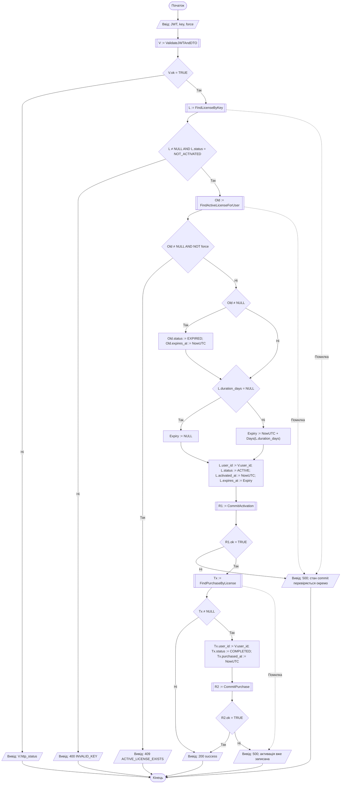

# A1 — Активація ліцензії

[Інтерактивний перегляд у Mermaid Live](https://mermaid.live/view#pako:eJx9VW1L21AU_iuXfFJWa1u2D6s4iEmKWbO0NmnmSEsISVyD9oU02SxRUD84BoIwhh8GY2O_oMjcxE39Czd_Yb9k594kbeJ0-XbveXKe55zn3HtDxhraDlNlXnvmqIdUvjNA8CkLOv6Cb6J3eBod4Rt81V1ES0vPkKgv4w_4PDrD36vo-Uu1gLadSQFtDT3LWe7G_4oUqem6hqqrSDN3XNv0HQCzA5tXG90EplHYRqgVh9toFamttrAfRzZIZA9_js72kCZQxsuUUyv2fH9kjH3TD8YpoybQXAKI_gSwa3wRHUcn3cVcum94iq_2kKTrEtFVcwe25FrOYOysTerOJJUl0VT1UEJ_3n9FcluSECvzSCrGlKBUbqgGy6mixqoCn0iuZySvsXxe8-NSCYmyxkoib9SFV6lqwMWycykSmayuN3bsVChr-e4bJ5FbG3rtseOlglmahAsJPCcZdMbGJBq5HAHXkO-qfIpoWYIhiZwgK4IhbIqKqqR64Y-sXi5T8nqOPeFbz_E1SD1pE6EsYbMptgR-BZFtZ3fkes7YMH0Skodv2yrXzWWhNMlwNqgMPpSKduCZvjscGLY5odbM2fkcu6wLhGJC0wOomwPR5KreYTIgqgE9QjxkXrjDtNhhkgRxRxRBjZdqutSlYgAeGS61UEsXK_M5gu2422TPJP7CIbFzHSCRfGdifQk30MTWl3W9VSZhbtjvuz4bJwOx6YhwZQps1Mthq_zPcYPtTBtq-al4UiqtoOgQLoEpvkYWJUD4Fk7YAb4goOggOo0-RkfRCaBOEbkraOg3vkkHp5Ydmxlb4kxT19XddM6bgWf1THIik1lPK2jSFOusEgL47pyxSkZ_S1DyFVTg9I0Dy3LGs_ti9keiod0EDQ8YBoG5Y1zjRVMSVDK2sD9K1Nr3zW07lsxVwJzK3Jy0wpk1lcSaStiq3GNNJScUirsToDU32ZZ6j23kHzAONuEWPwarwJ5z_ANfIPwTYrf4MjoktuJp2hiSKGsW8GWXcDcWEXkXwN1L_Atf4SkqQrg2u4n-F24-ECaknQFTYPqO1zddm6mGjN9z-uRVsp0tM9jxmf0CYwb-UJkMLKbqe4FTYIIReVZ414SXqx9v7v8F8V980Q). [Розділ 2](../2_design.md).

