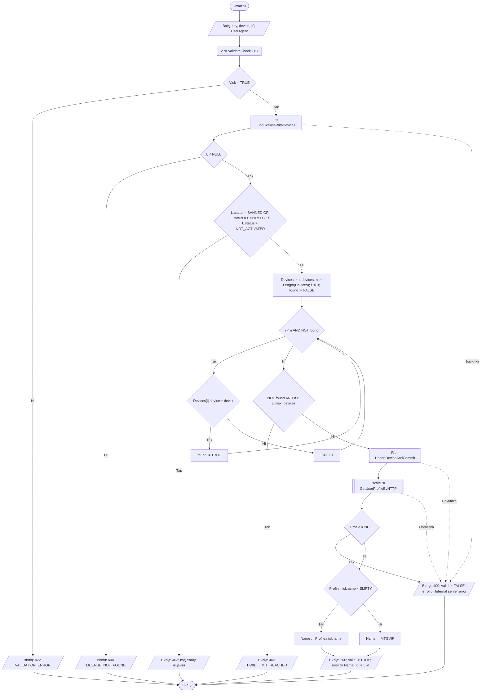

# A2 — Ліцензія та пристрої

[Інтерактивний перегляд у Mermaid Live](https://mermaid.live/view#pako:eJx9VV9r01AU_yqHPIjDrur0qWVC1ty5YJZkaZo5slJCc7eGtelI0-HI9qCCIvjkwwRBFMH3IYoy_3yGm6_gJ_Hcm9zYVDBPybm_8zu_8-8mU4bTkCot5TAJjkfgavsx4NO97rN37Ff-nF3mT9gvdtVfgdXVe6D7N9kr9im_YJ9bcERPGxDSk2hIG6DbDejNaKIe0ji92S9odOHk-b4HrXXwgnEUBintjOjwSHOtfonyBGon85rTI1gH1-mR8-Jkh5-csbf5xRl4RMT-JqPfXVsDTzV0TXV1yxwQx7EcGdcjgpJgFm8Q_ZN9yZ_lL_srNdYP7JJdnYHh-wZXtxnFoYGpxDO6G6UjTeQ1kxoNQbhp9UwtM-D3i_dg9gyjlCnMC1LNzSWpt-6CoXeI2SUD03IHAi-1mpuF1n-oSn1dNzOaszRI5zMszoZqmkQDy4EFI3lo684_Vh5J7bi6p7pEK5V23Rq3Rsy9Zal32sCusOWfIX-Mvb9kP_OnwL7nF_kz9gVL-RXfXkvxnGBRvuQXZdBN3fX3lbKSvMZGsxiXWRti8U3jw3R0vUSstCHi1lttOJjO41B0RTW6ZF-R84SMIpxhWXYWwbVxyplULBlmW3iVmXJELVeyk1Va_KhfKsE6FS_7SulI6uOxR7p-pYaPZr8OKzPt-EJ6BDfgdolAz0qrlN9ZsvxVKXh2eparZlUqIrEYp-0jVm4SPBqU1ZPbwdH1Wda3seTLDYWtXV0biLOBQ9TOFqmGTxgXG7jAKRR1Vdw73-G59Y5xvdOigmocdqaTSZTK_eA4wWP7vp1MD6Ix5T73acovhdKycbrlurZ0EYmLNcqkx_riVvHXegcdZzk3HJUTfqtUo9IGmiTThH_rcUqTOBgDCjihSXFQbV1FXmys3nkgVTTjaHgUBxMq1pxs2-6eVISomiJT3Sa-yaEYb9m9v-wkIqFKo3LZdu97ui2BSCZK4uDI1fJcq-XJh7ANc8yKf3Eq3JuwWK8olAnyOJKtsDjlPJadxmoufiK4CfzOZz8w8He8Ai6hyY8dZ7HD_8fY_wMoDWVCk0kQhUorU9IRnfD_TkgPgvk4Vc4bSjBPp93TeKi00mROG8r8mP8ttCjAf9OkMJ7_AT_gWaU). [Розділ 2](../2_design.md).

