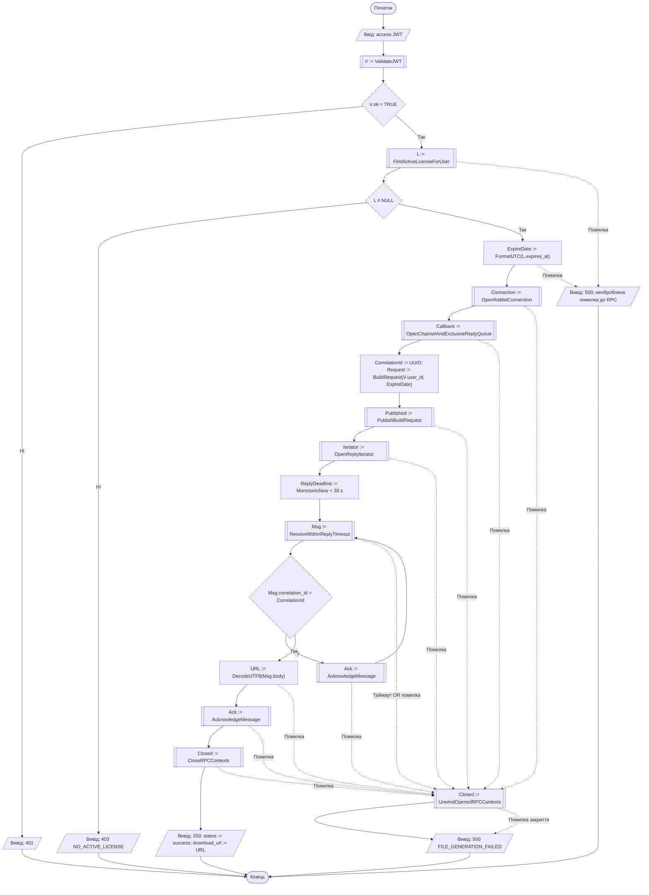

# A3 — VIP-завантаження

[Інтерактивний перегляд у Mermaid Live](https://mermaid.live/view#pako:eJyNVe1u40QUfZWRf7WimxYWJJRqkVx7Qg2O03XsFORW0cQeGmsdT7DHtFVaCRUJhISExI_9gYRAPEFAu2IpUF5h_Ao8CXfGdj5KVyGREnvmnHPv3Dl3ZqaFLKJaWzvLyHSMPPMkRfDpbwXiR3FXfiXm5Y24E7en2-jRo_eQFeyK78Sv5XPxoo1IGNI8Rx8ce7unFc1SoEEQDFD7CRqQJI4IpwA4rQEDBdB973A2aLFn6AnyXB9fV5NyWM5fiR_K51fId1SwV024t_febOL4jtLBkOX3MPmXeFl-WX5zun1f52cxF7dXyA4CWybUidNID3n8GbXjkKY57bDMz2nWZGcr1UO9P7PRP1__hBzftuvcYHAlNRM7H99P7jFyekPd8KwBHtqWgZ0-btKV8Crhe2J1fvijo-BEwxfTOKMmFEzlyrIJ4b5nbNktqmbyIeHbJ1qtCRwlafQcBxteEBgsTSksjqWS3pvS1CWjUcyX480ya4qiP_Wxj4FMkmREwmcN1RgTYCV6GuGLMClyKJlLp8nl04IWtNFR3MoWjuXBCgyWZTQhMpYVSSnft8x95NJPC5pzOXBQxElUv28NWgUUfxhHO2i59uUKpahSP_IPguCoGCVxPqZKt35ZVWuSAnCVkofdILA4zQhn2aIkchHNYEORUMXxrC6QFMakJEriVG1Fl6WMszQOHXaO3kCP91BeMxVBUY91qEDQzc8kwaUhhYodx3wcVyG9eEJZsUhSoqsszRlwWuGycFAO6Iq1StYWtMwVB-rGh0GgVxsGfyk7T2h0RrvQkORssUOAWmS3LlI7z8RGz8Swdb6rOsSk8jjwvc67WzKvEYsulxtSgZVgV_eMw_-RgMJVPrV7fWm0hOXVHqon98gAf3J6wfOFOyVQUXq-t95kb-3t7aOcE17kUiEv1AG0jyJ2niaMRMMiS5TtXLtpPdBY7Tzo8BaSJ5v4E2T_ELdijlowbR5g110P9o4MJo8WAP9Sfi5_gfASRuZI_L2mIF6IOwRL2V3tzdfHqaspH1dzW7Tlg8yObtmr5fPTczjNpKdp9EAV6958rdRKs2zAVN2xAVQZGkDSV78DbF5-Ud6gnnu_VOs05c8N0o3rNsBqp21A1ebagJJPamegsA_5AnUsGw_fxw52dc_qOUNJwGaz_RX9PzHEb7LnwEmvyhv4fquCVhEqXvXcWELb0SYU7oA40tozjY_pRF7TEf2EFAnXrnc0UnDWv0xDrc2zgu5oxVRetmZM4CqfVIPX_wLA5-fv). [Розділ 2](../2_design.md).

