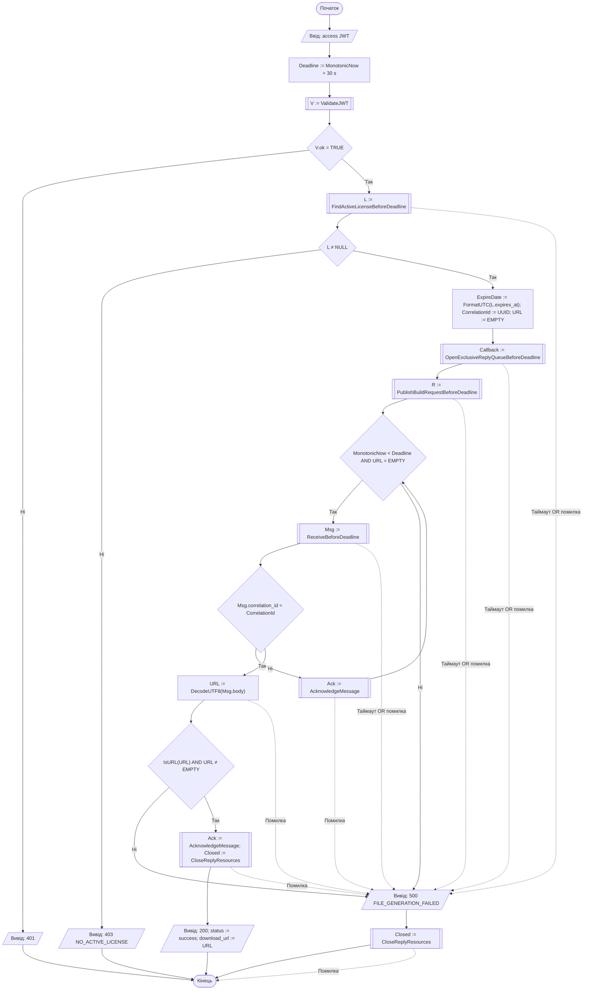

# A3 — VIP-завантаження

[Інтерактивний перегляд у Mermaid Live](https://mermaid.live/view#pako:eJydVd1O1EAUfpVJL8xuhGUVTcxuMCntINVuu5Z2CSmbTWkHaCidtT8CWbjBRGPilRdcmBiMT0CMJoqIr9B9BZ_EM9N22SUI6ibNNjPf-eY753xzOhBc6hGhIWxETn8TmfJqiOC3VLGz4-x8-Co7GR5m59lpt4qmpx8ixZ7J3mafhkfZ5wZyXJfEMXq8bM508zCFg0xbJo4X-CFBjTnUoiFNaOi7Gt1Bt9FsHcUF2uTojm13GK7jBL7nJATougWgwwGiZS4OOjW6heaQaVj4IN9ky2x_P3s_PNpHlsalfS3F3avfKVVZGufBkNM72PyRfRm-HL7pVi_zfMxOstN9pNq2ygQt-KEnuon_nKi-S8KYzJN1GpEyt1KkyskXxaWBin69_oA0S1ULibA4plDG2spljbNI03uiZCod3FMVCWtLuFTN4LnuS2SFTEVTTHtVwLt9H0RB4bhmGm07iWVKFbVG-E7cc5JqE0k0ikjgJD4NFY8hLUuRm8gyeKq41TZXVoWyi8DMT5Z0TcOSaduSEwRrjrvFsHqfhHjXDdIYKmOQfrD3NCXpH4pTMHC2tjVv2wajaKdrgR9vzqd-4BnkWUri5OpwCOGhqq63BxNGuhUkTTSymajJPJUik6L8LGqiZMsilMxuxRtMhEFcAhlcfTBD5oaXB4CvuRfl6_kenDNRz-I8RR7rtig9sW0xLxn8hXQnIN4GacGNcTZG5wBqlOAkSSFZxpIuY-hz0SmZsPtqmQsPKkzXGvX2qqPG5eD8VokqSF8VlBgCK_BUR0ViJi0aXgjn4DHtC6KiTjr1fr2OFhQV9x5hDRuiqehaj6GwXNp1jKOUrmv4mhKAJwMaE25G_sa9ZJCYphHMlbJCjIVnpFvmpKa79XoTxYmTpDHjiFM-jprIozthQB2vl0YBd7qhliKBY_xKXRhklPZ4-2uIp_ItO4Mp-GJ4iHQDZT9hGp6BiO_ZaXaCakB2ETZy-z9HcqP_c5T6HzHccRB1fA2m9NFNMN6aG0DsLR8mKhY1GCV_03SOHe9UsXDlWQARpoRtApPP94TGQEg2yTb7pHlk3UmDRDiYEpw0oUt7oSs0kiglU0LaZ58a2Xfgs7edLx78Btvrj9E). [Розділ 2](../2_design.md).

