# C4 Level 3 — License Service

```mermaid
%%{init: {"theme":"base","themeVariables":{"fontFamily":"Arial, sans-serif","fontSize":"16px","lineColor":"#64748b","clusterBkg":"#f8fafc","clusterBorder":"#cbd5e1","edgeLabelBackground":"#ffffff"},"flowchart":{"htmlLabels":true,"curve":"linear","nodeSpacing":35,"rankSpacing":65,"wrappingWidth":220}}}%%
flowchart TB
  %% C4 Level 3: actual concrete dependencies in services/license/app.
  Caller["Other containers: Host gateway / bots"]
  UserAPI["Other container: User Service"]
  PG[("Other container: License PostgreSQL")]
  Redis[("Other container: Redis")]
  MQ["Other container: RabbitMQ"]
  subgraph License["Container boundary: License Service / Python FastAPI"]
    Routes["Component: REST routers<br/>client / user / admin / bot / stats"]
    DTO["Component: Pydantic DTOs<br/>domain/schemas.py"]
    Guards["Component: Route-specific guards<br/>JWT access / ADMIN / x-bot-token"]
    Service["Component: LicenseService<br/>Activation / validity / devices / purchases"]
    Stats["Component: LicenseStatsService<br/>Public / legacy sales aggregates"]
    Worker["Component: Expiry task<br/>Status updates / social lookup / commands"]
    Repo["Component: LicenseRepository / TransactionRepository<br/>Concrete SQLAlchemy repositories and ORM models"]
    Client["Component: UserServiceClient<br/>Concrete HTTPX client"]
    Messaging["Component: Messaging functions<br/>aio-pika RPC / topic publisher"]
    Cache["Component: PublicStatsCache<br/>Redis / loader callback / refresh lock"]
    DB["Component: Database session factory<br/>get_db / AsyncSessionLocal"]
    Bootstrap["Component: FastAPI app / lifespan<br/>Router registration / caches / expiry task"]
    Errors["Cross-cutting: Error handlers<br/>DomainException / RequestValidationError"]
  end
  Caller -->|"HTTP / JSON"| Routes
  Routes -->|"FastAPI input validation"| DTO
  Routes -->|"Depends on protected routes"| Guards
  Routes -->|"Depends: get_db session"| DB
  Routes -->|"Python: LicenseService(db) / methods"| Service
  Routes -->|"Python: LicenseStatsService(app.state cache)"| Stats
  Routes -->|"Python await: download RPC after license check"| Messaging
  Service -->|"Constructs concrete repositories with session"| Repo
  Service -->|"Constructs / calls concrete client"| Client
  Service -->|"AsyncSession: flush / commit / refresh"| DB
  Stats -->|"cache.get(loader, background_tasks)"| Cache
  Stats -->|"Loader: own AsyncSessionLocal"| DB
  Stats -->|"Loader: LicenseRepository(db) aggregate query"| Repo
  Worker -->|"Own AsyncSessionLocal / commit"| DB
  Worker -->|"Constructs / calls LicenseRepository"| Repo
  Worker -->|"Resolves linked social IDs"| Client
  Worker -->|"Python await: VIP expiry commands"| Messaging
  Repo -->|"Injected AsyncSession: SQLAlchemy statements"| DB
  DB -->|"asyncpg / SQL / PostgreSQL TCP"| PG
  Client -->|"HTTP / JSON: x-internal-token"| UserAPI
  Messaging -->|"AMQP / TCP: build request/reply and bot commands"| MQ
  Cache -->|"RESP / TCP: cached aggregates / locks"| Redis
  Bootstrap -->|"include_router"| Routes
  Bootstrap -->|"Constructs two app.state caches / closes on shutdown"| Cache
  Bootstrap -->|"asyncio task: start / cancel"| Worker
  Bootstrap -->|"Registers exception handlers"| Errors
  Routes -.->|"DomainException / validation exception dispatch"| Errors
  Service -.->|"Raises DomainException on business errors"| Errors
  classDef external fill:#f3f4f6,stroke:#6b7280,color:#111827
  classDef component fill:#e8f1ff,stroke:#2563eb,color:#111827
  classDef storage fill:#ecfdf5,stroke:#059669,color:#111827
  class Caller,UserAPI,MQ external
  class PG,Redis storage
  class Routes,DTO,Guards,Service,Stats,Worker,Repo,Client,Messaging,Cache,DB,Bootstrap,Errors component
```

[Mermaid Live](https://mermaid.live/edit#pako:eJyFVw1v2zYQ_SuEgwApIMfNl5saQ4HYTrMUSePYXjugHgqKomzOMqmRVBKvyX_fHUlJluN2RdEmJO8d7-7dO-pHi6mEt3qt_f0fQgrbIz9mLbvgKz5r9WatmBr4IQpLX6gWNM64gT04lippP9KVyNbu7AVsZhExVJq24VqkzhAPTcS_Hu6omz-51UxIPlCZ0m55r3v67vQ8djssK4zlur-c-630PKUpa2wpnfBgyOLkjB-5XZ7M-Q2NedanbDnXqpBJQHB_Zq0XvE2mHtmCausjWNhV5mwwIqsLjl4K_eBvi5ek2oFLSNIkp0xIvNbJGSxpKpf1UheXHjXNc_j9q0jsAhaPj9--vLzs789k5ZdM-zNJyP4-GZySG_7AM3LSI5TZgmaEKck0t5wkPOcy4ZIJboiQBNL5IBg3nQz-lYZ3wM8h4gxolnH9bda6gwJpBLAUbq1Nj_yujCVzavkjXZMOiZWFIP9Coz8A7mJ0_dqq57bIxHsLp0dX3w52nLzxNyEjcDPXfHJ_M2u9cQZjngiz08btlMdu73ddYEzjWNjb--DcFPEckroo3YHJoDwMIUGNqV7Xlwk3h3BHa7tQknykxkKoAQ3upgrLjUNZ5UpyCYQfX06mROOGNr_FuvOBZQI2AKTAbHQITVZQA5dC-NdYWmWSkOH0rok2WidUWsFwx8MlagX37RgGLUTNYb6ujK8KqpPt2-BF2ibnTKSAMndHHM6nr1MgCrDAwC0uhrfXn-H_pzbcqm3VkssKNmShiRtSFPYc4AWz4oFaoTC4B5qJRFikSsId2eCnvNDAWsPreCcY_W5k3NmEHxUx0BVQMj6nbA3CAMpB6BzYgrSsMb8qvXQk3gC9fMqFXhNLzdKBIXphSJEnaIplUAzkhmRKLYscfmdqtaIyqVHHPFc7L4obRlilMdYptLGB9oMk1OvO46BsRqD2RYbFWxNdHsG-BG_kbnxLVqANWe134NjT9IxtFVLjt5sefp9OR38ST7sK5xYKTeegJk2oapmkhXT39uygQrVzsaRkPBpAXFblkPscS2AWqJbl7ShEssVYVydXPrfr4FyrYu0UTbBDQWdi0FVY0TzV3Cxghy3rNug3MYfUUpwdoFzGIMFSyHGZ2Tm335MYSWzWkk38iRsFPiq8vgK5stD5TdjQzgTkD-8mUm5yKv2FXQPD7eYCDQOrGQaEcfCaT5WTS62VdmTWypg2K6yFvPb8OllAfbNSEoauhy-fGM8D8pj_U3Bjv2DbOG_OKmCDeNfqTNrtD8-zFhYZ7D5N7j7PWs9BiZxeup_CqTJCIfPC-qZ06GgCivLq_NBNCkPgTrlWljPLEy9mBk28wvzMqkdCKUKVnJP-q9NeS7cl5CCJ30A8Kw6biXNWzo3_s98QigMcZKio3JfqjcNxCrsbhdBHiq-URD1K5KajO02x9GE2EoBBZj7XrYJY5WjwYNB6wJKCWVMP3UZzPwq72EwLisMvYTquRzbgynZ-Dorw2nqT_j2SwutmEYRM2LrR6qK4vARbl61DKN-B79CIxNWz5zuy3LhUuobetr1xFj0CKdzVgrvclSavJNSxoNJ0Aj2h15v58toeUO52OaxCrj03jHbk-NUtfupxzI3KHqCe8JZbQmeEqXE9NM3CNIyaTPtyPSrVo54xW-RC38H4Wv7tm7BZ3Y0h4ui-AsemjnjYD-YUrfI5hAoW-I6pnldkOhihwejKSYt_o7ySlh68CISEdpA0K58Fz-WLzz27qvkRSHh7j7YA3iNxITJQD69sHeiHbO2mHD58GrHfe3WDeMo8X04qFEfNZGPQuzHClsZXCZ-AckPhA4KQ8LxP-Hf_EGsq5PbZDUrYR0W2NMTxJFPQvKiKZlFYFItGN2wDuqwL5cZDDwukrSObZNw1hKfHLsuxmzcwJoAj5XAoJwda-hmzKWaHXoFfDZRa6zegIFk5tWzRhKpkxGONqcBgtyHhb1wYeCnDg5F72wYKy6gxQ56CO88Xkoos6-2lJ-lp2o0gSqBPb68bvzs-fxsx_Frr7R0dHZ0fv2uYs3I-B3t-nh6laWV_fNY94fEv7A10MJ3z0pqlSXpWWb89e9_tvv-JdRiwUaB3dHtfxVKfGV1F_jET_NQ7viIRjNXIz8koJDZy0hf5qkfY3JHvt6jqnshxKRr2o4oRkU9tnY-ZbEWtFddQlgQ-N_03NHxqJzylRWbhg7RFC6smwL3w9dny79uhoPDVs_KLL_8Bd0Jnlg) · [Текстове обґрунтування](../2_design.md#diagram-level3).
