# C4 Level 3 — License Service

[Опис і трасування в Розділі 2](../2_design.md#diagram-level3) · [Mermaid source](c4-component.mmd).

[Інтерактивний Mermaid Live](https://mermaid.live/edit#pako:eJyVVstuGzcU_RViVi1qVUDQlVAEsCXXdRDFY0mBF1YXnBlaYj1DsiRHthIFCLroqssg35EWLQq0SfsL8i_0S3ovOQ9KdSJ5YYszc87lfZ1LvoxSmbGoF13l8iadU23J5GgqCOnTPGf6chod31qmBc1JKoWlXDBteuSEWnZDl6RLEmnNNPoOKfHJ5WfT6ClPmTCMxNLYmWbj86fT6HP3_blh-jA-BZu4ImOmF4CtyMNzeD-iScLt8Lx6N2IZN2jTLWozpkxmmqo5qXa6bPesTJJ_X78hdz_dvV3_dffz-u_1r-t3ZP0nLN6v_4H_H9a_rz_c_Qi_8Po9vPgNXgCy2jXY4VQkshQZ7FCtCM2ognyYBkuID2l0PJ64FGmJiQsBg8kZAOJlRoXlKT6SBc15Ri2XIsCdlFTjXk8uJpDYw8Hw9JlPcMfKaybIDL-Hhi-kvq5qpLheEpPOWVbC7rWbDZaJbCu0vtSYuUOlcp46T2CvTBZQYZe-9S-QlD_IN9RYCJBAut4RqOVhDnsUy8AJqGWfGmaCMpTwl-K7rxPdfUxTyxfQL2AfuOk1_GpmmIVfhn6zMFXyRuSSYhbqZWPNGyvtXGr-gpEvwMoPJTOWJCXPs8DI2FKL7oxpzgwx8MQNJN40lgLsKMbSSG17dTuNLWQGfItLDXqonsN4Wwa28QACSAESpmTYQo7Qt1YtR9LGZZJzMw-KA2JrCc75PoVMfaJ4Z6WtG7Ne3teZI6Yk5qEpG6RMScPBXQ6Z6RKrqTBYH6i-SaUK4_x2MkGv5taqWxdpJa5-zpmwYf8PzxFIuewofk0hpX0wre4LE8O6rOQMlYCnj3fqBddczADdl4VzGp3UUlrXBwOmAGmI0nLBMwgbu0sKY3WJ1SBcfM_SDX0day01toVbEJc0qrEohgqw_oJlJJezGWxacSpX_CQknc7j1TTCrADlyfjs2TRaofYRggrx32u9hAJfoeQ3YZX7PQiotKxjFEv5FcwGJUGNS6S4YbBJ8jGBm1xAxq5oit2c54iuRbg3oVbX3gTXl4j2Q2eb4JUcKGzTp3rd0LbNj-K9YM93w3relyW0Q1FQgQNzBYpEXjNS7uc1s6V1aAfDTR6cm4xmORyN7VYuXR_bZwbn4gxmgiFoG5u_3u9TNK-XtkP6sT8jlSSdLz2jUDkrQJ2mLWBr27XuDqTPLyp6F9KH6RS9C-od9XqusQl36oWRZ4iVwfBauYgeRMDAHkTA-B5E8PP4f4xm4LRHi9nu_P0YoRz3YzR6dOr1WHabMuXmZEGVQiNdHGmELdzEXlUzMFTxg4l4e6lYXz16FMw5whCzCfbN6cBwCOGh2lwKyQTaAsDxSdub2xO25_sIL5_uBlTlVtdT17WpI7llt7YJF8i2N913uJ0F3_11UkQHUcE03HiyqPcysnBA4kU4Y1e0zG306iCCgSDHS5FGPagAO4hKBaGyAadwChf-5av_ALL129Q)

```mermaid
flowchart TB
  Caller["External containers: Gateway / bots"]
  PG[("License PostgreSQL")]
  UserAPI["User Service"]
  MQ["RabbitMQ"]
  Redis[("Redis")]
  subgraph License["License Service — цільова компонентна модель"]
    subgraph Inbound["Inbound adapters"]
      API["REST controllers"]
      DTO["Pydantic DTO validation"]
      Guard["JWT / ADMIN / bot-token guards"]
      Worker["Expiry scheduler adapter"]
    end
    subgraph Core["Application / domain — без FastAPI та SQLAlchemy"]
      UseCases["License use cases<br/>activate / check / reset / expire"]
      Download["Download use case<br/>authorize + request build"]
      Stats["Sales statistics use case"]
      RP["Port: LicenseStore / PurchaseStore"]
      UP["Port: UserDirectory"]
      MP["Port: BuildGateway / BotPublisher"]
      CP["Port: StatsCache"]
    end
    subgraph Outbound["Outbound adapters"]
      Repo["SQLAlchemy repositories / transaction scope"]
      HTTP["httpx UserServiceClient"]
      AMQP["aio-pika RPC / publisher"]
      Cache["Redis cache adapter"]
    end
    Wiring["Composition root<br/>Depends providers / constructor injection"]
    Errors["Error boundary / sanitized logging"]
  end
  Caller -->|"HTTP / JSON"| API
  API -->|"FastAPI validation"| DTO
  API -->|"Depends: route-specific policy"| Guard
  API -->|"injected interface call"| UseCases
  API -->|"injected interface call"| Download
  API -->|"injected interface call"| Stats
  Worker -->|"injected expire use case"| UseCases
  UseCases -->|"interface call"| RP
  UseCases -->|"interface call"| UP
  UseCases -->|"interface call: expiry commands"| MP
  Download -->|"interface call: authorize"| RP
  Download -->|"interface call: build / deadline"| MP
  Stats -->|"interface call: aggregates loader"| RP
  Stats -->|"interface call: cache policy"| CP
  Repo -.->|"implements interface"| RP
  HTTP -.->|"implements interface"| UP
  AMQP -.->|"implements interface"| MP
  Cache -.->|"implements interface"| CP
  Wiring -.->|"binds ports to adapters"| Repo
  Wiring -.->|"binds ports to adapters"| HTTP
  Wiring -.->|"binds ports to adapters"| AMQP
  Wiring -.->|"binds ports to adapters"| Cache
  Wiring -.->|"constructs use cases"| UseCases
  Wiring -.->|"constructs use cases"| Download
  Wiring -.->|"constructs use cases"| Stats
  API -.->|"exception mapping / log event"| Errors
  Worker -.->|"exception mapping / log event"| Errors
  DTO -.->|"422 validation error"| Errors
  Repo -->|"SQL / PostgreSQL TCP"| PG
  HTTP -->|"HTTP / JSON: internal token"| UserAPI
  AMQP -->|"AMQP / TCP"| MQ
  Cache -->|"RESP / TCP"| Redis
```

