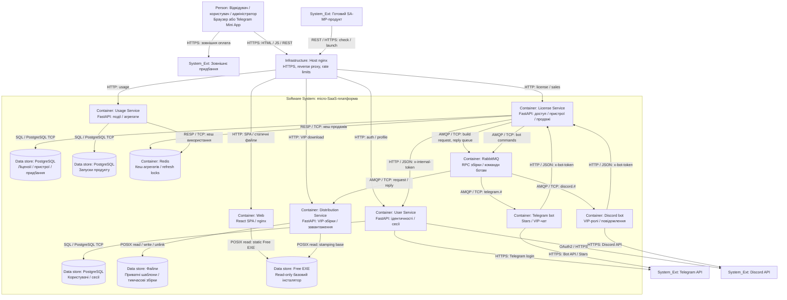

# C4 Level 2 — Container

[Опис і трасування в Розділі 2](../2_design.md#diagram-level2) · [Mermaid source](c4-container.mmd).

[Інтерактивний Mermaid Live](https://mermaid.live/edit#pako:eJyVV1tP40YY_Ssj96WVSJH6GFUrAQGWipQEp-1Km6qa2BNi4XjS8XgDWlbisuruG-pFILUPfekPAHYp7HL7C_Y_6vnGduLcFvUliiffOXPmuxxPXlqOdIVVttq-7DsdrjRrLDYDxhaV7IdCPW9aNaFCGZRZ_FtyEr-PL-gzOYov4rPkDZtn8cf4PtmPr5OD5LC4fIbYW8TeJSfmp338cEihX7fU_JP4V7NwFF_Fl8k-RZ_H96whfLGleJdVvcBjC71e0_qRxNSUdCNHQ4y9G2rR_Wl5R0PQ76ADJfa8jj8we6FUrZXiBxDfG4Ufk8MM31gdgw42WqitZTGVpbGYihc6UrmFkCpX22JCxalRQMd8i88_mFFwjdOf41R3WDrO4Ktciz7fBX4taCseaoUzRUqU2VMZahZsecGOSc7TRqNmzzElXiD1gvWU3NnFI-DM97qeDjPCMGrhEL0Oq_lct6XqkjTZ1n2uBEs1llnXc5Qs2ZzbyE18Q1VIXpuS3cZnGRFjP4gWwEsy0NwLhCrTgtGyKbijmV1bQE2NwgHkO7QHcjMKo0VmC_XCc4TBr-CciCoz0zyXSMcheuUNEnNv2uIEvMkBmuAACTwdkK8DH4RilDxbnM4P9vusBx-o_x4GTYl-SE7zJbQGyvJvclI4B98S46fA0oxtHkx3naSMZ_E7cF7G70xzXw840Tt6lJJWlNeKtCeD6czfr6F7r-JzcO9jqK6J_wo7XFAbgR2qKX-FhoL2yuLzz5tWhWvOQi2pl2ropS0l7Pp6Omh_To7nRNK_yLP-ON1fQPxidFzlSZiR6bERyPewH9_jFKiH5AgKKQ2jE50cDak2heuFRFbIs1nLT36ZvB2rEbrwAgKVaCsRdpgvne1wSFitjxZtk7danq7W00moLbHx-sD7aIxwxvek9NwY0ll8OyhQY1GONcLAelpSG15bcxWCjOqPwTgbuBbaaAKdm1IONiBKz40pqulO49BG2M1Ew6x4vgjH8x__A80fEH2dJu5vU70L09PwNQZjI3--AeedOTf1OsydxB6kG45kZpjQFSXE-G60xpafLef24pZk4O8y0ytXAzc3b44Dk82b5Dh9c-S8InALryhWKj3Za1rGNGGljeo6FH5j42Nz2W40rb3ceAtvkgxDAYjLoE5HONt49HkUOJ0xYPa1sFk5c8VUZW5rlK7XeTqJA0Y6C88j3QEB_L2NslBw5qmzAH5mgPMs5KgjITJPnIWIyMlSZvoyIwpdxFzZD3zJXQoms6LYTE4Wi_nEzsNhZY2lmqGumBtD7s6fDl5Pg1OH_XSoPY2XBJv6bnxbZjslL9BCBdwvabktgrEUjiJRbEKCvEyDa7xh5I0QXxDeGMi4xGlY6tPC3WfodAWOUQUL1fqApRV5vgsf-jkSoaZ3fQ8zgIfIVKtaN_eN-hRgBjEmBkyxXJ_YTWrmyG6XB274CL_O_OnLzyiQ_GtmqJuaURpZySIJMb1WEDEsU6FvK_8bMdqX2fgOjNWXuKcY8auTwRsLGLqv8qE3wpemyAYfLRBunhmHHhJWJkJHroo5IwY_i6pt2GvPUC7ulmGCXHvOwAQpnL4bXpRxOqLb84It1uKheDQecvvK0-QRUeB7wbZBkOvPtMzMdfMb7DHDY3ZTpBviXnbvbQbWnNUVqss91yq_tHRHdOmfgyvaPPK19WrOgqFJezdwrDLutmLOinou3KbicapLuvjqP4M4FnY)

