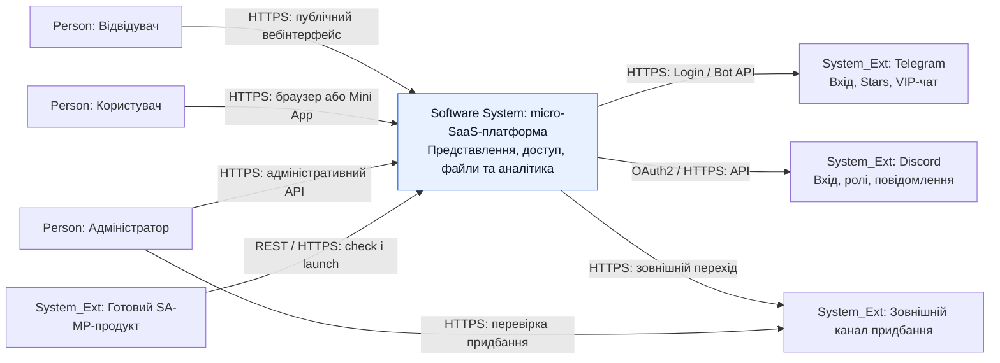

# C4 Level 1 — System Context

[Опис і трасування в Розділі 2](../2_design.md#diagram-level1) · [Mermaid source](c4-context.mmd).

[Інтерактивний Mermaid Live](https://mermaid.live/edit#pako:eJx1VF1r2zAU_StCfXUoydhWzChktGyFloU628syhmrLjaltFVmmK22hTTe6t40OMtjL_kJSFpaPJvkL0j_alaK0nZM-2ImVc84999zrnGCfBRS7OIzZkd8kXKDt3UaK0KucZuJ9A9coz1jqInmt2vKPvNF3dSlvZEddNfAHDX2bUf4Q-UtO1LnsqwvVKiCrQRKlD6HfQfIWJMeqbeDnAG5puiXUYiJCxhPgeCwUR4RT5B1ngiYuSiKfs5JHiFeSUznSTPXZlL6VnRd7fHVd_oaHHvgFadkBJyN4GkOxbw6CwhPrcOogIHbkAH7vIw1F8DSGawS2WrIvh7IzN8RZkPs6mJmNj5ufBPTxA8TAN5ToywHyqqWdGpiC6hOT1lC1LL9OY7rPSVIQmB_PbF-rLzpmB3mC8MxB77ZqJXWlG7QqG1HmMx4UROxpQcOYgEag5al2aMY4gYzuwrCiO4Qf0IXOfpqu9Hy-6jt0p9OYpYNMi33Q65qjey2zPahUWj9t4Nf1es1zNfYScDrSK8DqnEC4J7tm_C3ZU-cwhZ4cqIsGPr2b_HzBCmJdsyqX8q_m6XF15QTtRGmEqoeHRb5Zu4JAZ-nm9XWvxlu1tlWUsbO3QrubXh2tIqvnN6l_gFQbxSRP_eYC1X7_38Q22wdfq-glE_N680VYQnpTzUWzcl_SMuzUH68CGS2McKpjg8vsiFaZDf-xsCxcLw98DvULsmTyD1X8mGTZBg1RZpYJhVEcuyt0LSyHoZMJzg6ou1J5-uwJ3XN8FjPurpTL5bXK8zvyfTcziUaKHZxQnpAowO4JFk2a6D-ugIYkjwU-czDJBfOOUx-7gufUwflhQATdiIhOdHZ49g9jp0_K)

