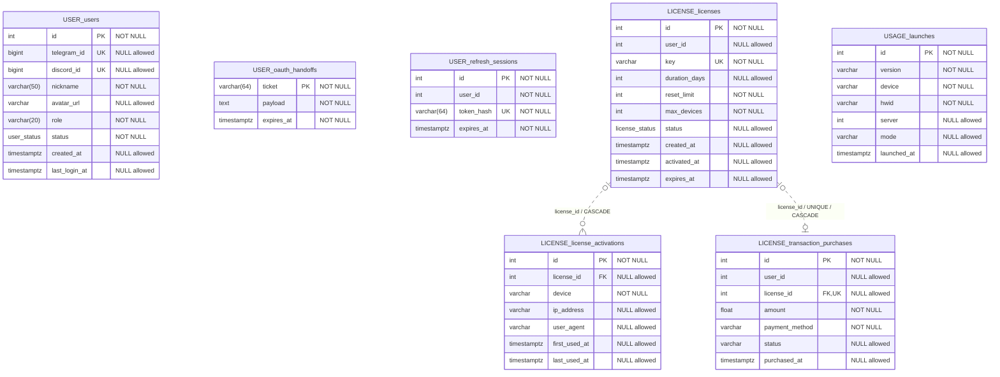

# ERD — 7 таблиць у 3 PostgreSQL-БД

[Інтерактивний перегляд у Mermaid Live](https://mermaid.live/view#pako:eJy1VtuO2jAQ_RXLT10Jbauq7QNviKXVqoheKG9I1jSeEIvYjmyHhbL8eyeQtNxyoZe8REqOj2fOnBl7yyMrkfc5ugcFCwd6bhg9s-noq8g9Os-2hy_Fo0xgSrLPH9mcTz59Y5PZeDznv_9_V4sCEjDFgkoQdrbHEo5BmtonlFfwUvnIOtkKX4GLEnAv3r66Y0ZFSwMaayIpoQxWEMCJ3KUdeF8Tr7NpHWchh_ABQu5Z-boODEojAXQWfrDIIQSUAkJDAMcLUvBBpJaEqV-zOyqShTwkIgEjbRyfVKtK692bO9ohWmKor1zAdWAZbFILskNWuM6UQ19GeAY-js5hTLhEePReWXOTm4r_e81VXUgnGdolGtLBJ6WJ_kEK48fhaDIdiVRFaCiFv4i-2XpsiZv6sPc9kjsIpKCQsPENhAWW0kLykNLqWm4VSsNaSFxRanU-LtO-9HwHG9_se4iCWt225LSE9X1yVkZRbvUnfqwoCPe-w6hiB4FbhpTKBEhJmTSJW4H3noIFmq4qxcrRRKFltw6h5iVn2gYHxhfCkkWzvAj1v_TLRQ16jSdGTPMsMNA2N3WtUOlKw0-TqEJjSGzLwLmtFSo52sWcTQcfyKaQmyi5Tb0qsBWd2FSCFlQnVyZPtXO3iIZKRZt1MKymC0Zn2-0z7-66X4P52d7f221jp_eJ8sg6L9lwMB0OHkYV9XXO5xaHX7DOJo9fZqNjet7jGp0GJXl_y0OCurhwSYwhTwPf9Tid4Ha6MRHvB5djj-eZpEFY3scOH3c_Ad25-_E). [Розділ 2](../2_design.md).

