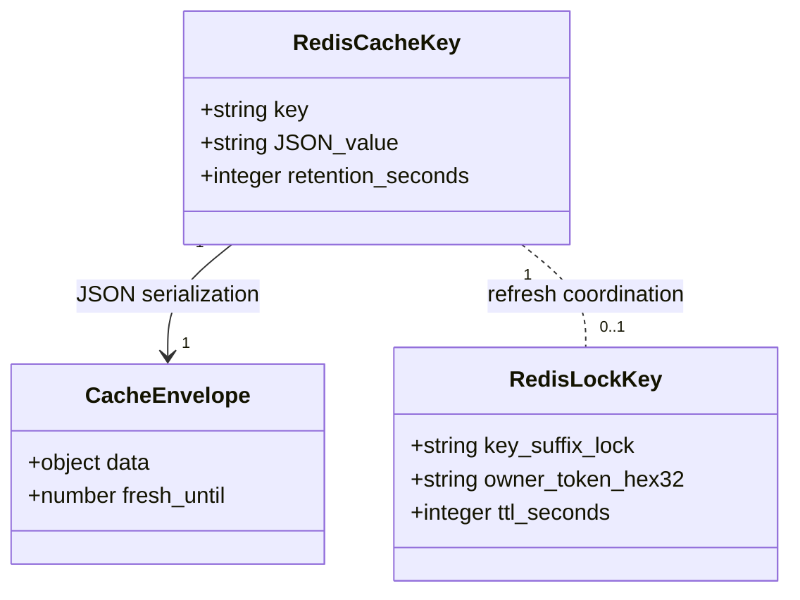

# Redis — кеш і блокування

[Інтерактивний перегляд у Mermaid Live](https://mermaid.live/view#pako:eJx1UrtuwzAM_BWBaxOjj81Dl7ZLWrRAsxoQFIm21chSIFFpUiP_Xvkx2EjMiTgSdzySLUinEHKQRoTwqkXlRVNYlqJH2IuQNb7ZIxp3QNYOpS7u3O4HJTElSExQG5sdelZ6DDWPlrQZipcp6TcqHXrmdzzPSAN5bSu2x_M1uNl-ffKjMBEnNW0JqyTokTCpOcsDSmdVWJL9cHK_rMpDLEt94iZ1XTe4X4uek9uj5TWenh5vDEJkbo4w91zAQwFsvX4es_ma894rC-i1MPpPdL6WWbIsJfdZ1uUzi3naSn8IJp3zStuRCFbQoG-EVpC3QDU23QcoLEU0BJcViEhue7YScvIRVxAP6co4fscAXv4BGJa4CQ). [Розділ 2](../2_design.md).

